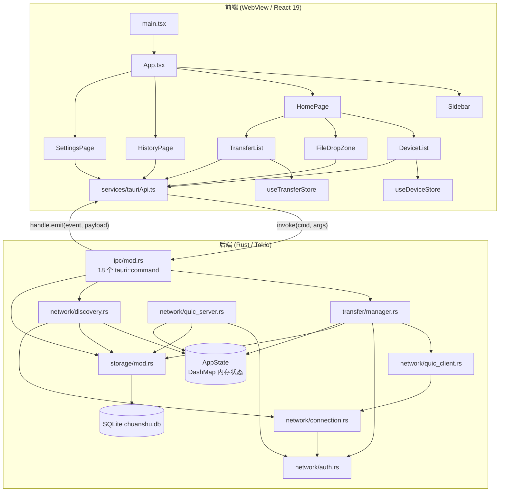
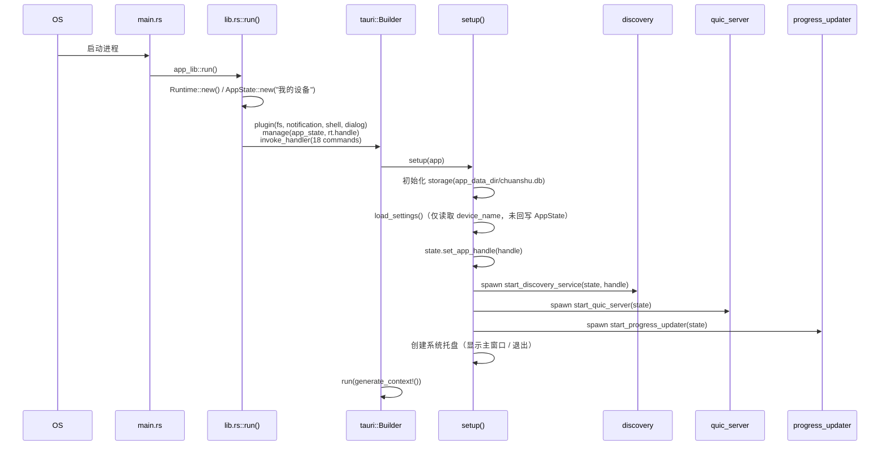
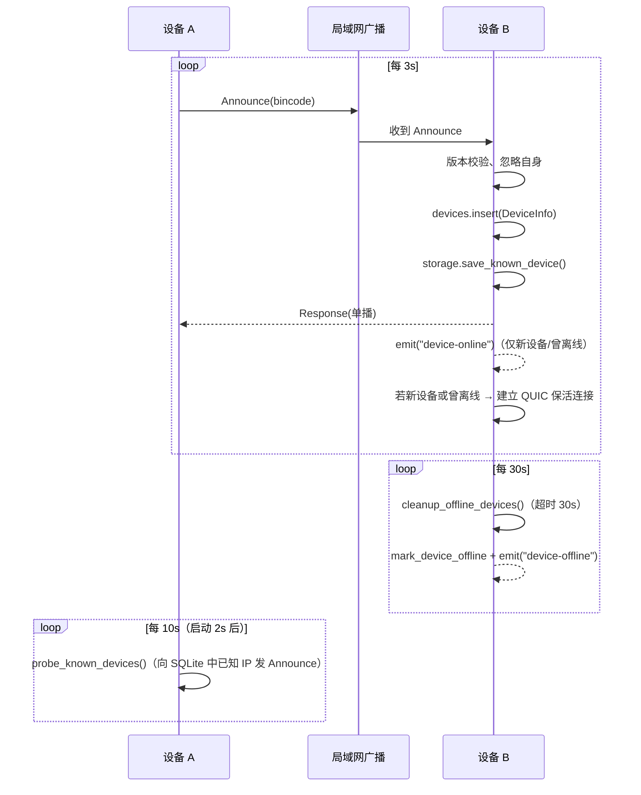
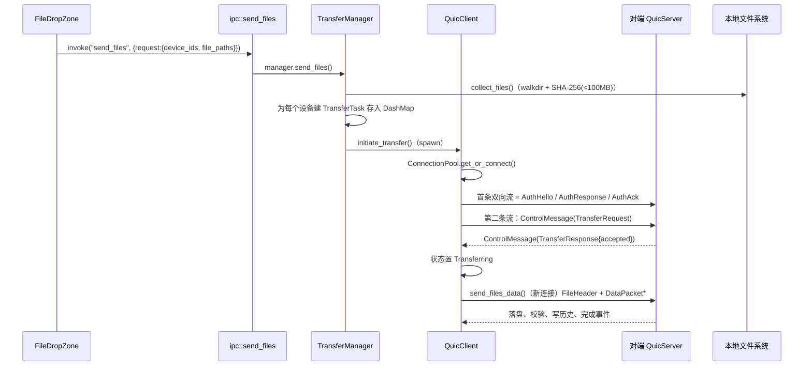
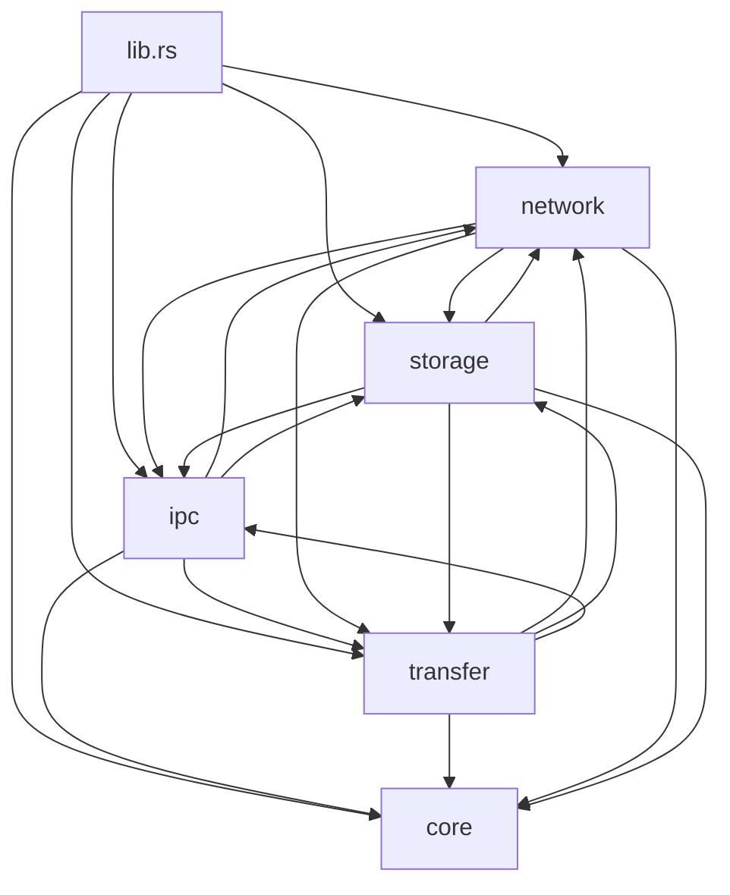

# 01 · 整体架构

## 1. 架构总览

应用是典型的 **Tauri 双层架构**：一个 Web 前端（WebView） + 一个 Rust 后端（宿主进程），二者通过 IPC（命令 + 事件）通信。网络通信、文件读写、数据库全部在 Rust 侧完成，前端只做展示与用户操作。



### 分层职责

| 层 | 目录 | 职责 | 不负责 |
|----|------|------|--------|
| 表现层 | `src/components`, `src/pages`, `src/App.tsx` | 布局、页面、交互、表单、主题 | 不直接接触网络与文件系统 |
| 状态层 | `src/store` | 前端内存态（设备列表、传输任务列表） | 不做持久化（持久化在后端 SQLite） |
| 适配层 | `src/services/tauriApi.ts` | 统一封装 `invoke` / `listen`，定义 TS 类型与常量 | 不含业务逻辑 |
| 命令层 | `src-tauri/src/ipc/mod.rs` | `#[tauri::command]` 入口、参数反序列化、事件与通知发射 | 不做具体传输算法 |
| 业务层 | `transfer/`, `network/` | 传输编排、分片、发现、QUIC 会话、认证 | 不直接面向 UI |
| 存储层 | `storage/mod.rs` | SQLite 建表与 DAO，全局单例 | 不做网络 |
| 基础设施 | `core/` | `AppState`、常量、错误类型 | — |

---

## 2. 运行时与并发模型

```mermaid
graph LR
    M[主线程<br/>tauri::Builder / 事件循环] -->|setup| R[自建 Tokio Runtime<br/>Arc&lt;Runtime&gt;]
    R -->|spawn| T1[DiscoveryService::start<br/>心跳/监听/清理/探测 4 个任务]
    R -->|spawn| T2[start_quic_server<br/>accept 循环]
    R -->|spawn| T3[start_progress_updater<br/>每 500ms]
    R -->|spawn| T4[每个传输任务<br/>initiate_transfer / send_files_data]
    M -->|#[tauri::command] async| R
```

关键点：

1. **自建 Tokio Runtime**。`lib.rs` 中 `Runtime::new()` 后 `Arc` 化；并把 `rt.handle().clone()` 通过 `.manage()` 注入 Tauri 状态，`send_files` 命令可以拿到 `State<'_, Handle>`。
2. **服务通过 `tokio::spawn` 常驻**：发现服务、QUIC 服务、进度推送器都是后台任务，不阻塞 UI。
3. **共享状态用 `DashMap`**：`AppState.devices`（无锁并发哈希表）与 `AppState.transfer_tasks`（值再包一层 `Arc<tokio::Mutex<TransferTask>>`）。
4. **事件回推**：后端通过 `AppHandle::emit` 把 `device-online` / `device-offline` / `transfer-progress` / `transfer-completed` / `transfer-failed` 推给前端。部分代码用 `AppState::emit_async`（持锁后 `emit`），部分直接 `app_handle.emit`。

> ⚠️ `AppState::emit()`（同步版）内部使用 `tokio::Mutex::blocking_lock()`，若在异步任务上下文中调用会 panic；现有调用点 `emit_async` 居多，修改时需留意。

---

## 3. 启动流程



各步骤细节见 [03 后端核心](03-backend-core.md#2-应用入口-librs)。

**系统托盘**：`setup` 中用 `TrayIconBuilder` 创建托盘图标，菜单项为「显示主窗口」「退出」；「退出」先置 `SHOULD_QUIT`，再停止发现/QUIC 服务后 `app.exit(0)`。需 `tauri` 启用 `tray-icon` feature。

**窗口关闭**：`on_window_event(CloseRequested)` 先读设置 `minimize_to_tray`（默认 `true`）。为 `true` 且非托盘“退出”时 `api.prevent_close()` + `window.hide()`，发现、QUIC、进度器继续运行于后台；否则停止发现服务与 QUIC endpoint（仅关闭 endpoint，不等待任务退出）。

---

## 4. 网络拓扑与端口

| 用途 | 协议 | 端口 | 常量 |
|------|------|------|------|
| 设备发现 | UDP 广播/单播 | `45678` | `DISCOVERY_PORT` |
| QUIC 传输 | QUIC over UDP | `45679` | `QUIC_DEFAULT_PORT` |
| 前端开发服务器 | HTTP | `1420` | `vite.config.ts` 中 `strictPort: true` |

一个设备同时是 **QUIC 服务端**（监听 45679）与 **QUIC 客户端**（主动连接对端 45679）。所有设备都必须放通上述 UDP 端口（Windows 首次运行通常会弹防火墙授权）。

### 超时与节奏（`core/constants.rs`）

| 常量 | 值 | 使用者 |
|------|-----|--------|
| `DISCOVERY_HEARTBEAT_INTERVAL` | 3 s | 广播 `Announce` 的间隔 |
| `DISCOVERY_TIMEOUT` | 30 s | `cleanup_offline_devices` 判定离线 |
| `QUIC_IDLE_TIMEOUT` | 60 s | QUIC transport `max_idle_timeout` |
| `QUIC_KEEP_ALIVE_INTERVAL` | 15 s | QUIC `keep_alive_interval` |
| `DEFAULT_CHUNK_SIZE` | 4 MB | 分片读写 |
| `SMALL_FILE_THRESHOLD` | 256 KB | `FileChunker::optimal_chunk_size` |
| `MAX_CONCURRENT_TRANSFERS` | 5 | **当前未被任何代码使用** |

> 文档与实现存在偏差：`README.md` 写「9 秒超时」，`FEATURES.md` 与 `constants.rs` 为 30 秒；`discovery.rs::check_device_was_offline` 另硬编码了 25 秒阈值。以代码为准。

---

## 5. 主链路数据流

### 5.1 设备发现（UDP）



前端侧另有两层兜底：`DeviceList` 每 5 秒拉取一次 `get_known_devices`，`tauriApi` 同时监听 `device-online` / `device-offline`。

### 5.2 发送文件（发送端视角）



> 注意：`send_files_data()` **另起一个 `quinn::Endpoint` 和连接**发送数据，而不是复用连接池的连接；而服务端把每条新连接的第一条流当认证流。这条链路的一致性存疑，详见 [08 已知问题](08-known-issues.md#1-高优先级缺陷)。

### 5.3 接收文件（接收端视角）

`QuicServer::run` → `handle_incoming_connection`（首流认证 → 注册连接池 → 循环 `accept_bi`）→ `handle_stream` 读 4 字节长度前缀 + `ControlMessage` → `TransferRequest` 分派到 `handle_transfer_request`：

1. 从设置读取 `auto_accept`（默认 false）。
2. 回写 `TransferResponse`（含 `save_path`）。
3. 若接受：创建 `TransferType::Receive` 任务并插入 `transfer_tasks`。
4. `receive_files()`：逐文件读 `FileHeader` → 写入 `<download>/.<file_id>.tmp` → 逐片读 `DataPacket`、校验 CRC32、`seek(offset)` 写入 → 全文件完成后校验 SHA-256（若有）→ `rename` 到 `download_path/relative_path/file_name`。
5. 全部完成：状态 `Completed`，写 `transfer_history`，`emit_transfer_completed`（含系统通知）。

### 5.4 控制链路（暂停/恢复/取消）

前端 `pauseTransfer` / `resumeTransfer` / `cancelTransfer` → IPC 命令 → `TransferManager` 修改 `TransferTask.status`；发送/接收循环在每个分片前检查状态：`Paused` 每 100ms 自旋等待，`Canceled` 返回错误。QUIC 客户端另有 `send_control()` 通过**单向流**发送控制消息给对端（`cancel_transfer` / `pause_transfer` / `resume_transfer` 方法存在，但当前 IPC 路径未调用它们，只在本地改状态）。

---

## 6. 模块依赖关系



**归纳**（箭头 = 依赖）：

| 模块 | 依赖 |
|------|------|
| `core` | 无（仅依赖 `network::DeviceInfo`、`transfer::TransferTask` 类型） |
| `storage` | `core`、`ipc::Settings`、`transfer::resume`、`network::device` |
| `network` | `core`、`storage`、`transfer`（任务类型）、`ipc`（完成事件） |
| `transfer` | `core`、`network`（协议/客户端）、`storage`、`ipc::SendFilesRequest` |
| `ipc` | 以上全部 |

> ⚠️ 存在**双向/循环依赖**：`transfer::manager` 依赖 `ipc::SendFilesRequest`，而 `ipc` 又依赖 `transfer`；`storage` 依赖 `ipc::Settings`，`ipc` 又依赖 `storage`。Rust 模块层面可编译，但拆分/测试困难，是重构时的首要解耦点。

### 全局单例（进程级）

| 单例 | 定义位置 | 类型 | 初始化时机 |
|------|----------|------|-----------|
| `DISCOVERY_SERVICE` | `network/discovery.rs` | `tokio::sync::OnceCell<DiscoveryService>` | 首次 `start_discovery_service()` |
| `QUIC_SERVER` | `network/quic_server.rs` | `tokio::sync::OnceCell<QuicServer>` | 首次 `start_quic_server()` |
| `CONNECTION_POOL` | `network/connection.rs` | `OnceCell<Arc<ConnectionPool>>` | 首次 `init_connection_pool()` |
| `QUIC_CLIENT` | `network/quic_client.rs` | `OnceCell<Arc<Mutex<Option<QuicClient>>>>` | `init_quic_client()` |
| `STORAGE` | `storage/mod.rs` | `OnceCell<Mutex<Storage>>` | `init_storage(app_data_dir)` |

`STORAGE` 用 `std::sync::Mutex`，`get_storage()` 返回 `MutexGuard`；在持有 guard 时调用会再次 `get_storage()` 的地方需警惕死锁（当前 DAO 均为短临界区）。

---

## 7. 前后端契约

### 命令（前端 → 后端）

前端统一走 `invoke`；Tauri 2 会把 JS 侧 camelCase 参数映射为 Rust 的 snake_case 形参。共 18 个命令，完整表见 [06 API 参考](06-api-reference.md#1-ipc-命令完整列表)。

### 事件（后端 → 前端）

| 事件名 | 载荷 | 发射点 |
|--------|------|--------|
| `device-online` | `DeviceInfo` | `discovery.rs`（Announce/Response/手动发现） |
| `device-offline` | `Uuid`（字符串） | `discovery.rs`（Goodbye/超时）、`connection.rs` 关闭回调 |
| `transfer-progress` | `TransferTaskInfo` | `transfer/manager.rs`（每 100ms 或进度器每 500ms） |
| `transfer-completed` | `Uuid` | `ipc::emit_transfer_completed` |
| `transfer-failed` | `{ task_id, error }` | `ipc::emit_transfer_failed` |
| `incoming-transfer` | `{ task_id, sender_name, file_count, total_size }` | `ipc::emit_incoming_transfer`（`quic_server.rs` 接受传输后调用） |

> 前端类型定义中 `transfer-failed` 的载荷是 `{ taskId, error }`，后端 `serde_json::json!` 用的是 `task_id`——字段名不一致，前端读取不到 `taskId`。见 [08](08-known-issues.md)。

---

## 8. 状态归属一览

| 状态 | 唯一权威来源 | 前端副本 |
|------|--------------|----------|
| 在线设备 | 后端 `AppState.devices` + SQLite `known_devices` | `useDeviceStore.devices`（轮询 + 事件同步） |
| 传输任务 | 后端 `AppState.transfer_tasks`（内存，不持久化） | `useTransferStore.tasks`（2s 轮询 + 事件） |
| 传输历史 | SQLite `transfer_history` | `HistoryPage` 局部 `useState` |
| 设置 | SQLite `settings`（键值对） | `SettingsPage` 表单 |
| 断点续传 | SQLite `resume_info` | 无（后端内部） |

> 传输任务**不落库**，进程重启后运行中的任务丢失；只有最终结果写入 `transfer_history`。

---

## 9. 设计取舍与边界

- **无中央服务器**：纯 P2P，局域网内自发现；跨子网依赖「已知设备 IP 探测」。
- **自签名证书**：`rcgen` 现场生成，无 PKI、无证书固定；认证握手是简化实现（见 04）。
- **bincode 二进制协议**：紧凑、快，但**不可跨版本兼容**（字段顺序/类型变化即失败），仅以 `protocol_version: "1.0.0"` 字符串做粗粒度拒绝。
- **前端轮询 + 事件双通道**：实现简单但有冗余，见 [08 技术债](08-known-issues.md#3-技术债与改进点)。
- **单机单实例假设**：`OnceCell` 全局单例，不支持热重载/重启服务（除关闭窗口时停止）。
