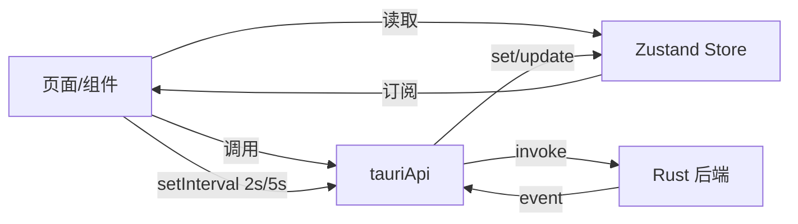

# 02 · 前端模块

前端是单页应用，无路由库（用 `useState` 切换页面），无请求库（直接用 Tauri `invoke`）。全部源码在 `src/`，共 10 个文件。

---

## 1. 组件树

```text
main.tsx
└── App.tsx                       # ConfigProvider + Layout + 页面切换 + 主题
    ├── components/layout/Sidebar.tsx
    ├── pages/HomePage.tsx        # 文件传输（默认页）
    │   ├── components/device/DeviceList.tsx
    │   ├── components/transfer/FileDropZone.tsx
    │   └── components/transfer/TransferList.tsx
    ├── pages/HistoryPage.tsx
    └── pages/SettingsPage.tsx
```

| 文件 | 职责 | 主要依赖 |
|------|------|----------|
| `main.tsx` | React 18+ `createRoot`，挂载 `<App/>`，引入 `index.css`，开启 `StrictMode` | react-dom |
| `App.tsx` | 全局布局、AntD 主题算法（light/dark）、当前页面状态、主题同步 | antd、`getSettings` |
| `components/layout/Sidebar.tsx` | 左侧 200px 菜单（文件传输 / 传输历史 / 设置）与品牌标题 | antd Menu |
| `pages/HomePage.tsx` | 三栏式主界面：设备列表 350px + 拖拽区 + 传输列表；持有 `selectedDeviceId` | 三个子组件 |
| `components/device/DeviceList.tsx` | 已知设备加载、IP 手动发现、在线/离线渲染、每 5s 轮询 | `useDeviceStore`、tauriApi |
| `components/transfer/FileDropZone.tsx` | 原生拖拽监听、待发送文件列表、确认弹窗、调用 `sendFiles` | `getCurrentWebviewWindow`、tauriApi |
| `components/transfer/TransferList.tsx` | 任务列表、进度条、暂停/恢复/取消、每 2s 轮询 | `useTransferStore`、tauriApi |
| `pages/HistoryPage.tsx` | 历史表格（前 100 条）、清空历史；打开位置/重发为占位实现 | tauriApi |
| `pages/SettingsPage.tsx` | 设置表单、系统信息、下载目录选择、开机自启、主题切换 | `@tauri-apps/plugin-dialog`、tauriApi |
| `services/tauriApi.ts` | **唯一** IPC 适配层：类型定义 + 18 个 invoke 封装 + 5 个事件监听 | `@tauri-apps/api` |
| `store/useDeviceStore.ts` | 设备列表与选中态 | zustand |
| `store/useTransferStore.ts` | 传输任务列表与进度 | zustand |

---

## 2. 入口与主题机制

### `App.tsx`

```ts
const [currentPage, setCurrentPage] = useState<'home' | 'history' | 'settings'>('home')
const [currentTheme, setCurrentTheme] = useState<'light' | 'dark'>('light')
```

- **主题来源**：启动时 `getSettings()` → `applyTheme(settings.theme)`。
  - `auto` → 读 `window.matchMedia('(prefers-color-scheme: dark)').matches`。
  - `light` / `dark` → 直接设置。
- **两条同步通道**：
  1. 浏览器系统主题变化 → `mediaQuery` 的 `change` 监听 → 只有在设置为 `auto` 时重新应用。
  2. `SettingsPage` 修改主题 → `window.dispatchEvent(new CustomEvent('theme-change', { detail: { theme } }))` → `App` 监听并应用。
- **页面切换副作用**：`useEffect(..., [currentPage])` 中再次 `getSettings()` 并应用主题，保证从设置页返回后主题一致。
- **AntD 配置**：`colorPrimary: '#1890ff'`、`borderRadius: 6`，`algorithm` 在 `theme.darkAlgorithm` / `theme.defaultAlgorithm` 间切换；`locale=zhCN`。

> 主题的「持久化」有两套：后端 SQLite 的 `settings.theme`（权威）与 `SettingsPage.applyTheme()` 写入的 `localStorage.theme`（未被读取）。见 [08](08-known-issues.md)。

---

## 3. 页面与组件详解

### 3.1 `HomePage.tsx`

- 布局：`display:flex`，左卡片宽 350px（设备列表），右侧纵向排列拖拽区与传输列表。
- 状态：`selectedDeviceId: string | null`（**局部 state，未放入 Zustand**）。点击在线设备时由 `DeviceList.onSelectDevice` 写入。
- 三张卡片的标题分别为「在线设备」「传输列表」，拖拽区无标题。

### 3.2 `DeviceList.tsx`

Props：

| prop | 类型 | 说明 |
|------|------|------|
| `selectedDeviceId` | `string \| null` | 当前选中的设备，用于高亮 |
| `onSelectDevice` | `(deviceId: string) => void` | 仅在 `is_online` 时可点击 |

行为：

1. **加载**：挂载时 `getKnownDevices()` → `loadKnownDevices()`（同时包含离线设备）。
2. **事件**：`onDeviceOnline` → `setDeviceOnline`；`onDeviceOffline` → `setDeviceOffline`。
3. **轮询兜底**：`setInterval(loadDevices, 5000)`。
4. **IP 发现**：输入框 + 「发现」按钮 → `discoverDeviceByIp(ip)`，成功/失败用 `message` 提示。注意该命令**不会**把设备加入前端 store，依赖随后的 5s 轮询刷新。
5. **渲染**：
   - 头部文案 `"{n} 个设备在线"` 实际统计的是 **全部已知设备数**（含离线），文案与数据不符。
   - 状态 Tag 颜色/文案来自 `DEVICE_STATUS_COLORS` / `DEVICE_STATUS_LABELS`（四态）。
   - 离线设备 `opacity: 0.6`，显示「最后连接」时间戳（秒 → `toLocaleString('zh-CN')`）。
   - 空态显示 `<SyncOutlined spin /> 正在扫描网络设备...`。

> `placeholder`、`message` 等未做防抖；`useEffect` 依赖了 `loadDevices`（`useCallback` 依赖 `loadKnownDevices`、`setLoading`，二者是 Zustand 稳定引用），不会重复建定时器。

### 3.3 `FileDropZone.tsx`

- **拖拽实现**：使用 **Tauri v2 的原生拖拽事件** `getCurrentWebviewWindow().onDragDropEvent(...)`，只处理 `payload.type === 'drop'`，取 `payload.paths`（绝对路径数组）。DOM 上的 `onDragOver/Enter/Leave` 仅用于视觉反馈与阻止浏览器默认行为。
- **前置校验**：未选中设备 → `message.error('请先选择要发送的设备')`。
- **文件项**：`{ name, path }`，`name` 由 `/` 或 `\\` 分割取末段。
- **发送流程**：点击「发送 N 个文件」→ 打开 `Modal` 确认 → `confirmSend()` → `sendFiles([selectedDeviceId], filePaths)` → 成功后清空列表并关闭弹窗。
- 弹窗中最多预览 5 个文件，超出显示「...还有 N 个文件」。
- ⚠️ 拖入**文件夹**时只拿到文件夹路径，实际展开由后端 `collect_files`（walkdir）完成。

### 3.4 `TransferList.tsx`

- 数据：`useTransferStore.tasks`。
- 加载：挂载 `getTransferTasks()` + 每 2s 轮询。
- 事件：
  - `transfer-progress` → `updateTaskProgress(task_id, progress, speed, transferred_size)`
  - `transfer-completed` → `setTaskStatus(Completed)` + 重新拉取
  - `transfer-failed` → `setTaskStatus(Failed)` + 重新拉取（依赖后端字段为 `taskId`，实际后端发的是 `task_id`）
- 操作按钮按状态渲染：
  - `Transferring` → 暂停
  - `Paused` → 继续
  - 非 `Completed` / `Canceled` → 取消
  - `Completed` → 打开文件夹图标（**无 onClick，未实现**）
- 展示：`Progress percent={Math.round(progress*100)/100}`、`filesize(transferred_size) / filesize(total_size)`、传输中显示速度、失败显示 `error_message`。
- 状态文案映射：`Pending 等待中 / Transferring 传输中 / Paused 已暂停 / Completed 已完成 / Failed 失败 / Canceled 已取消`。

### 3.5 `HistoryPage.tsx`

- `getTransferHistory({ limit: 100, offset: 0 })`，无分页参数联动（表格前端分页 20 条/页）。
- 列：文件名、大小、类型（发送/接收）、状态、设备、时间、操作。
- 状态映射：`completed→success / failed→failed / canceled→canceled`，其余落为 `canceled`。
- 「清空历史」用 `Modal.confirm` 二次确认后调用 `clearTransferHistory()`。
- **操作列是占位实现**：打开位置只弹 `message.info('文件路径需要在历史记录中保存')`；重新发送只弹 `message.info('重新发送功能需要原始文件路径')`（且仅 `type === 'send'` 可点）。
- 时间戳为秒（`×1000` 后格式化）。

### 3.6 `SettingsPage.tsx`

- 表单字段与后端 `Settings` 一一对应：`device_name`、`download_path`、`auto_accept`、`upload_limit`、`download_limit`、`enable_notification`、`theme`、`minimize_to_tray`。
- 初始值：`upload_limit/download_limit = 0`、`auto_accept = false`、`enable_notification = true`、`theme = 'auto'`、`minimize_to_tray = true`，随后被 `getSettings()` 覆盖。
- `Form.useWatch` 监听 `theme`，变化即 `applyTheme()`（并 dispatch `theme-change`）。
- 「开机自启」不是表单字段，单独 `getAutoLaunch()` / `setAutoLaunch(enabled)` 即时保存。
- 「默认下载路径」通过 `@tauri-apps/plugin-dialog` 的 `open({ directory: true })` 选择（需要 `capabilities/default.json` 中的 `dialog:allow-open`）。
- 「设备名称」提示「修改后需重启生效」——与后端实现一致（启动时读取一次）。
- 速度滑块 `0–100`，单位标注 **MB/s**，但直接以数字存入 `upload_limit` / `download_limit`（`u32`）。后端 `RateLimiter` 按 **字节/秒** 消费，存在单位不一致，见 [08](08-known-issues.md)。
- 底部「快捷键」列表（Ctrl+V / Ctrl+R / Ctrl+,）**仅为文案**，未注册任何键盘事件。

---

## 4. 状态管理（Zustand）

### `useDeviceStore`

```ts
interface DeviceWithStatus extends DeviceInfo {
  is_online: boolean
  status: 'scanning' | 'connecting' | 'online' | 'offline'
  last_connected?: number | null
}
```

| 字段 / 方法 | 说明 |
|-------------|------|
| `devices` | 设备数组（在线优先，其次按 `last_connected ?? last_seen` 倒序） |
| `selectedDeviceId` | 选中设备 id（**当前页面未使用**，选择态在 `HomePage` 局部 state） |
| `isLoading` / `error` | 加载态与错误 |
| `setDevices` | 整体替换 |
| `addDevice` | 存在则替换，否则追加 |
| `removeDevice` | 删除并清理选中态 |
| `updateDevice` | 按 id 替换 |
| `loadKnownDevices` | `KnownDevice[]` → `DeviceWithStatus[]`：解析 `capabilities` JSON、`is_online` 决定 `status`、排序 |
| `setDeviceOnline` | 更新或追加，`is_online=true, status='online'`，新设备补 `last_connected=now` |
| `setDeviceOffline` | `is_online=false, status='offline'` |
| `setDeviceStatus` | 通用状态设置（用于 scanning/connecting）——**当前无调用方** |

### `useTransferStore`

| 字段 / 方法 | 说明 |
|-------------|------|
| `tasks` | `TransferTaskInfo[]` |
| `setTasks` | 整体替换（轮询结果） |
| `addTask` | 去重后头部插入——**当前无调用方** |
| `updateTask` | 按 id 替换整个任务——**当前无调用方** |
| `removeTask` | 按 id 删除——**当前无调用方** |
| `updateTaskProgress` | 仅更新 `progress/speed/transferred_size` |
| `setTaskStatus` | 仅更新 `status` |
| `setLoading` / `setError` | 通用 |

> Store 没有持久化中间件；刷新/重启后状态由后端轮询重建。

---

## 5. IPC 适配层 `services/tauriApi.ts`

### 类型导出

| 类型 | 关键字段 |
|------|----------|
| `DeviceInfo` | `device_id, device_name, os, ip_address, quic_port, protocol_version, capabilities[], last_seen, is_online?` |
| `KnownDevice` | 同上 + `capabilities: string`（JSON 字符串）、`last_connected`、`created_at` |
| `TransferTaskInfo` | `task_id, peer_device_name, transfer_type, status, total_size, transferred_size, file_count, current_file, speed, progress, error_message?` |
| `Settings` | `device_name, download_path, auto_accept, upload_limit, download_limit, enable_notification, theme, minimize_to_tray` |
| `TransferHistoryEntry` | `task_id, peer_device_name, transfer_type('send'\|'receive'), status, total_size, file_count, file_names, created_at, completed_at` |
| `SystemInfo` | `os, os_version, arch, default_download_path` |
| `DeviceStatus` | `'scanning' \| 'connecting' \| 'online' \| 'offline'` |

### 常量

```ts
DEVICE_STATUS_COLORS = { scanning:'#9CA3AF', connecting:'#F59E0B', online:'#10B981', offline:'#6B7280' }
DEVICE_STATUS_LABELS = { scanning:'扫描中', connecting:'连接中', online:'在线', offline:'离线' }
```

### 函数清单

| 函数 | invoke 命令 | 参数形态 |
|------|-------------|----------|
| `getDeviceList()` | `get_device_list` | — |
| `discoverDeviceByIp(ip)` | `discover_device_by_ip` | `{ ip }` |
| `getTransferTasks()` | `get_transfer_tasks` | — |
| `sendFiles(deviceIds, filePaths)` | `send_files` | `{ request: { device_ids, file_paths } }` |
| `cancelTransfer(taskId)` | `cancel_transfer` | `{ taskId }` |
| `pauseTransfer(taskId)` | `pause_transfer` | `{ taskId }` |
| `resumeTransfer(taskId)` | `resume_transfer` | `{ taskId }` |
| `getSettings()` | `get_settings` | — |
| `saveSettings(settings)` | `save_settings` | `{ settings }` |
| `getTransferHistory(query)` | `get_transfer_history` | `{ query: { limit, offset } }` |
| `clearTransferHistory()` | `clear_transfer_history` | — |
| `getKnownDevices()` | `get_known_devices` | — |
| `deleteKnownDevice(deviceId)` | `delete_known_device` | `{ deviceId }` |
| `getSystemInfo()` | `get_system_info` | — |
| `setAutoLaunch(enabled)` | `set_auto_launch` | `{ enabled }` |
| `getAutoLaunch()` | `get_auto_launch` | — |
| `openFileLocation(filePath)` | `open_file_location` | `{ filePath }` |
| `resendFiles(deviceId, filePaths)` | `resend_files` | `{ deviceId, filePaths }` |

事件封装：`onDeviceOnline`、`onDeviceOffline`、`onTransferProgress`、`onTransferCompleted`、`onTransferFailed`、`onIncomingTransfer`，均返回 `Promise<UnlistenFn>`。

`onIncomingTransfer` 在 `App.tsx` 根部订阅（不随页面切换重建），收到后调用 antd `notification.info` 弹出「收到文件传输」提示，与后端的系统通知互为补充。

### 未被页面使用的前端 API

`getDeviceList`、`deleteKnownDevice`、`openFileLocation`、`resendFiles`。其中 `resendFiles` 的参数名与后端签名不一致（见 [08](08-known-issues.md#21-前后端参数不匹配)）。

---

## 6. 样式与 UI 约定

- **Tailwind 配置存在但基本未生效**：
  - 安装的是 Tailwind **v4**（`tailwindcss@^4.2.2`）+ `@tailwindcss/postcss`，但 [index.css](file:///D:/Projects/chuanshu-app/src/index.css) 仍写 v3 的 `@tailwind base; @tailwind components; @tailwind utilities;`；v4 要求 `@import "tailwindcss";`，且需要 `@config "./tailwind.config.js"` 才会加载旧格式配置。因此**当前很可能不产出 Tailwind 工具类**（对现状影响不大，因为组件几乎不用 Tailwind 类）。
  - `tailwind.config.js` 设置了 `corePlugins.preflight = false`（意图避免重置样式与 AntD 冲突）。
  - 实际样式主体是**内联 `style` + AntD 组件**，`className` 的 Tailwind 工具类在业务代码中基本未使用；`index.css` 里另有手写的 `* { margin:0 } / body / #root` 全局样式。
- **设计规范**（`DESIGN.md`）：主色 `#1890ff`、圆角 6、卡片间距 24、侧栏宽 200、设备卡宽 350。
- **深色模式**：`ConfigProvider` 的 `algorithm` 切换 + `Sider`/`Content` 手写背景色（`#141414` / `#1f1f1f`）；`SettingsPage` 还会设置 `document.documentElement.style.colorScheme` 与 `data-theme` 属性。
- **图标**：全部来自 `@ant-design/icons`。
- **中文文案**：硬编码在组件中，无 i18n 方案（仅 AntD 做了 `zhCN` 本地化）。

---

## 7. 前端数据流小结



- **写路径**：用户操作 → `invoke` → 后端改状态 → 前端轮询或事件感知。
- **读路径**：`getTransferTasks` / `getKnownDevices` 全量拉取，覆盖式写入 store。
- **派生数据**：进度百分数、大小格式化、状态文案、时间格式化均为组件内即时计算，不缓存。
