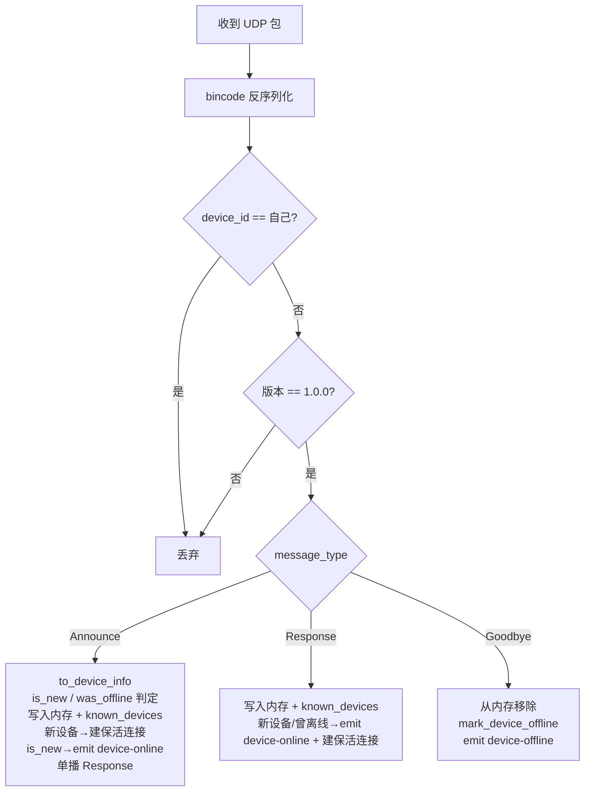
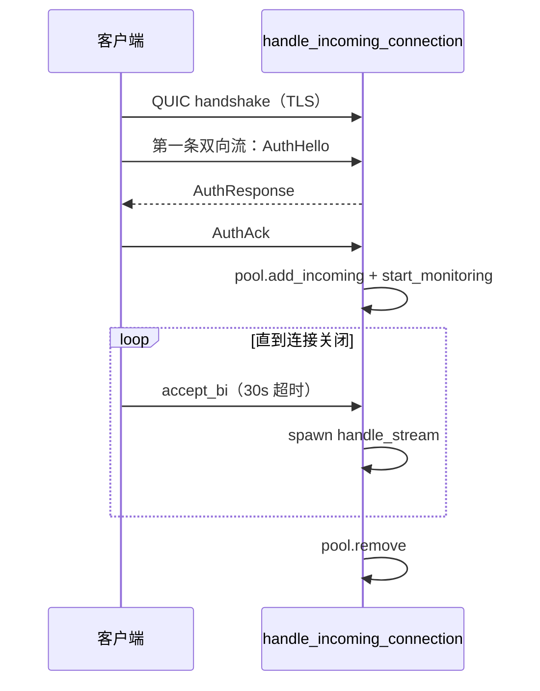
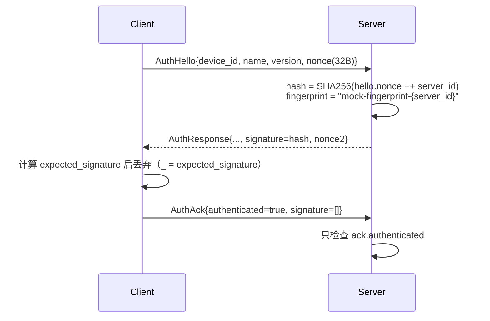
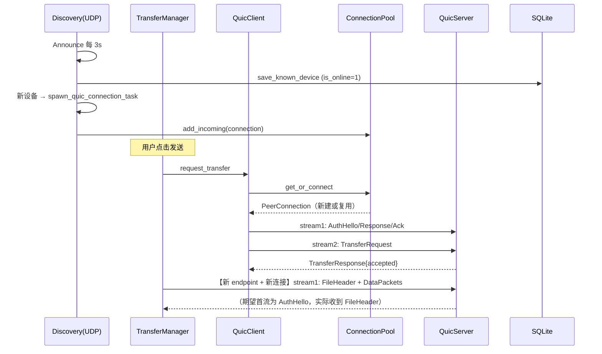

# 04 · 网络层

目录：`src-tauri/src/network/`

| 文件 | 职责 | 关键导出 |
|------|------|----------|
| `mod.rs` | 模块聚合 | `pub use discovery::*; pub use device::*;` 等 |
| `device.rs` | 设备模型 | `DeviceInfo`、`KnownDevice`、`OperatingSystem`、`Capability` |
| `protocol.rs` | 线上协议结构 | `DiscoveryPacket`、`ControlMessage`、`TransferRequest/Response`、`DataPacket`、`FileMetadata`、`ChunkMetadata`、`AuthHello/Response/Ack`、`PROTOCOL_VERSION` |
| `discovery.rs` | UDP 发现服务与手动发现命令 | `DiscoveryService`、`start/stop_discovery_service`、`discover_device_by_ip` |
| `connection.rs` | 连接池、TLS 配置、连接监控 | `ConnectionPool`、`PeerConnection`、`create_client_config`、`create_server_config`、`generate_self_signed_cert`、`init/get_connection_pool` |
| `quic_server.rs` | QUIC 服务端：认证、接收请求、落盘 | `QuicServer`、`start_quic_server`、`stop_quic_server` |
| `quic_client.rs` | QUIC 客户端：认证、发请求、控制消息 | `QuicClient`、`request_transfer`、`init_quic_client`、`get_quic_client` |
| `auth.rs` | 三段式握手（简化实现） | `authenticate_as_client`、`authenticate_as_server` |

---

## 1. 设备模型 `device.rs`

### `OperatingSystem`

```rust
enum OperatingSystem { Windows, MacOS, Linux, Unknown }
```
serde 默认按变体名序列化为字符串（`"Windows"` 等）。

### `Capability`

```rust
enum Capability { FolderTransfer, ResumeTransfer, MultiDeviceSend, P2PTransfer }
```

- 发现报文实际只宣告前三个；`P2PTransfer` 定义了但从未使用。
- 这是**声明式能力**，后端没有按能力协商行为的逻辑。

### `DeviceInfo`（运行态，内存）

| 字段 | 类型 | 说明 |
|------|------|------|
| `device_id` | `Uuid` | 每次启动随机生成（未持久化） |
| `device_name` | `String` | 运行期固定为 `"我的设备"` |
| `os` | `OperatingSystem` | 由 `detect_os()` 根据编译目标决定 |
| `ip_address` | `IpAddr` | 取自 UDP 报文的来源地址（或报文内覆盖值） |
| `quic_port` | `u16` | 对端 QUIC 端口（恒为 45679） |
| `protocol_version` | `String` | `"1.0.0"` |
| `capabilities` | `Vec<Capability>` | — |
| `last_seen` | `SystemTime` | 每次收到报文刷新 |

`is_online()`：`last_seen.elapsed() < DISCOVERY_TIMEOUT(30s)`。

> ⚠️ serde 把 `SystemTime` 序列化为 `{ "secs_since_epoch": n, "nanos_since_epoch": n }` 对象，而前端 `DeviceInfo.last_seen` 声明为 `number`。这是前后端类型不一致（见 08）。

### `KnownDevice`（持久化，SQLite 行）

| 字段 | 类型 | 说明 |
|------|------|------|
| `device_id` | `String` | UUID 字符串 |
| `os` | `String` | 枚举名 |
| `quic_port` | `i64` | SQLite 兼容 |
| `capabilities` | `String` | JSON 数组字符串 |
| `last_seen` / `last_connected` / `created_at` | `i64` | Unix 秒 |

转换：`KnownDevice::from_device_info(&DeviceInfo)`（`is_online` 恒为 true）与 `to_device_info()`（能力字符串未知时**兜底为 FolderTransfer**）。

---

## 2. 协议 `protocol.rs`

### 2.1 发现报文

```rust
struct DiscoveryPacket {
    message_type: DiscoveryMessageType,  // Announce | Response | Goodbye
    protocol_version: String,
    device_id: Uuid,
    device_name: String,
    os: OperatingSystem,
    ip_address: Option<IpAddr>,
    quic_port: u16,
    capabilities: Vec<Capability>,
    timestamp: u64,
}
```

- 编解码：`bincode`（紧凑、无自描述，**字段顺序即协议**）。
- `announce()` 固定 `ip_address=None`，接收端用 UDP 来源地址回填（`to_device_info(addr)`）。
- `response()` 由收到的 Announce 派生，仅保留本机身份信息。
- `goodbye()` 能力列表为空。
- 版本校验：字符串完全相等才处理，否则丢弃。

### 2.2 控制消息

```rust
struct ControlMessage { message_type: ControlMessageType, payload: Vec<u8> }
```

`payload` 是 **bincode 序列化后的二级负载**；`ControlMessage::new(type, &value)` / `.payload::<T>()` 负责编解码。
线上格式为 `4 字节大端长度 + bincode(ControlMessage)`。

`ControlMessageType`：`AuthHello / AuthResponse / AuthAck / TransferRequest / TransferResponse / CancelTransfer / PauseTransfer / ResumeTransfer / QueryProgress / ProgressUpdate / Error`。

> 服务端只处理前 8 种；`QueryProgress`、`ProgressUpdate`、`Error` 未被处理（`_ =>` 分支仅打日志）。**且 `send_control` 使用单向流，服务端只 `accept_bi()`，因此 Cancel/Pause/Resume 控制消息实际上不会被读取**。

### 2.3 传输相关

```rust
struct FileMetadata {
    file_id: u64, relative_path: String, file_name: String, file_size: u64,
    modified_time: u64, checksum: Option<String>, is_directory: bool,
    #[serde(skip)] source_path: String,   // 不传输，仅发送端使用
}

struct TransferRequest {
    task_id: Uuid, sender_id: Uuid, sender_name: String,
    file_count: u32, total_size: u64, files: Vec<FileMetadata>, resume: bool,
}

struct TransferResponse { task_id, accepted: bool, reason: Option<String>, save_path: Option<String> }

struct ChunkMetadata {
    task_id: Uuid, file_id: u64, chunk_index: u64, total_chunks: u64,
    chunk_size: u32, offset: u64, checksum: u32,   // CRC32
}

struct DataPacket { metadata: ChunkMetadata, data: Vec<u8> }
```

### 2.4 认证消息

```rust
AuthHello    { device_id, device_name, protocol_version, nonce: Vec<u8> }
AuthResponse { device_id, device_name, cert_fingerprint: String, signature: Vec<u8>, nonce: Vec<u8> }
AuthAck      { device_id, signature: Vec<u8>, authenticated: bool, error: Option<String> }
```

---

## 3. 设备发现 `discovery.rs`

### 3.1 网络配置

| 项 | 值 |
|----|----|
| 监听/发送端口 | `45678`（UDP） |
| Socket 选项 | `SO_REUSEADDR`；macOS 额外 `SO_REUSEPORT`；`SO_BROADCAST`；非阻塞 |
| 广播地址 | `if_addrs` 枚举所有非回环 IPv4 网卡的 `broadcast`；为空时退回 `255.255.255.255` |
| 心跳 | 每 3s 广播 `Announce` |
| 清理 | 每 30s 扫描 `devices`，`last_seen` 超 30s 移除 |
| 已知设备探测 | 启动 2s 后，每 10s 向 SQLite 中的已知 IP 单播 `Announce`，并监听 5s 响应 |

### 3.2 `DiscoveryService`

```rust
pub struct DiscoveryService {
    device_id: Uuid,
    device_name: String,
    quic_port: u16,
    running: Arc<tokio::sync::Mutex<bool>>,
}
```

`start()` 做三件事：

1. `mark_all_devices_offline()`（避免重启后残留 `is_online=1`）。
2. 创建 UDP socket，`Arc` 共享给各任务。
3. 启动 **4 个后台任务**：

| 任务 | 周期 | 行为 |
|------|------|------|
| 心跳 | 3s | 向所有广播地址发送 `Announce` |
| 监听 | 阻塞 `recv_from` | `handle_discovery_packet` 处理 Announce/Response/Goodbye |
| 清理 | 30s | `cleanup_offline_devices` 移除超时设备并置库离线、emit `device-offline` |
| 探测 | 10s | 读取已知设备，逐个单播 Announce 并收集 5s 内的响应 |

`stop()`：置 `running=false`，用**新建的临时 socket** 广播 `Goodbye`（原 socket 未保存，注释里说明 tokio `UdpSocket` 无 `try_clone`）。

> `running` 标志只是循环条件；`recv_from` 阻塞中的监听任务不会立即退出，要等下一条报文到达。窗口关闭时进程随即结束，影响有限。

### 3.3 处理逻辑



关键细节：

- `check_device_was_offline()` 使用**硬编码 25 秒**，与常量 30 秒不一致；因为 3s 心跳，正常情况几乎总返回 false。
- `save_known_device()` 每次收到报文都会 `UPSERT` 并把 `is_online` 置 1，写库频率较高（每设备每 3s 一次）。
- **Announce 与 Response 的 emit 条件不同**：Announce 只在 `is_new` 时 emit，Response 在 `is_new || was_offline` 时 emit。
- 保活连接：`spawn_quic_connection_task` 新建 endpoint 连接对端 → `pool.add_incoming` → 注册关闭回调（置库离线 + emit `device-offline`）→ `start_monitoring`。
- `discover_device_by_ip` 是**命令**，被 `ipc` 直接引用（`network::discover_device_by_ip`），用临时 socket 单播、3s 超时，成功则写内存/库并 emit。

### 3.4 已知问题（发现相关）

1. `spawn_quic_connection_task` 的 endpoint 在函数结束时被 drop（`connection.closed().await` 之前一直存活，结束于连接关闭后），但连接池里保存的 `Connection` 依赖该 endpoint；连接断开后池中条目会被清理，尚可接受。
2. 连接被对端关闭时，关闭回调会 emit `device-offline`，即使设备仍在广播 → 前端可能闪现离线，下一次轮询/心跳恢复。
3. 每 10s 的探测会在没有已知设备时打印 `No known devices to probe` 日志。
4. 同一 `device_id` 的旧记录不会清理，因为 `device_id` 每次启动都变。

---

## 4. 连接池与 TLS `connection.rs`

### 4.1 `ConnectionPool`

```rust
struct ConnectionPool {
    connections: DashMap<Uuid, PeerConnection>,
    pending: DashMap<Uuid, oneshot::Sender<AppResult<PeerConnection>>>,
    close_callbacks: DashMap<Uuid, Box<dyn Fn(Uuid) + Send + Sync>>,
}
```

| 方法 | 行为 |
|------|------|
| `get_or_connect(device_id, addr, endpoint)` | 有健康连接直接返回；死连接移除；否则 `connect_to_peer`（5s 超时）并插入 |
| `add_incoming(device_id, connection)` | 服务端/保活连接入池 |
| `get(device_id)` | 克隆 `PeerConnection` |
| `remove(device_id)` | 移除 |
| `remove_and_callback` | 移除并触发关闭回调 |
| `on_connection_close` / `trigger_close_callback` | 回调注册与触发（每设备仅一个） |
| `close_all` | 关闭全部 |

> `pending` 字段有读无写（没有任何地方插入），`get_or_connect` 中的 pending 分支是死代码。

### 4.2 `PeerConnection`

| 方法 | 说明 |
|------|------|
| `open_stream()` | `connection.open_bi()` → `(SendStream, RecvStream)` |
| `accept_stream()` | `connection.accept_bi()` |
| `send_control(&ControlMessage)` | **打开单向流**，写 `4 字节长度 + 数据`，然后 `finish()` |
| `is_connected()` | `close_reason().is_none()` |
| `start_monitoring(pool)` | `spawn` 等待 `connection.closed()`，之后 `pool.remove_and_callback` |
| `close()` | `connection.close(0, "connection closed")` |

`streams` 与 `next_stream_id` 字段、`StreamHandle` / `StreamDirection` / `StreamStatus` 类型**均未被使用**。

### 4.3 证书与 TLS

- **服务端**：`generate_self_signed_cert()` 用 `rcgen` 生成，CN=`传书文件传输`，SAN=`chuanshu.local` + `127.0.0.1`；每次进程启动重新生成（不持久化、无固定指纹）。
- **`create_server_config`**：
  - `max_concurrent_bidi_streams(100)`、`max_concurrent_uni_streams(100)`
  - `receive_window(16)` ← **16 字节**，几乎必然严重限制吞吐
  - `send_window(16 MB)`
  - `keep_alive_interval(15s)`、`max_idle_timeout(60s)`
- **`create_client_config`**：
  - 注释声称“permissive、接受自签名”，但实现只是 `RootCertStore::empty()` + `with_root_certificates()`，**没有注册自定义 `ServerCertVerifier`**。按 rustls 默认的 WebPKI 校验，自签名证书会以 `UnknownIssuer` 失败。
  - 同样设置 15s 保活、60s 空闲超时。

> 这是当前最影响「能否连通」的问题：服务端证书自签、客户端空信任库。要么给客户端加 `dangerous().with_custom_certificate_verifier(...)`，要么做证书固定/指纹交换。详见 [08](08-known-issues.md)。

---

## 5. 服务端 `quic_server.rs`

### 5.1 启动

```rust
static QUIC_SERVER: OnceCell<QuicServer>;

pub async fn start_quic_server(app_state) -> AppResult<u16> {
    // QuicServer::new(45679) → 生成证书 → Endpoint::server
    // spawn(server.run(app_state))
}
pub fn stop_quic_server();  // endpoint.close(...)
```

全局只能初始化一次；端口固定 `45679`，绑定 `0.0.0.0`。

### 5.2 连接生命周期



- 首条流必须在 **10s 内**到达，否则整条连接被关闭。
- 认证成功后循环 `accept_bi()`，每次超时 30s 只 `continue`（不会断开）。
- 每条流独立 `spawn`。

### 5.3 `handle_stream`

1. 读 4 字节长度（>10MB 拒绝）。
2. 读 payload → `ControlMessage`。
3. 按类型分派：
   - `TransferRequest` → `handle_transfer_request`
   - `Cancel/Pause/Resume` → 修改任务状态
   - 其他 → 仅 debug 日志

### 5.4 `handle_transfer_request`（接收流程）

1. 解析 `TransferRequest`。
2. `auto_accept` 从设置读取（默认 false，读不到视为拒绝）。
3. 回 `TransferResponse`，`save_path` **硬编码** `"~/Downloads/传书"`。
4. 若接受：创建 `TransferType::Receive` 任务并插入全局任务表，然后 **在同一条流的 `recv` 上调用 `receive_files`**。
5. 完成后：状态 `Completed`、写历史（`"receive"/"completed"`）、`emit_transfer_completed`；失败则 `set_error` + 写 `"failed"` + `emit_transfer_failed`。

### 5.5 `receive_files`（落盘）

| 步骤 | 说明 |
|------|------|
| 下载目录 | `settings.download_path`，把 `~/` 替换为 `$HOME`；读不到则 `<USERPROFILE>/Downloads/传书`（Windows）或 `<HOME>/Downloads/传书` |
| 限速 | `SharedRateLimiter::new(download_limit)`，按收到的字节数消费 |
| 循环读 | `4 字节 header_len` → `0` 表示全部结束；否则读 `FileHeader` |
| 临时文件 | `download_path/.<file_id>.tmp`，`File::create` + `set_len(file_size)` 预分配 |
| 分片循环 | 读 `4 字节 chunk_len` → `0` 或 `FinishedEarly` 结束；反序列化 `DataPacket`；校验 CRC32；`seek(offset)` + `write_all` |
| 进度 | 每 100ms 计算速度并 `emit_async("transfer-progress")` |
| 文件收尾 | `flush` + `sync_all`；若有 `checksum` 则计算整文件 SHA-256 比对 |
| 落位 | `relative_path` 非空 → 建子目录；`rename(.tmp → final)` |
| 暂停/取消 | 每片前检查：`Paused` 每 100ms 自旋；`Canceled` 返回错误 |

> 临时文件名只含 `file_id`，并发接收多个任务时（file_id 都从 0 开始）会互相覆盖。

---

## 6. 客户端 `quic_client.rs`

### 6.1 `QuicClient`

```rust
pub struct QuicClient { endpoint: Endpoint }
```

- `new()`：创建 client endpoint（`0.0.0.0:0`）+ `create_client_config()`。
- `send_transfer_request(peer_addr, peer_device_id, request, app_state)`：
  1. `init_connection_pool()` → `pool.get_or_connect(...)`。
  2. 取 `peer_conn.connection().remote_address()`。
  3. `open_stream()` → `authenticate_as_client(...)`。
  4. 再 `open_stream()` → 发送 `ControlMessage(TransferRequest)` → `finish`。
  5. 读 `4 字节长度 + TransferResponse`。
  6. 若接受，**重新插入一个 `TransferTask`**（注意：`peer_device_name` 用的是 `request.sender_name`，即本机名称；会覆盖 manager 先前创建的带正确设备名的任务）。
- `cancel/pause/resume_transfer`：从连接池取连接，`send_control(...)`（单向流）。
- `close()`：关闭 endpoint。

### 6.2 全局实例与 `request_transfer`

```rust
static QUIC_CLIENT: OnceCell<Arc<Mutex<Option<QuicClient>>>>;
pub async fn init_quic_client() -> AppResult<()>;
pub async fn get_quic_client() -> AppResult<QuicClient>;   // 无法克隆 endpoint，返回新建实例
pub async fn request_transfer(...) -> AppResult<TransferResponse>;
```

> `request_transfer` 每次 `QuicClient::new()`，函数返回时该 endpoint 被 drop；而连接池里保存的连接是由这个 endpoint 创建的——endpoint 被释放后连接会随驱动关闭。这是连接复用在真实调用路径上失效的根因之一。

---

## 7. 认证 `auth.rs`

三段式挑战应答，但**未做任何密码学校验**：



问题：

- 客户端**不校验**服务端签名与证书指纹。
- 服务端**不校验**客户端签名。
- `cert_fingerprint` 是伪造字符串，与 TLS 层实际证书无关。
- 因此认证只起到「交换设备 ID/名称」的作用，**不提供身份保证**；安全性完全依赖局域网信任。
- `authenticate_as_client/server` 会把对端写入 `app_state.devices`，且 `capabilities=[]`、`quic_port=remote_addr.port()`（客户端连接的临时端口，而非对端的 45679），可能覆盖发现服务写入的正确 `quic_port`。

---

## 8. 网络层时序（完整链路）



最后一行即当前实现最关键的不一致点（见 [08](08-known-issues.md)）。

---

## 9. 端口 / 防火墙清单

| 方向 | 协议 | 端口 | 备注 |
|------|------|------|------|
| 入站+出站 | UDP | 45678 | 发现（广播 + 单播） |
| 入站+出站 | UDP | 45679 | QUIC 传输 |
| 出站 | TCP | 任意 | 仅客户端探测/其他功能无 |
| 本地 | TCP | 1420 | Vite dev server（仅开发） |

局域网环境若开启防火墙，需要放通 UDP 45678/45679；否则表现为「看不到设备」或「请求一直超时」。
