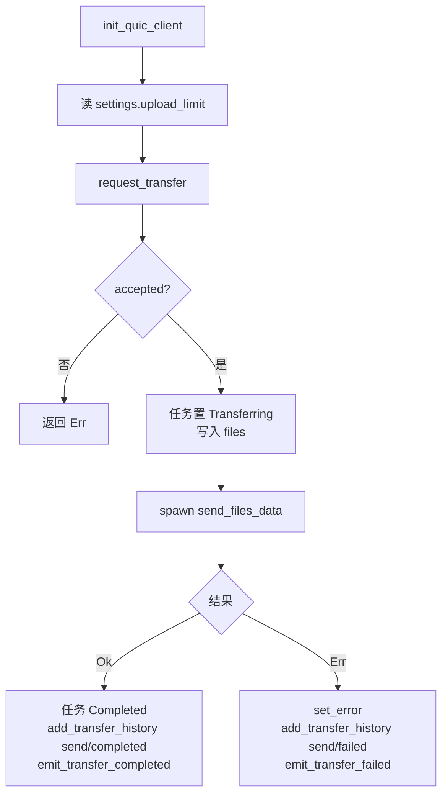
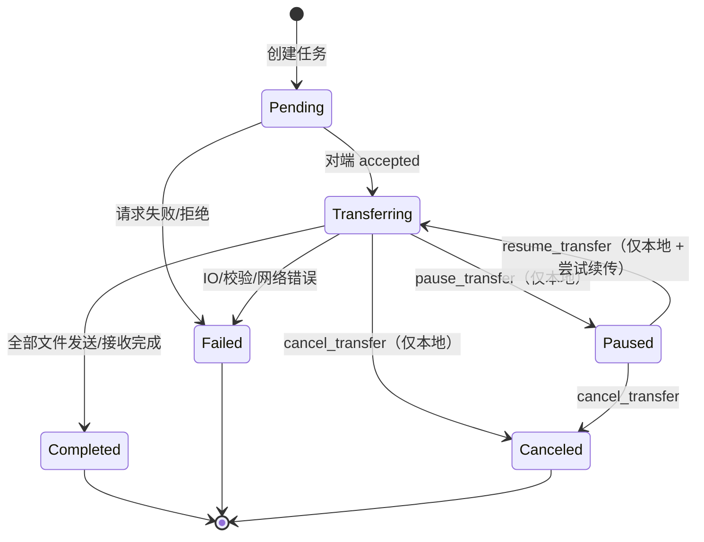
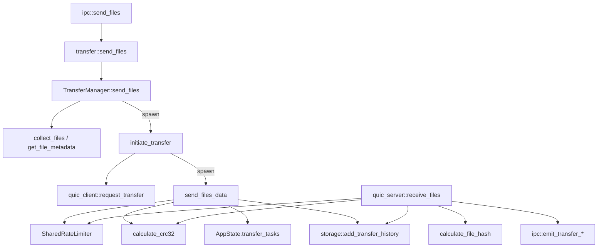

# 05 · 传输层

目录：`src-tauri/src/transfer/`

| 文件 | 职责 | 关键导出 |
|------|------|----------|
| `mod.rs` | 聚合，`pub use manager::*; pub use task::*;` | — |
| `task.rs` | 任务模型与状态 | `TransferTask`、`TransferTaskInfo`、`TransferStatus`、`TransferType` |
| `manager.rs` | 发送编排、进度推送、暂停/恢复/取消、公共函数 | `TransferManager`、`send_files`、`start_progress_updater`、`cancel/pause/resume_transfer` |
| `file_chunk.rs` | 分片工具、CRC32/SHA-256、批处理 | `FileChunker`、`FileAssembler`、`calculate_crc32`、`calculate_file_hash`、`BatchBuilder` |
| `resume.rs` | 断点续传信息模型 | `ResumeInfo`、`FileResumeInfo`、`ResumeManager`、位图互转 |
| `rate_limiter.rs` | 令牌桶限速 | `RateLimiter`、`SharedRateLimiter` |

---

## 1. 任务模型 `task.rs`

### `TransferStatus`

```rust
enum TransferStatus { Pending, Transferring, Paused, Completed, Failed, Canceled }
```

serde 序列化为变体名（前端按 `'Pending' | ...` 匹配）。

### `TransferTask`（内存态）

| 字段 | 类型 | 说明 |
|------|------|------|
| `task_id` | `Uuid` | 传输 ID |
| `peer_device_id` | `Uuid` | 对端设备 |
| `peer_device_name` | `String` | 对端名称（展示用） |
| `transfer_type` | `TransferType` | `Send` / `Receive` |
| `status` | `TransferStatus` | — |
| `total_size` | `u64` | 全部文件字节数 |
| `transferred_size` | `u64` | 已传输 |
| `file_count` | `u32` | 文件数 |
| `files` | `Vec<FileMetadata>` | 文件清单（发送端有 `source_path`，接收端为空） |
| `current_file_index` | `u32` | — |
| `current_file` | `String` | — |
| `speed` | `u64` | 最近一次采样的字节/秒 |
| `error_message` | `Option<String>` | — |
| `created_at` / `updated_at` | `SystemTime` | 排序、清理用 |
| `save_path` | `Option<PathBuf>` | 预留，未被写入 |
| `source_paths` | `Vec<PathBuf>` | 预留，未被写入 |

方法：

| 方法 | 行为 |
|------|------|
| `new(...)` | 初始状态 `Pending`，其余字段清零 |
| `update_progress(transferred, speed)` | 更新字节数与速度、`updated_at` |
| `set_status(status)` | 改状态 + `updated_at` |
| `set_current_file(name, index)` | 更新当前文件 |
| `set_error(msg)` | 写 `error_message` 并置 `Failed` |
| `progress()` | `transferred / total * 100.0`（**0–100**，不是 0–1） |

### `TransferTaskInfo`（传给前端的 DTO）

与 `TransferTask` 相比：不含 `files`、`source_path` 等敏感/冗余字段；`created_at` 转成 Unix 秒；`progress` 为 0–100。

---

## 2. 传输管理器 `manager.rs`

### 2.1 `TransferManager`

```rust
pub struct TransferManager {
    app_state: Arc<AppState>,
    active_transfers: Arc<Mutex<Vec<Uuid>>>,
}
```

`active_transfers` 只在 `cancel_transfer` 里被 `retain`，**从未 insert**，属于半成品。

### 2.2 发送入口 `send_files`

```rust
pub async fn send_files(&self, request: SendFilesRequest) -> AppResult<Vec<Uuid>>
```

流程：

1. `collect_files(&request.file_paths)`：
   - 文件：直接取 metadata。
   - 目录：`WalkDir::new(dir).follow_links(true)` 递归，计算相对路径（**以目录的父级为基准**，因此单目录发送会包含目录名本身）。
   - `file_id` 从 0 递增。
   - `checksum`：仅 `< 100MB` 的文件计算 SHA-256（`calculate_file_hash`）。
   - `modified_time`：Unix 秒。
2. 汇总 `total_size` / `file_count`。
3. 对每个 `device_id`：
   - 从 `AppState.devices` 取设备，取不到 → `DeviceNotFound`。
   - 构造 `TransferRequest`（`resume: false`）。
   - 创建 `TransferTask`（`Send`、`Pending`）并插入 `transfer_tasks`。
   - `tokio::spawn(initiate_transfer(...))`；失败时 `set_error`。
4. 返回 `task_ids`。

> 注意：`send_files` 是**同步等待文件收集完成**的（大目录会阻塞该命令一段时间），但传输本身是异步的。

### 2.3 `initiate_transfer`



- `request_transfer` 内部完成认证与请求/响应。
- 注意 `request_transfer` 会**覆盖**同 `task_id` 的任务（见 04 §6.1），因此 `peer_device_name` 可能变成自己。
- 历史记录的 `file_names` 是逗号拼接的字符串。

### 2.4 数据发送 `send_files_data`

关键点：

- **自己新建 `quinn::Endpoint`**（`0.0.0.0:0`）并 `connect(peer_addr, "chuanshu.local")`，超时 10s。
- `open_bi()` 得到一条流，**没有认证、没有发送 TransferRequest**，直接开始发数据。
- 每个文件：
  1. `set_current_file`
  2. 发 `FileHeader`：`4 字节长度 + bincode(task_id, file_id, file_name, file_size, relative_path, checksum)`
  3. 按 `DEFAULT_CHUNK_SIZE = 4MB` 循环读文件：
     - 检查任务状态（暂停自旋 / 取消报错）
     - 计算 CRC32
     - 发 `DataPacket`：`4 字节长度 + bincode(ChunkMetadata + data)`
     - 若 `upload_limit > 0`，`consume_and_wait(packet_len)`
     - 每 100ms 更新任务并 `emit_async("transfer-progress")`
- 全部文件后发 `4 字节 0` 作为结束标记，`finish()`，等待对端 1 字节 ACK（5s 超时，失败忽略）。
- 未发送任何文件总数校验；`transferred_size` 会跨多个文件累加。

### 2.5 会话控制

| 方法 | 行为 | 局限 |
|------|------|------|
| `cancel_transfer(task_id)` | 任务置 `Canceled`，从 `active_transfers` 移除 | 有 `// TODO: Notify peer`，不发控制消息 |
| `pause_transfer(task_id)` | 仅当 `Transferring` → `Paused` | 不通知对端 |
| `resume_transfer(task_id)` | 仅当 `Paused` → `Transferring`；尝试 `ResumeManager::load_resume(task_id)`，有记录则 `spawn(resume_transfer_task)` | 发送端从不保存 resume 记录 → 永远 `load_resume` 为 `None` |
| `cleanup_old_tasks(max_age)` | 用 `entry.value().blocking_lock()` 过滤完成/取消/失败任务并删除 | **在 async 上下文使用 `blocking_lock` 会 panic**；且无调用方 |

`get_all_tasks()`：遍历 `transfer_tasks`、`TransferTaskInfo::from`、按 `created_at` 倒序。

### 2.6 断点续传路径

`resume_transfer_task`：

1. 从 `AppState.devices` 找回对端地址（设备不在线 → `DeviceNotFound`）。
2. 读设置限速。
3. 用 `resume_info.files` 还原 `FileMetadata`。
4. `send_files_data_with_resume(...)`：与 `send_files_data` **代码几乎完全相同**，唯一区别是接收了 `_resume_info` 参数——**参数带下划线，完全未使用**，不会跳过已发送分片。
5. 成功后置 `Completed` 并删除 resume 记录；失败 `set_error`。

结论：**断点续传当前只有数据结构和 UI 状态，没有真正实现**（没有保存、没有跳过、没有对端协商）。

### 2.7 进度推送器

```rust
pub async fn start_progress_updater(app_state: Arc<AppState>) {
    let mut ticker = interval(Duration::from_millis(500));
    loop {
        ticker.tick().await;
        for entry in app_state.transfer_tasks.iter() {
            let task = entry.lock().await;
            if task.status == TransferStatus::Transferring {
                let _ = app_state.emit_async("transfer-progress", &TransferTaskInfo::from(&*task)).await;
            }
        }
    }
}
```

- 与数据循环里的 100ms 推送重复，前端会收到两倍事件。
- 任务完成时状态不再是 `Transferring`，最后一帧可能停留在 99%。

### 2.8 公共函数（供 `ipc` 调用）

```rust
pub async fn send_files(request, state: Arc<AppState>, _rt_handle: Handle) -> AppResult<Vec<Uuid>>
pub async fn cancel_transfer(task_id, state) -> AppResult<()>
pub async fn pause_transfer(task_id, state) -> AppResult<()>
pub async fn resume_transfer(task_id, state) -> AppResult<()>
```

每次调用都 `TransferManager::new(state)`，即 `active_transfers` 每次都是新的空 `Vec`——又一次说明该字段无效。

---

## 3. 分片工具 `file_chunk.rs`

### 3.1 `FileChunker`

| 方法 | 说明 |
|------|------|
| `new()` / `with_chunk_size(n)` | 默认 4MB |
| `optimal_chunk_size(file_size)` | `<256KB` → `max(size, 64KB)`；`<100MB` → 1MB；`<1GB` → 4MB；否则 8MB |
| `chunk_count(size, chunk)` | 向上取整，至少 1 |
| `read_chunk(path, index, total)` | 读指定块并计算 CRC32；`>10MB` 文件走 `mmap2`，否则 `seek + read_exact` |

> `read_chunk` 返回的 `task_id` 是 `Uuid::nil()`、`file_id` 是 0，注释说明“由调用方填充”，但**没有任何调用方**。

### 3.2 `FileAssembler`

| 方法 | 说明 |
|------|------|
| `new(path, size, chunk_size)` | 建父目录、`File::create`、`set_len(size)`（Windows/macOS/Linux 均预分配） |
| `write_chunk(&meta, data)` | 先校验 CRC32，再 `seek(offset)` 写入，置位 bitvec，返回是否完成 |
| `is_complete()` / `progress()` / `missing_chunks()` / `received_chunks()` | 位图查询 |
| `finalize()` | `flush` + `sync_all`，返回路径 |

> **未被接收流程使用**（`quic_server::receive_files` 自己用 `File + seek` 实现）。

### 3.3 校验与批处理

| 函数 / 类型 | 说明 | 使用情况 |
|-------------|------|----------|
| `calculate_crc32(&[u8])` | `crc32fast` | 发送端与接收端均用 |
| `calculate_file_hash(&Path) -> String` | 64KB 缓冲异步读，SHA-256 十六进制小写 | 发送端 <100MB 文件、接收端整文件校验 |
| `BatchBuilder` | 按 `MAX_BATCH_FILES(100)` / `MAX_BATCH_SIZE(64MB)` 组批 | **未使用** |
| `batch_files(files)` | 大文件单独成批，小文件合并 | **未使用** |

---

## 4. 断点续传模型 `resume.rs`

```rust
struct ResumeInfo {
    task_id: Uuid, peer_device_id: Uuid, peer_device_name: String,
    transfer_type: TransferType,
    files: HashMap<u64, FileResumeInfo>,   // key = file_id
    total_transferred: u64,
    last_updated: u64,
}

struct FileResumeInfo {
    metadata: FileMetadata,
    received_chunks: Vec<u8>,   // 位图，1 bit/chunk
    chunks_received: u64,
    temp_path: PathBuf,
}
```

| 方法 | 说明 |
|------|------|
| `new(...)` | 为每个文件按 `optimal_chunk_size` 分配位图 `ceil(total/8)` 字节 |
| `mark_chunk_received(file_id, idx)` | 置位并 `chunks_received += 1`（**无重复置位保护**，重复调用会多加） |
| `is_chunk_received` | 查询位 |
| `get_missing_chunks(file_id)` | 遍历总块数收集未收块 |
| `progress()` | 按块数统计（不是字节数） |
| `completed_files()` / `remove_completed_files()` | 完成文件判定与摘除 |

`ResumeManager<'a>` 只是 `Storage` 的薄包装：`save_resume` / `load_resume` / `delete_resume` / `list_incomplete_transfers` / `cleanup_old_entries`。

工具函数：`bitmap_to_indices(&[u8], total)`、`indices_to_bitmap(&[u64], total)`（补零到 `ceil(total/8)`）。

**实际使用情况**：除 `load_resume`（`resume_transfer` 中）与 `delete_resume_info`（续传成功后）外，`save_resume`、`list_incomplete_transfers`、`cleanup_old_entries`、位图工具均无调用点。

---

## 5. 限速器 `rate_limiter.rs`

### `RateLimiter`（令牌桶）

```rust
pub struct RateLimiter { max_tokens, tokens, refill_rate, last_refill }
```

- `new(bytes_per_sec)`：`0` 表示无限（`max_tokens = refill_rate = u64::MAX`）。
- `consume(tokens) -> Option<Duration>`：先按流逝时间补充令牌；够则扣减并返回 `None`；不够则返回需要等待的时长（`needed * 1000 / refill_rate` ms）。
- `refill()`：`elapsed_secs * refill_rate` 取整后加回，封顶 `max_tokens`。
- `is_limited()` / `tokens()`：状态查询。

### `SharedRateLimiter`

```rust
pub struct SharedRateLimiter { inner: Arc<Mutex<RateLimiter>> }
pub async fn consume_and_wait(&self, bytes: u64)  // 循环 consume + sleep 直到成功
pub async fn try_consume(&self, bytes: u64) -> bool
```

单元测试：`test_unlimited_limiter`、`test_limited_limiter`、`test_shared_limiter`。

> 单位：`limit` 被当作 **字节/秒**。前端设置页标注的是 **MB/s** 且直接把滑块数值（0–100）写库，因此选 10 实际是 10 B/s。见 08。
>
> 另：`consume_and_wait` 先扣令牌再等待，但由于令牌不足以扣除时不会消费，逻辑上是正确的；不过当 `tokens < needed` 且 `refill_rate` 较小、`needed` 很大（4MB 分片、限速 10B/s）时会计算出一个极长的 sleep，表现为“卡住”。

---

## 6. 线上帧格式（发送/接收端实际使用）

```text
双向流（数据流）
├── 文件 N 头
│   ├── u32 BE  header_len
│   └── [header_len]  bincode(FileHeader {
│           task_id: Uuid(16B),
│           file_id: u64,
│           file_name: String(len+bytes),
│           file_size: u64,
│           relative_path: String,
│           checksum: Option<String>
│       })
├── 分片 K
│   ├── u32 BE  packet_len
│   └── [packet_len]  bincode(DataPacket {
│           metadata: ChunkMetadata {
│               task_id, file_id, chunk_index, total_chunks,
│               chunk_size: u32, offset: u64, checksum: u32
│           },
│           data: Vec<u8>
│       })
├── ...（更多分片 / 文件）
└── u32 BE  0x00000000   ← 传输结束标记
```

- 所有长度前缀为 **4 字节大端**。
- 分片大小固定 4MB（`DEFAULT_CHUNK_SIZE`），与 `ChunkMetadata.chunk_size` 记录的实际长度可能不同（最后一片）。
- 接收端读完所有文件后不会回写 ACK（注释写着“连接会由发送方关闭”），发送端的 5s 等待 ACK 必然超时（被忽略）。

---

## 7. 传输状态机



- 状态**只存在于内存**，进程重启即丢失。
- 接收端在 `receive_files` 返回 `Ok` 后无条件置 `Completed`，即使实际没收到任何字节。
- 暂停不会停止对端发送：发送端只看自己的任务状态，接收端暂停后对端仍继续发，最终由 QUIC 流控/超时决定结果。

---

## 8. 传输层调用关系



---

## 9. 性能与正确性提示

| 项 | 现状 | 影响 |
|----|------|------|
| 分片大小 | 固定 4MB，未使用 `optimal_chunk_size` | 小文件也用 4MB 缓冲分配 |
| 内存 | 每片 `Vec<u8>` 序列化后在内存中可能有 2 份 | 大文件高内存峰值 |
| 并发 | 无并发上限（`MAX_CONCURRENT_TRANSFERS` 未使用），每个文件串行、每个设备并行 | 多设备同时发大文件会争抢 IO/带宽 |
| 校验 | 分片 CRC32 + (<100MB) 整文件 SHA-256 | ≥100MB 文件无端到端校验 |
| 进度 | 100ms（传输内）+ 500ms（全局）双通道 | 事件冗余 |
| 临时文件 | `.<file_id>.tmp` 不含 task_id | 并发接收冲突 |
| 路径安全 | `relative_path` 直接 `download_path.join()` | 恶意对端可用 `../` 路径穿越（局域网内风险） |
| 文件名冲突 | 同名文件直接覆盖（`rename`） | 无去重/重命名策略 |
