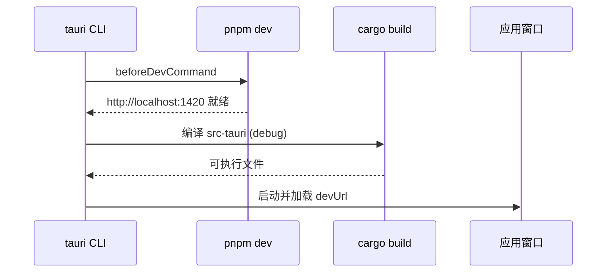

# 07 · 构建与运行

## 1. 环境要求

| 工具 | 版本要求 | 说明 |
|------|----------|------|
| Node.js | 18+ / 20（CI 用 20） | 前端构建 |
| pnpm | 8/9/最新 | 项目脚本与 CI 均使用 pnpm（`pnpm-lock.yaml`） |
| Rust | ≥ 1.77.2（`rust-version`） | 后端编译 |
| Tauri CLI | `@tauri-apps/cli` ≥ 2.10 | 已在 devDependencies，通过 `pnpm tauri` 调用 |
| 平台依赖（Linux） | `libwebkit2gtk-4.1-dev`、`libgtk-3-dev`、`librsvg2-dev`、`libayatana-appindicator3-dev`、`libsoup-3.0-dev`、`build-essential` | Tauri 2 的 Linux 依赖 |
| Windows | WebView2 运行时（Win10 1803+ 通常自带）、MSVC 工具链 | — |
| macOS | Xcode Command Line Tools | — |

---

## 2. 常用命令

```bash
# 安装依赖
pnpm install

# 仅前端（浏览器打开 http://localhost:1420）
# ⚠️ 浏览器环境没有 Tauri API，invoke/listen 会报错，只能看静态 UI
pnpm dev

# 完整桌面应用开发（推荐）：自动起 Vite + 编译 Rust + 打开窗口
pnpm tauri dev

# 类型检查 + 生产构建前端（tsc && vite build）
pnpm build

# 打包安装程序（msi/nsis；macOS 为 dmg/app；Linux 为 deb/appimage）
pnpm tauri build

# 其他 Tauri CLI 子命令
pnpm tauri info
pnpm tauri icon path/to/icon.png
```

### 脚本映射（`package.json`）

| 脚本 | 实际命令 | 说明 |
|------|----------|------|
| `dev` | `vite` | 开发服务器 |
| `build` | `tsc && vite build` | **先类型检查**，TS 报错会中断构建 |
| `preview` | `vite preview` | 预览产物 |
| `tauri` | `tauri` | 转发到 Tauri CLI |

> 没有 `lint`、`test` 脚本；Rust 侧有 `rate_limiter` 的 3 个单元测试，可用 `cargo test --manifest-path src-tauri/Cargo.toml` 运行。

---

## 3. 开发前的环境检查

```bash
pnpm tauri info        # 输出 Node/Rust/Tauri 版本与平台依赖状态
cargo --version
node --version
pnpm --version
```

`pnpm tauri dev` 的启动链路：



---

## 4. 关键配置文件

### 4.1 `src-tauri/tauri.conf.json`

| 配置 | 值 | 说明 |
|------|-----|------|
| `productName` | `传书` | 安装包与窗口名 |
| `version` | `0.1.0` | 需与 `package.json` / `Cargo.toml` 手动保持一致 |
| `identifier` | `com.chuanshu.app` | 决定 `app_data_dir`（Windows 为 `%APPDATA%\com.chuanshu.app`） |
| `build.devUrl` | `http://localhost:1420` | 与 Vite `strictPort` 对应 |
| `build.beforeDevCommand` | `pnpm dev` | — |
| `build.beforeBuildCommand` | `pnpm build` | — |
| `build.frontendDist` | `../dist` | Vite 输出目录 |
| 窗口 | 1000×700，最小 800×600，可缩放，有边框 | — |
| `security.csp` | `null` | **关闭 CSP**，方便开发，但降低安全防护 |
| `bundle.targets` | `all` | 按平台产出所有包格式 |
| `bundle.macOS.entitlements` | `../entitlements.mac.plist` | 网络/下载目录权限 |
| `bundle.windows.nsis` | 简体中文 + 英文 | — |

### 4.2 `vite.config.ts`

- `server.port = 1420` 且 `strictPort = true`：端口被占用会直接失败，不会自动换端口。
- `watch.ignored = ['**/src-tauri/**']`：避免 Rust 产物触发前端热更新。
- `envPrefix = ['VITE_', 'TAURI_']`。
- 未配置代理、未配置别名（`@/` 不可用），全部使用相对路径导入。

### 4.3 `tsconfig.json`

- `target: ES2020`、`module: ESNext`、`moduleResolution: bundler`、`jsx: react-jsx`、`strict: true`、`noEmit: true`。
- `include: ["src"]`，`references: [tsconfig.node.json]`（后者覆盖 `vite.config.ts`）。

### 4.4 `src-tauri/capabilities/default.json`

```json
{ "identifier": "default", "windows": ["main"], "permissions": ["core:default", "dialog:allow-open"] }
```

新增前端插件调用（fs/shell/notification）时必须在此追加权限，否则运行时报 “not allowed”。

### 4.5 `entitlements.mac.plist`

声明网络客户端/服务端、用户选择文件与下载目录读写、局域网用途说明。**未开启** App Sandbox（不需要，因为应用要监听 UDP 端口）。

---

## 5. 依赖清单

### 5.1 前端（`package.json`）

| 包 | 版本 | 用途 |
|----|------|------|
| `react` / `react-dom` | `^19.2.4` | 注意：放在 **devDependencies**（打包时由 Vite 打进产物，运行时不从 node_modules 读取） |
| `antd` | `^6.3.3` | UI 组件库 |
| `@ant-design/icons` | `^6.1.0` | 图标 |
| `zustand` | `^5.0.12` | 状态管理 |
| `@tauri-apps/api` | `^2.10.1` | `invoke` / `listen` / WebviewWindow |
| `@tauri-apps/plugin-dialog` | `^2.6.0` | 选择目录 |
| `@tauri-apps/plugin-notification` | `^2.3.3` | 声明了但前端未直接使用（通知在 Rust 侧发） |
| `@tauri-apps/plugin-shell` | `^2.3.5` | 同上，前端未直接使用 |
| `filesize` | `^11.0.13` | 字节格式化 |
| `dayjs` | `^1.11.20` | 日期处理（当前页面用原生 `toLocaleString`） |
| `clsx` | `^2.1.1` | 类名拼接（业务代码几乎未用） |
| `tailwindcss` / `@tailwindcss/postcss` / `postcss` / `autoprefixer` | `4.2.2` / `4.2.2` / `8.5.8` / `10.4.27` | 样式工具链（配置存在但基本未生效，见 02 §6） |

### 5.2 后端（`src-tauri/Cargo.toml`）

| 依赖 | 版本 | 用途 |
|------|------|------|
| `tauri` | `2.0` | 桌面框架 |
| `tauri-plugin-fs / notification / shell / dialog / log` | `2` | 插件 |
| `tokio` | `1.35`（full） | 异步运行时 |
| `quinn` | `0.10` | QUIC |
| `rustls` | `0.21` | TLS |
| `rcgen` | `0.12` | 自签名证书生成 |
| `rusqlite` | `0.29`（bundled） | SQLite（内置编译，无需系统库） |
| `dashmap` | `5.5` | 并发 Map |
| `serde` / `serde_json` / `bincode` | `1.x` / `1.0` / `1.3` | 序列化 |
| `walkdir` | `2.4` | 目录遍历 |
| `memmap2` | `0.9` | 大文件 mmap 读分片 |
| `sha2` / `crc32fast` / `xxhash-rust` | `0.10` / `1.3` / `0.8` | 校验（`xxhash-rust` 当前未使用） |
| `bitvec` | `1.0` | 接收位图 |
| `if-addrs` / `socket2` | `0.10` / `0.5` | 网卡枚举 / UDP socket 选项 |
| `uuid` | `1.6`（v4, serde） | 设备/任务 ID |
| `thiserror` / `anyhow` | `1.0` / `1.0` | 错误（`anyhow` 当前未使用） |
| `chrono` / `filetime` / `confy` / `once_cell` / `tracing*` / `futures` / `bytes` / `tokio-util` / `rustls-pemfile` / `rand` | 见 Cargo.toml | 部分为预留依赖，当前代码未使用 |

> 首次编译 `rusqlite`（bundled）与 `quinn`/`rustls` 会较慢，属正常现象。

---

## 6. 端口与防火墙

| 端口 | 协议 | 用途 | 必须放通 |
|------|------|------|----------|
| 45678 | UDP | 设备发现（广播 + 单播） | 是 |
| 45679 | UDP | QUIC 文件传输 | 是 |
| 1420 | TCP | Vite 开发服务器（仅 dev） | 本机 |

Windows 首次运行会弹出防火墙授权，务必勾选**专用网络**；若误点取消，可在「Windows Defender 防火墙 → 允许应用通过防火墙」中手动添加，或临时关闭防火墙验证。

排查「设备互相看不到」：

1. 两台设备是否在同一网段（`ipconfig` 看 IP 前缀）。
2. 是否放通 UDP 45678/45679。
3. 路由器是否开启了 AP 隔离（访客网络常见）。
4. 查看日志（debug 构建）：`%APPDATA%\com.chuanshu.app\logs\`（`tauri-plugin-log` 默认目录）。
5. 用「IP 发现」直接填对端 IP 验证单播链路。

---

## 7. CI 工作流

### 7.1 `.github/workflows/build.yml`（主流程）

- 触发：`push` 到 `main`、`v*` tag、向 `main` 的 PR。
- 矩阵：Windows x64 / macOS Intel / macOS ARM64 / Linux x64。
- 步骤：Node 20 → pnpm → Rust stable + target → Ubuntu 系统依赖 → `pnpm install` → `tauri-apps/tauri-action` → 上传产物。
- `publish-release`：tag 触发时下载全部产物，用 `softprops/action-gh-release` 创建 **draft** Release。

已知问题：

1. Ubuntu 依赖列表中的 `libgstreameller-plugins-bad-dev` 拼写错误（多一个 `l`，且包名本身应为 `libgstreamer-plugins-bad1.0-dev`），会导致 `apt-get install` 失败。
2. `actions/setup-node` 的 `cache: 'pnpm'` 在 `pnpm/action-setup` **之前**执行，缓存步骤找不到 pnpm 可执行文件会报错；应把 `pnpm/action-setup` 放在 `setup-node` 前面，或去掉 `cache`。
3. macOS 两个 target 共用 `macos-latest`，实际架构取决于 runner（当前为 arm64），构建 `x86_64-apple-darwin` 需 Rosetta 工具链。

### 7.2 `.github/workflows/build-windows.yml`

- 专注 Windows（pnpm 9、Node 20、`x86_64-pc-windows-msvc`），产物为 MSI + NSIS。
- 附带一个仅在打 tag 时运行的 macOS universal 构建。
- 打 tag 时合并产物并创建 draft Release。

两个 workflow 触发条件重叠（push main / PR / tag），会重复构建，可按需删除其一。

---

## 8. 产物位置

```text
src-tauri/target/<target>/release/
├── chuanshu-app.exe            # 可执行文件
└── bundle/
    ├── msi/*.msi               # Windows MSI
    ├── nsis/*.exe              # Windows NSIS 安装器
    ├── dmg/*.dmg               # macOS
    ├── macos/*.app
    ├── deb/*.deb               # Linux
    └── appimage/*.AppImage
```

---

## 9. 常见问题排查

| 现象 | 可能原因 | 处理 |
|------|----------|------|
| `pnpm tauri dev` 卡在 “Waiting for your frontend dev server” | 1420 端口被占用（`strictPort`） | 结束占用进程：`netstat -ano | findstr :1420` |
| TS 报错导致 `pnpm build` 失败 | `tsc` 严格模式 | 先 `pnpm exec tsc --noEmit` 逐条修复 |
| 前端白屏 | 资源路径/CSP/JS 异常 | 开发模式打开 DevTools 查看 Console；`csp=null` 下一般为运行时异常 |
| 命令报 “not allowed” | capabilities 缺权限 | 在 `capabilities/default.json` 增加对应 `plugin:allow-*` |
| 看不到设备 | 防火墙 / 网段 / AP 隔离 / 版本不一致 | 见 §6 |
| 发送一直 `Pending` 后失败 | QUIC 连通性问题（自签名证书校验、连接被 drop） | 见 [08 §1](08-known-issues.md#1-高优先级缺陷) |
| 接收端 0 字节就显示完成 | 数据流与认证流不一致 | 见 [08 §1](08-known-issues.md#1-高优先级缺陷) |
| 限速滑块不起作用/极慢 | 单位是字节/秒而非 MB/s | 设为 0 关闭限速 |
| 数据库异常 | `%APPDATA%\com.chuanshu.app\chuanshu.db` 损坏 | 退出应用后删除该文件（会丢失历史/设置） |

---

## 10. 本地验证清单（提交前）

```bash
pnpm exec tsc --noEmit                                  # 前端类型
cargo fmt --manifest-path src-tauri/Cargo.toml -- --check
cargo clippy --manifest-path src-tauri/Cargo.toml -- -D warnings
cargo test --manifest-path src-tauri/Cargo.toml
pnpm tauri build                                        # 至少确保能打包
```

> 仓库未提供 lint/format 配置（无 `.eslintrc`、无 `rustfmt.toml`），上述命令按默认规则执行。
