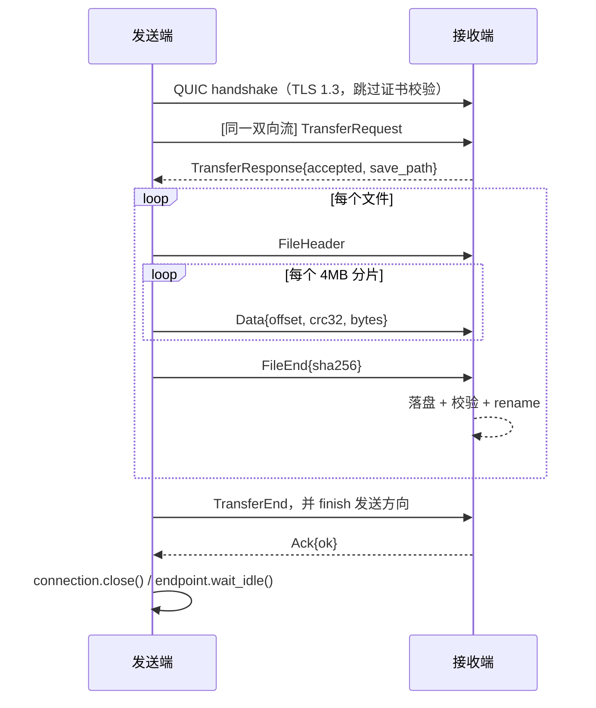

# 09 · MVP 改造方案（局域网直传）

> 目标：**让局域网内不同系统的两台设备真正、快速、稳定地互传文件**。
> 范围决定：本方案只做减法与最小必要修复；断点续传删除，传输历史保留；自签名证书保留但跳过校验，不引入 CA。

---

## 1. 目标与非目标

### 1.1 MVP 必须满足

1. 打开应用 5 秒内能在设备列表看到同网段的其他设备（含离线历史设备）。
2. 选中设备，拖入文件或文件夹，点击发送即可开始传输；接收端无需手工配置。
3. 跨 Windows / macOS / Linux 互通。
4. 有进度、速度、当前文件；支持暂停/继续/取消。
5. 完成后有通知；传输历史可查。
6. 千兆局域网单文件吞吐 ≥ 70 MB/s（目标值，非硬指标）。
7. 取消/失败不残留半成品文件。

### 1.2 明确不做（本阶段）

| 不做 | 原因 |
|------|------|
| CA 证书 / 证书固定 / 真正的密码学认证 | 局域网个人工具，无证书基础设施；认证当前是假的，删除比保留更安全 |
| 断点续传（跨进程） | 现有实现只有数据结构，协议未支持；成本高、收益低 |
| 多连接并发传输 / 连接池 | 单连接单流已能打满局域网带宽，池化是故障源 |
| 传输任务持久化 | 进程重启后任务丢失可接受 |
| 文件去重、断点秒传、增量同步 | 非 MVP |
| 历史“重新发送 / 打开位置” | 历史不存源路径，先隐藏按钮 |
| 系统托盘、多语言、自动更新 | 非 MVP |

---

## 2. 当前实现的阻断点（按链路顺序）

| # | 阻断点 | 位置 | 结论 |
|---|--------|------|------|
| 1 | 客户端用空 `RootCertStore` 校验自签名证书 | `network/connection.rs::create_client_config` | 握手直接失败 |
| 2 | 服务端要求“新连接第一条双向流 = 认证” | `network/quic_server.rs::handle_incoming_connection` | 与客户端行为冲突 |
| 3 | 客户端另开新连接、首流直接发 `FileHeader` | `transfer/manager.rs::send_files_data` | 无认证、无请求、无响应 |
| 4 | 服务端只在**请求流**上 `receive_files` | `network/quic_server.rs::handle_transfer_request` | 数据流永远收不到 |
| 5 | `receive_window(16)` = 16 字节 | `network/connection.rs::create_server_config` | 即使连通也无法流动 |
| 6 | `request_transfer` 的 `Endpoint` 返回即 drop | `network/quic_client.rs` | 连接池连接失效 |
| 7 | `auto_accept` 默认 false，且接收端没有确认 UI | `ipc::get_settings` | 所有传输被拒绝 |
| 8 | 前后端契约错位（`task_id/taskId`、限速单位、`last_seen`） | 见 08 | 状态与限速异常 |

> 1–7 任意一个都会让“发送文件”失败。因此本次改造必须一次性打通整条链路，而不是只修证书。

---

## 3. 目标架构

### 3.1 简化后的传输模型

**一次发送 = 一个 QUIC 连接 = 一条双向流 = 一问一答一数据流。**



要点：

- **没有认证流**：设备身份由 `TransferRequest.sender_id/sender_name` 声明（局域网信任模型）。
- **没有连接池**：连接随任务创建、随任务结束销毁。
- **没有后台保活连接**：设备在线状态只由 UDP 心跳决定。
- 服务端每个连接只处理一条流，无需 `spawn` 每条流。

### 3.2 模块调整总览

```text
src-tauri/src/
├── core/
│   ├── app_state.rs        [改] device_id/device_name 初始化来源
│   ├── constants.rs        [改] 删除未使用常量，调整窗口/超时
│   └── config.rs           [删] 空文件
├── network/
│   ├── mod.rs              [改] 移除 auth / connection 导出
│   ├── device.rs           [改] last_seen 改为 u64 秒
│   ├── protocol.rs         [改] 协议 v2：去掉 Auth*，增加数据帧标签
│   ├── discovery.rs        [改] 删除保活连接与关闭回调
│   ├── tls.rs              [新] 证书生成 + 服务端/客户端 TLS 配置（跳过校验）
│   ├── connection.rs       [删] 连接池 / PeerConnection / StreamHandle
│   ├── auth.rs             [删] 假认证
│   ├── quic_server.rs      [重写] 单连接单流：请求 → 接收 → 落盘 → Ack
│   └── quic_client.rs      [重写] 单连接单流：请求 → 接收响应 → 发送数据
├── transfer/
│   ├── manager.rs          [改] 删除续传与连接池逻辑，直接调用新客户端
│   ├── task.rs             [改] 删除 save_path/source_paths 等未用字段
│   ├── file_chunk.rs       [改] 只保留 crc32 / 流式 sha256
│   └── resume.rs           [删]
├── storage/mod.rs          [改] 删除 resume 相关 DAO 与表；新增 device_id 设置
└── ipc/mod.rs              [改] 删除无调用命令；修正事件载荷
src/                        [改] 事件字段、限速单位、历史操作列
```

---

## 4. 删除清单

| 文件 / 符号 | 处理 | 原因 | 连带影响 |
|-------------|------|------|----------|
| `network/auth.rs`（整文件） | 删除 | 签名不校验、指纹是 mock，无安全价值 | `quic_server/quic_client` 中的认证调用一并删除 |
| `network/connection.rs`（整文件） | 删除，保留内容迁入 `tls.rs` | 连接池无调用价值、`pending` 是死代码、endpoint 生命周期错误 | `discovery` 的保活任务、`quic_client` 的池调用 |
| `ConnectionPool` / `PeerConnection` / `StreamHandle` / `StreamDirection` / `StreamStatus` | 删除 | 未使用或仅服务连接池 | — |
| `transfer/resume.rs`（整文件） | 删除 | 未接入流程 | `manager::resume_transfer_task`、`storage` 四个 DAO |
| `storage` 中 `save_resume_info/load_resume_info/delete_resume_info/list_incomplete_transfers/cleanup_old_resume_entries` | 删除 | 同上 | `resume_info` 表 |
| `transfer/file_chunk.rs` 中 `FileChunker` / `FileAssembler` / `BatchBuilder` / `batch_files` / 位图工具 | 删除 | 实际传输未使用 | `bitvec`、`memmap2` 依赖可移除 |
| `manager::cleanup_old_tasks` | 删除 | 无调用方，且 async 中使用 `blocking_lock` 会 panic | — |
| `TransferManager.active_transfers` | 删除 | 只 `retain` 从不写入 | — |
| `core/constants.rs`：`MAX_CONCURRENT_TRANSFERS`、`MAX_BATCH_FILES`、`MAX_BATCH_SIZE`、`SMALL_FILE_THRESHOLD` | 删除 | 无使用 | — |
| `ipc`：`get_device_list`、`delete_known_device`、`open_file_location`、`resend_files` | 删除 | 前端无有效调用；`resend_files` 签名本身不匹配 | `lib.rs` 注册列表、`tauriApi.ts` |
| `ipc::emit_device_online` / `emit_transfer_progress` | 删除 | 定义了但无人调用（其他模块直接 emit） | — |
| `core/config.rs` | 删除 | 空文件 | `core/mod.rs` 注释行 |
| 依赖 `bitvec`、`memmap2`、`xxhash-rust`、`confy`、`anyhow`、`tracing*`（确认无引用后） | 移除 | 减少编译时间与体积 | — |

> 删除前用 `cargo check` 逐步验证；建议按“先删叶子（auth/resume/file_chunk 未用部分）→ 再删连接池”的顺序，避免一次性改动过大。

---

## 5. 证书方案：保留自签名，跳过校验

### 5.1 原则

- 服务端仍然用 `rcgen` 现场生成自签名证书（QUIC 要求 TLS 1.3，无法关闭 TLS）。
- 客户端**显式**接受任意服务端证书，不依赖 CA、不需要用户配置。
- 这是有意的安全取舍：**任何能访问 UDP 45679 的主机都可冒充设备**。仅在可信局域网使用，并在 README/设置页注明。

### 5.2 实现要点

`Cargo.toml` 需要开启 rustls 的危险配置特性：

```toml
rustls = { version = "0.21", features = ["dangerous_configuration"] }
```

`network/tls.rs`：

```rust
#[derive(Debug)]
struct NoCertificateVerification;

impl rustls::client::ServerCertVerifier for NoCertificateVerification {
    fn verify_server_cert(
        &self,
        _end_entity: &rustls::Certificate,
        _intermediates: &[rustls::Certificate],
        _server_name: &rustls::ServerName,
        _scts: &mut dyn Iterator<Item = &[u8]>,
        _ocsp_response: &[u8],
        _now: std::time::SystemTime,
    ) -> Result<rustls::client::ServerCertVerified, rustls::Error> {
        Ok(rustls::client::ServerCertVerified::assertion())
    }

    fn verify_tls12_signature(
        &self, _message: &[u8], _cert: &rustls::Certificate, _dss: &rustls::DigitallySignedStruct,
    ) -> Result<rustls::client::HandshakeSignatureValid, rustls::Error> {
        Ok(rustls::client::HandshakeSignatureValid::assertion())
    }

    fn verify_tls13_signature(
        &self, _message: &[u8], _cert: &rustls::Certificate, _dss: &rustls::DigitallySignedStruct,
    ) -> Result<rustls::client::HandshakeSignatureValid, rustls::Error> {
        Ok(rustls::client::HandshakeSignatureValid::assertion())
    }

    fn supported_verify_schemes(&self) -> Vec<rustls::SignatureScheme> {
        vec![
            rustls::SignatureScheme::RSA_PKCS1_SHA256,
            rustls::SignatureScheme::RSA_PKCS1_SHA384,
            rustls::SignatureScheme::RSA_PKCS1_SHA512,
            rustls::SignatureScheme::ECDSA_NISTP256_SHA256,
            rustls::SignatureScheme::ECDSA_NISTP384_SHA384,
            rustls::SignatureScheme::ECDSA_NISTP521_SHA512,
            rustls::SignatureScheme::RSA_PSS_SHA256,
            rustls::SignatureScheme::RSA_PSS_SHA384,
            rustls::SignatureScheme::RSA_PSS_SHA512,
            rustls::SignatureScheme::ED25519,
        ]
    }
}

pub fn client_config() -> rustls::ClientConfig {
    rustls::ClientConfig::builder()
        .with_safe_defaults()
        .with_custom_certificate_verifier(std::sync::Arc::new(NoCertificateVerification))
        .with_no_client_auth()
}
```

注意事项：

1. `ServerName` 仍需合法字符串，继续用 `"chuanshu.local"`（证书 SAN 里已有）。
2. 服务端证书保留 SAN + `127.0.0.1`，便于同机双开测试。
3. 不设置 `alpn_protocols`（两端都不设即可）。
4. 未来若要做配对：在发现报文增加 `cert_fingerprint`，客户端只接受首次指纹（TOFU），**不要**现在实现。

---

## 6. 协议 v2 规范

**原则**：一条双向流、顺序读写、帧自带长度、尽量零拷贝。

### 6.1 帧定义（全部大端）

```text
[1] 请求
u32              req_len
[req_len]        bincode(TransferRequest)

TransferRequest {
    protocol_version: u16,        // = 2，不匹配直接回 Error
    task_id: Uuid,
    sender_id: Uuid,
    sender_name: String,
    total_size: u64,
    files: Vec<FileMeta>,
}

FileMeta {
    file_id: u64,
    relative_path: String,        // 可为空；用于保留目录结构
    file_name: String,
    file_size: u64,
}

[2] 响应
u32              resp_len
[resp_len]       bincode(TransferResponse)

TransferResponse {
    task_id: Uuid,
    accepted: bool,
    reason: Option<String>,
    save_path: Option<String>,    // 实际下载目录（不再是硬编码）
}

[3] 文件头（每个文件一次）
u32              hdr_len
[hdr_len]        bincode(FileHeader)

FileHeader {
    file_id: u64,
    file_name: String,
    relative_path: String,
    file_size: u64,
}

[4] 数据帧（循环）
u8               tag = 0x01
u64              offset
u32              data_len          // <= 4MB
u32              crc32             // 对 data 计算
[data_len]       raw bytes         // 原始字节，不再 bincode 包装

[5] 文件结束
u8               tag = 0x02
u8               has_sha256        // 0/1
[32]             sha256（可选）

[6] 全部结束
u8               tag = 0x00

[7] 接收端确认
u8               0x00 = OK
u8               0x01 + u32 len + utf8 错误信息
```

### 6.2 与 v1 的差异

| 项 | v1 | v2 |
|----|----|----|
| 连接数 | 请求一个、数据一个 | 一个 |
| 认证 | 三段式假认证 | 无 |
| 数据负载 | `bincode(DataPacket{meta, Vec<u8>})`（4MB 复制） | `meta 字段 + 原始字节`（零额外复制） |
| 整文件校验 | 发送前预读计算（<100MB） | 发送时流式计算，`FileEnd` 携带摘要（全尺寸） |
| 结束语义 | `u32 0` | 显式标签 + Ack |
| 版本 | `"1.0.0"` | `u16 = 2`，不兼容即拒绝 |

### 6.3 分片与校验策略

- 分片固定 **4MB**（`DEFAULT_CHUNK_SIZE` 保留）。
- 每片 CRC32：接收端立即校验，失败立刻断开并报错。
- 整文件 SHA-256：**流式计算**
  - 发送端：读文件时同步 `hasher.update(buf)`，`FileEnd` 带上摘要。
  - 接收端：写文件时同步 `hasher.update(buf)`，`FileEnd` 时比对。
  - 收益：省掉当前对 <100MB 文件的**额外一次全量读取**；大文件也能端到端校验。
- 接收端在 `FileEnd` 后：`flush` → `sync_all` → 校验字节数 == `file_size` → `rename`。

### 6.4 落盘规则

| 项 | 规则 |
|----|------|
| 下载目录 | `settings.download_path`（统一 `~` 展开；Windows 用 `USERPROFILE`） |
| 临时文件 | `<download>/.<task_id>.<file_id>.part`（含 task_id，避免并发冲突） |
| 目录结构 | `relative_path` 逐级创建 |
| 路径安全 | 拼接后 `canonicalize`，必须以上述下载目录为前缀，否则拒绝该文件 |
| 重名 | 已存在则 `name (1).ext` 递增，不覆盖 |
| 失败/取消 | 删除 `.part`；已完成的文件保留 |
| 0 字节文件 | 允许，直接创建空文件 |

---

## 7. 关键文件改动明细

### 7.1 `core/constants.rs`

```rust
pub const DISCOVERY_PORT: u16 = 45678;
pub const QUIC_DEFAULT_PORT: u16 = 45679;
pub const DISCOVERY_HEARTBEAT_INTERVAL: u64 = 3;
pub const DISCOVERY_TIMEOUT: u64 = 30;
pub const QUIC_IDLE_TIMEOUT: u64 = 60;
pub const QUIC_KEEP_ALIVE_INTERVAL: u64 = 10;
pub const DEFAULT_CHUNK_SIZE: u32 = 4 * 1024 * 1024;
pub const PROTOCOL_VERSION: u16 = 2;
```

删除：`MAX_CONCURRENT_TRANSFERS`、`SMALL_FILE_THRESHOLD`、`MAX_BATCH_FILES`、`MAX_BATCH_SIZE`。

### 7.2 `network/tls.rs`（新）

- `generate_self_signed_cert() -> (Vec<Certificate>, PrivateKey)`（从 `connection.rs` 迁入）
- `server_config() -> rustls::ServerConfig`
- `client_config() -> rustls::ClientConfig`（跳过校验）
- `transport_config() -> quinn::TransportConfig`：
  ```rust
  transport.max_concurrent_bidi_streams(8u32.into());
  transport.max_concurrent_uni_streams(8u32.into());
  transport.receive_window((16u32 * 1024 * 1024).into());
  transport.stream_receive_window((8u32 * 1024 * 1024).into());
  transport.send_window(16 * 1024 * 1024);
  transport.keep_alive_interval(Some(Duration::from_secs(10)));
  transport.max_idle_timeout(Some(Duration::from_secs(60).try_into()?));
  ```
- 单元测试：客户端配置能成功握手服务端证书（可用 `quinn` echo 测试，或至少构造不报错）。

### 7.3 `network/quic_server.rs`（重写）

```rust
pub async fn start_quic_server(app_state: Arc<AppState>) -> AppResult<u16>;
pub fn stop_quic_server();

async fn handle_connection(conn: quinn::Connection, app_state: Arc<AppState>) -> AppResult<()> {
    let (send, recv) = tokio::time::timeout(Duration::from_secs(10), conn.accept_bi()).await??;
    handle_transfer(send, recv, app_state).await
}
```

`handle_transfer` 流程：

1. 读 `u32` 长度（上限 1MB）→ 反序列化 `TransferRequest`。
2. 校验 `protocol_version == 2`，否则回 `TransferResponse{accepted:false, reason:"版本不一致"}`。
3. 读设置 `auto_accept`（MVP 默认改为 **true**）与 `download_path`、`download_limit`。
4. 回 `TransferResponse{accepted, save_path}`。
5. 若拒绝：`finish()` 并返回。
6. 创建接收任务并注册到 `AppState.transfer_tasks`。
7. 循环读文件头 → 数据帧 → 写 `.part` → `FileEnd` 校验 → `rename`。
8. 收到 `0x00`：回 Ack，置 `Completed`，写历史，发通知。
9. 任何错误：写历史 `failed`、`emit transfer-failed`、删除未完成 `.part`、回错误 Ack。

### 7.4 `network/quic_client.rs`（重写）

只保留一个公共入口：

```rust
pub async fn send_transfer(
    peer: SocketAddr,
    request: TransferRequest,
    files: Vec<(PathBuf, FileMeta)>,
    app_state: Arc<AppState>,
    task_id: Uuid,
) -> AppResult<()>;
```

流程：

1. `Endpoint::client("0.0.0.0:0".parse()?)`，绑定 `client_config()`。
2. `endpoint.connect(peer, "chuanshu.local")?`，10s 超时。
3. `open_bi()`：
   - 写请求 → 读响应。
   - 若拒绝：返回 `AppError::Permission(reason)`。
   - 逐文件：写 `FileHeader` → 循环读文件 → 写数据帧（复用 4MB 缓冲 + 流式 SHA-256）→ 写 `FileEnd`。
   - 写 `TransferEnd` → `finish()`。
   - 读 Ack。
4. `connection.close(0, b"done")`；`endpoint.wait_idle().await`。
5. 全程检查任务状态（暂停自旋 / 取消返回错误）；限速器按实际发送字节消费。

删除：`QUIC_CLIENT` 单例、`init_quic_client`、`get_quic_client`、`request_transfer`、`send_transfer_request`、`send_files_data` 系列、`send_control`（暂停/取消只做本地，对端由连接关闭感知）。

### 7.5 `transfer/manager.rs`

- `send_files`：
  - `collect_files` 不再计算 SHA-256（改为流式），只收集 `PathBuf + FileMeta`。
  - 每个设备 `spawn` 一个 `send_transfer`。
  - 失败统一 `set_error` + 写历史 + `emit_transfer_failed`。
- `pause_transfer` / `resume_transfer` / `cancel_transfer`：只改状态，删除续传分支。
- `start_progress_updater`：保留，但把周期改为 500ms，并删除传输循环内的 100ms 冗余 emit（只保留一个来源）。

### 7.6 `storage/mod.rs`

- 建表时不再创建 `resume_info`，并执行一次 `DROP TABLE IF EXISTS resume_info;`（升级兼容）。
- 新增设置项 `device_id`：
  - 启动时 `get_setting("device_id")`，不存在则 `Uuid::new_v4()` 并写入。
- 删除 5 个 resume 相关方法。

### 7.7 `lib.rs`

- 调整顺序：`setup` 中先 `init_storage`，再读 `Settings`，再 `AppState::new(device_id, device_name)`，然后 `app.manage(app_state.clone())` 并启动服务。
- 设备名/ID 来自持久化，不再写死 `"我的设备"`。
- 保存设置时同步更新 `AppState` 中的设备名（字段改为 `RwLock<String>`），下一次心跳即用新名称广播。
- 增加环境变量 `CHUANSHU_DATA_DIR` 覆盖数据目录，便于同机双开测试。
- 保留 `on_window_event(CloseRequested)`，移除 QUIC 服务停止时不必要的 `block_on`（直接 `endpoint.close`，进程退出由系统回收）。

### 7.8 `ipc/mod.rs`

| 变更 | 内容 |
|------|------|
| 删除 | `get_device_list`、`delete_known_device`、`open_file_location`、`resend_files` |
| 修改 | `emit_transfer_failed` 载荷改为 `{ "taskId": ..., "error": ... }` |
| 修改 | `get_settings` 默认值：`auto_accept = true`、`device_id` 由存储注入 |
| 修改 | `get_system_info` 的 `default_download_path` 与 `resolve_download_dir()` 共用同一函数 |
| 新增（可选） | `get_local_device_info` 返回 `{ device_id, device_name }`，设置页展示 |

### 7.9 前端

| 文件 | 变更 |
|------|------|
| `services/tauriApi.ts` | 删除 4 个已移除命令的封装；`Settings` 增加 `device_id`（只读展示可不加）；`upload_limit/download_limit` 提交前 `× 1048576`，读取时 `÷ 1048576` |
| `pages/SettingsPage.tsx` | 限速滑块与 `MB/s` 真正对应；说明“修改设备名立即生效”；默认接收开关默认勾选 |
| `pages/HistoryPage.tsx` | 移除“打开位置/重新发送”两个占位按钮与操作列 |
| `components/device/DeviceList.tsx` | 头部文案改为“N 台设备，M 台在线” |
| `components/transfer/TransferList.tsx` | `transfer-failed` 使用 `taskId`；完成后按钮改为“打开所在文件夹”（如保留则需后端返回 `save_path`） |
| `store/useTransferStore.ts` | 删除无调用的 `addTask/updateTask/removeTask` |
| `store/useDeviceStore.ts` | 删除 `setDeviceStatus` 与未使用的 `selectedDeviceId`（或让 `HomePage` 使用 store 中的选中态） |

> 前端限速换算建议封装为两个小函数 `toBytesPerSec(mb)` / `toMbPerSec(bytes)`，避免散落。

---

## 8. 其他必要修复（与链路同等重要）

| 问题 | 修法 |
|------|------|
| `last_seen` 是 serde 对象 | `DeviceInfo.last_seen: u64`（Unix 秒）；`is_online = now - last_seen < 30` |
| 设备 ID 每次启动变化 | 持久化到 `settings.device_id` |
| 设备名不生效 | 启动读取 + 保存时更新 `RwLock` |
| 接收端 0 字节即完成 | 完成前校验 `received == total_size` 且文件数一致 |
| 临时文件冲突 | 文件名带 `task_id` |
| 路径穿越 | `canonicalize` + 前缀校验 |
| 重名覆盖 | 自动追加序号 |
| 限速单位 | 前端 MB/s ↔ 后端 B/s |
| 事件字段 | `taskId` 统一 |
| `auto_accept` 默认拒绝 | MVP 默认 true；设置页可关 |
| 关闭窗口 `block_on` | 改为非阻塞 close |
| 持久化写入频率 | `known_devices` 只在名称/IP/端口变化或 30s 节流后写库，避免每 3s 一次 |
| 版本不一致 | 请求携带 `protocol_version`，不匹配时返回明确原因并提示“请升级到同一版本” |

---

## 9. 实施顺序（每步可独立验证）

### 阶段 1 · 打通链路（最高优先级）

1. `tls.rs`：证书生成 + 跳过校验 + transport 参数。
2. `quic_server` 改为“首流即请求”，实现接收循环。
3. `quic_client` 改为单连接单流发送。
4. `manager` 接入新客户端，删除 `send_files_data`。
5. 删除 `auth.rs`、连接池与发现里的保活连接。

**验证**：同机双开（不同 `CHUANSHU_DATA_DIR`）互传 100MB 文件成功，SHA-256 一致。

### 阶段 2 · 契约与设置

1. `transfer-failed` 字段、`last_seen` 类型、限速单位。
2. `device_id` 持久化、设备名生效、`auto_accept` 默认 true。
3. 历史页移除占位操作。

**验证**：改名重启后对端显示新名称；暂停/继续/取消状态正确；限速 10 MB/s 时实测约 10 MB/s。

### 阶段 3 · 健壮性

1. 临时文件命名、路径净化、重名策略。
2. 0 字节/文件数校验、失败清理。
3. 取消时立即关闭连接。

**验证**：取消 5GB 传输后目录无 `.part`；构造 `../../evil.txt` 的相对路径被拒绝。

### 阶段 4 · 清理与体积

1. 删除 `resume.rs`、file_chunk 未用类型、未用依赖。
2. 删除 DB `resume_info` 表与 DAO。
3. `cargo clippy -D warnings`、`tsc --noEmit` 通过。

### 阶段 5 · 跨平台与性能

1. Windows ↔ macOS ↔ Linux 互传。
2. 1GB / 10GB 大文件、1 万个小文件、深层目录、Unicode 文件名。
3. 记录吞吐与内存峰值。

---

## 10. 验收标准

| 类别 | 标准 |
|------|------|
| 发现 | 冷启动 5s 内看到同网段设备；离线 30s 内变灰 |
| 传输 | 单文件、多文件、文件夹、空文件、Unicode 名称均可 |
| 校验 | 接收端 SHA-256 与发送端一致；不一致必须失败而非静默完成 |
| 控制 | 暂停后速度归零、继续后恢复；取消后 1s 内停止且无残留 |
| 稳定性 | 连续传输 10GB 内存无持续增长（< 300MB 峰值） |
| 性能 | 千兆有线单文件 ≥ 70 MB/s；Wi-Fi 5 环境下不低于链路实测的 60% |
| 异常 | 对端退出、拔网线、磁盘满 → 任务标记失败并给出可读原因 |
| 兼容 | 协议版本不一致时给出明确提示，不崩溃 |

---

## 11. 风险与回滚

| 风险 | 应对 |
|------|------|
| 跳过证书校验被滥用 | 仅监听局域网；文档与设置页注明；后续可用“首次信任指纹”补齐 |
| 协议 v2 与旧版不兼容 | 双方必须同版本；错误信息明确提示升级；不保留双协议兼容 |
| `auto_accept=true` 被同网段恶意发送 | MVP 可接受；后续增加配对码/白名单；用户可在设置关闭 |
| 删除连接池后连接建立开销 | QUIC 建连在局域网通常 < 50ms，可忽略；如确有影响再加连接复用 |
| 大改导致回归 | 按阶段提交；每阶段结束跑一次双机互传；保留当前分支作为回滚点 |
| DB 删表丢数据 | 只删 `resume_info`（本就未写入）；`settings`/`history`/`known_devices` 不动 |

---

## 12. 需要在实现时同步更新的文档

- `README.md`：删除“9 秒超时”等与代码不符的描述；补充“跳过证书校验”的安全说明。
- `docs/code-wiki/01-architecture.md`：更新网络拓扑与传输时序（无认证、无连接池）。
- `docs/code-wiki/04-network.md`：删除认证与连接池章节，补充 `tls.rs`。
- `docs/code-wiki/05-transfer.md`：替换为协议 v2 帧格式与状态机。
- `docs/code-wiki/06-api-reference.md`：命令表从 18 个减为 13 个左右。
- `docs/code-wiki/08-known-issues.md`：P0 项标记为已修复，保留安全说明。
