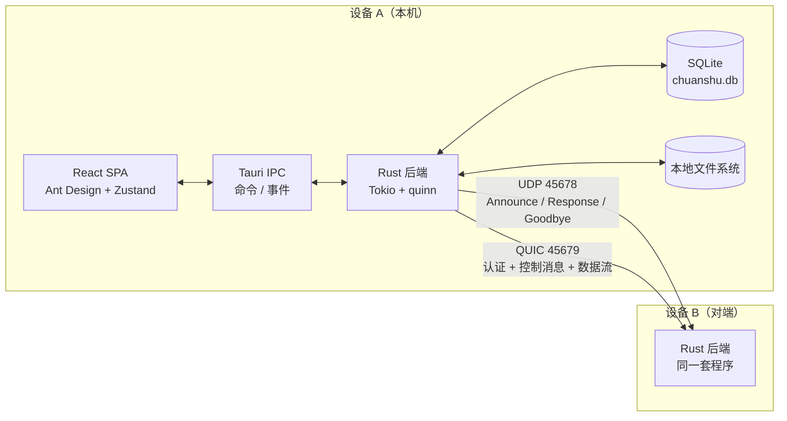
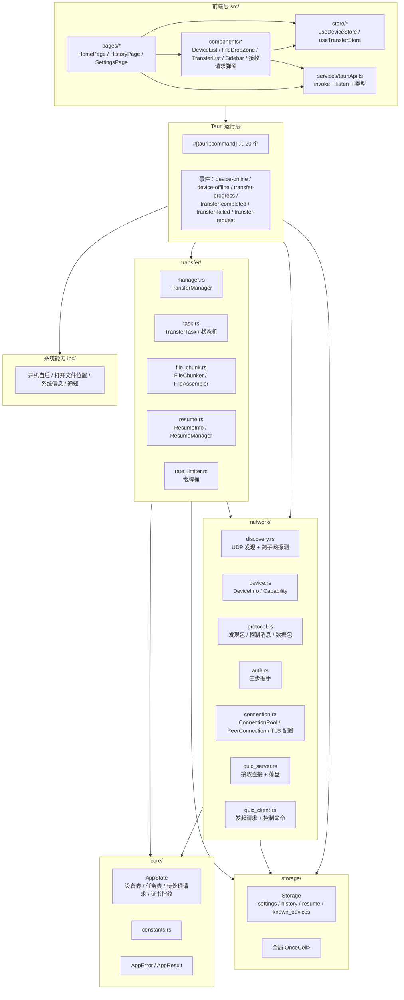
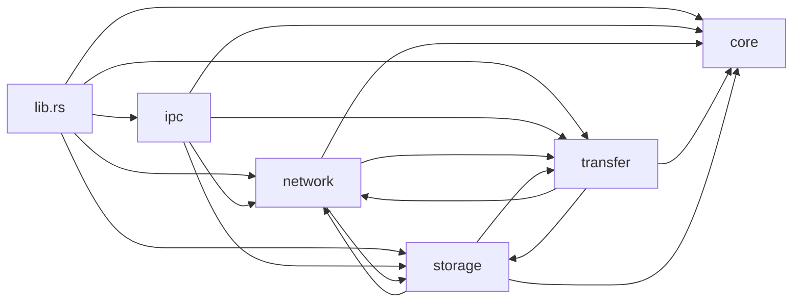
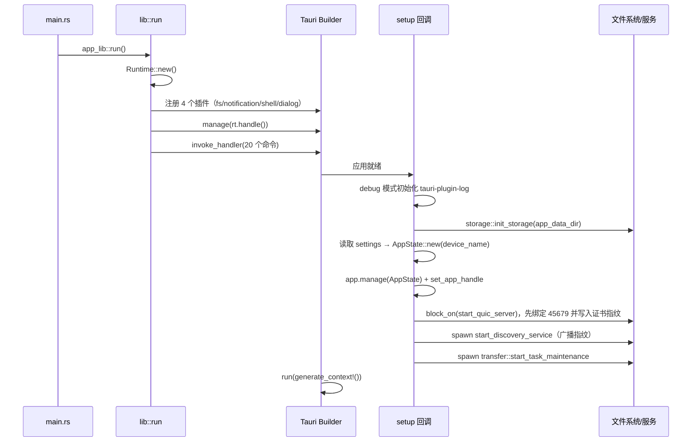

# 01 · 整体架构

## 1. 系统上下文

「传书」是典型的 **Tauri 桌面应用**：前端是运行在系统 WebView 中的 React SPA，后端是同进程内的 Rust 服务。两者通过 **Tauri IPC（`invoke` 命令 + `emit` 事件）** 通信；Rust 侧负责全部网络、文件、数据库与系统集成。

## 2. 分层结构

### 各层职责

| 层 | 目录 | 职责 | 不负责 |
| --- | --- | --- | --- |
| 表现层 | `src/pages`, `src/components` | 渲染、交互、拖拽、弹窗 | 网络、磁盘 |
| 前端状态层 | `src/store` | 设备/任务的本地副本与增量更新 | 持久化 |
| 前端适配层 | `src/services/tauriApi.ts` | 把 IPC 命令与事件包装成类型化函数 | 业务逻辑 |
| IPC 层 | `src-tauri/src/ipc` | 参数校验、调用领域服务、发射事件、系统集成 | 协议细节 |
| 领域层 | `core`, `network`, `transfer`, `storage` | 发现、连接、认证、传输、落盘、持久化 | UI |
| 运行入口 | `lib.rs`, `main.rs` | 组装状态、注册命令、启动后台任务、退出清理 | 具体算法 |

## 3. 模块依赖关系

Rust 侧的编译期依赖（`use` 关系）如下：

需要注意的**循环依赖**：`network::quic_server` 直接创建 `transfer::TransferTask` 并写传输历史，`transfer::manager` 又调用 `network::quic_client`；这是模块边界上的耦合，但不再有 `storage ↔ ipc` 的循环（`Settings` 已迁到 `core::config`）。

## 4. 运行模型与状态所有权

### 4.1 进程与线程

- Tauri 主线程：窗口/事件循环；`on_window_event` 在关闭时阻塞式停止服务。
- **独立 Tokio Runtime**：`lib.rs` 中 `Runtime::new()` 后 `Arc` 持有，并通过 `.manage(rt.handle().clone())` 注入 Tauri，供 IPC 命令取用。后台任务通过 `rt_handle.spawn` 启动。
- 每个 QUIC 入站连接、每条双向流、每次发送任务都是独立 `tokio::spawn` 任务。
- UDP 发现启动 4 个后台循环任务：心跳广播、收包、离线清理、已知设备探测；另有按需的 QUIC 保活连接任务。

### 4.2 全局单例

| 单例 | 位置 | 类型 | 说明 |
| --- | --- | --- | --- |
| `AppState` | `lib.rs` → `app.manage` | `Arc<AppState>` | 所有命令共享，内部全部是 `Arc<DashMap>` / `Arc<Mutex>` |
| `DISCOVERY_SERVICE` | `network/discovery.rs` | `OnceCell<DiscoveryService>` | 发现服务单例 |
| `QUIC_SERVER` | `network/quic_server.rs` | `OnceCell<QuicServer>` | 服务端单例 |
| `CONNECTION_POOL` | `network/connection.rs` | `OnceCell<Arc<ConnectionPool>>` | 全局连接池 |
| `QUIC_CLIENT` | `network/quic_client.rs` | `OnceCell<Arc<QuicClient>>` | 全应用共享的客户端 Endpoint |
| `STORAGE` | `storage/mod.rs` | `OnceCell<Mutex<Storage>>` | SQLite 全局句柄 |

`AppState` 字段（[app_state.rs](../../src-tauri/src/core/app_state.rs)）：

| 字段 | 类型 | 用途 |
| --- | --- | --- |
| `devices` | `Arc<DashMap<Uuid, DeviceInfo>>` | 在线设备内存表 |
| `transfer_tasks` | `Arc<DashMap<Uuid, Arc<Mutex<TransferTask>>>>` | 进行中/近期任务 |
| `device_id` | `Uuid` | 本机 ID，每次进程启动随机生成（**未持久化**） |
| `device_name` | `String` | 本机显示名，启动时从设置读取 |
| `app_handle` | `Arc<Mutex<Option<AppHandle>>>` | 用于后端主动 emit 事件 |
| `pending_transfer_requests` | `DashMap<Uuid, oneshot::Sender<bool>>` | 接收确认弹窗的应答通道 |
| `certificate_fingerprint` | `Arc<Mutex<Option<String>>>` | 本机 QUIC 证书的 SHA-256 |
| `transfer_semaphore` | `Arc<Semaphore>` | 最多 5 个并发发送任务 |

> `AppState` 的证书指纹与 app handle 访问已改为 `async` + `tokio::sync::Mutex`，避免 `blocking_lock()` 在 Tokio 运行时内 panic。

## 5. 启动生命周期

`app_lib::run()`（[lib.rs](../../src-tauri/src/lib.rs)）的执行顺序：

关键点：

1. **存储先于服务**：`init_storage` 在 `app_data_dir` 下创建 `chuanshu.db` 与所有表。
2. **QUIC 先于发现启动**：先绑定 `45679` 并把证书指纹写入 `AppState`，发现服务才能广播指纹。
3. **设备名来自设置**：`AppState` 在 `setup` 中创建，`device_name` 直接使用 SQLite 中的配置值。
4. **后台维护**：每 60 秒清理终态任务与超期断点；进度事件由传输循环直接发送。
5. **退出清理**：`CloseRequested` 时停止 UDP 发现（发送 `Goodbye`）、关闭 QUIC Server 与共享客户端 Endpoint。

## 6. 依赖清单

### 6.1 前端（`package.json`）

| 依赖 | 版本 | 用途 |
| --- | --- | --- |
| `react` / `react-dom` | 19.2.x | UI 框架 |
| `antd` / `@ant-design/icons` | 6.3.x / 6.1.x | 组件库与图标 |
| `zustand` | 5.0.x | 全局状态 |
| `@tauri-apps/api` | 2.10.x | `invoke` / `listen` / `webviewWindow` |
| `@tauri-apps/plugin-dialog` | 2.6.x | 选择下载目录 |
| `@tauri-apps/plugin-notification` / `plugin-shell` | 2.3.x / 2.3.x | 通知与 shell（前端声明） |
| `filesize` | 11.x | 文件大小/速率格式化 |
| `tailwindcss` / `postcss` / `autoprefixer` | 4.2.x / 8.5.x | 样式构建（`index.css` 仅引入 base/components/utilities） |
| `vite` / `typescript` | 7.3.x / 5.9.x | 构建与类型检查 |

### 6.2 后端（`src-tauri/Cargo.toml`）

| 依赖 | 版本 | 用途 |
| --- | --- | --- |
| `tauri` | 2.x | 应用框架；`tauri-plugin-fs/notification/shell/dialog/log` |
| `tokio` | 1.35（full） | 异步运行时、UDP、任务 |
| `quinn` | 0.10 | QUIC 传输 |
| `rustls` / `rcgen` | 0.21 / 0.12 | TLS 与自签名证书生成 |
| `rusqlite` | 0.29（bundled） | SQLite，免系统依赖 |
| `bincode` | 1.3 | 发现包/控制消息/数据包二进制序列化 |
| `serde` / `serde_json` | 1.x | 结构体序列化、设置/元数据 JSON |
| `dashmap` | 5.5 | 并发 map（设备表、任务表） |
| `socket2` / `if-addrs` | 0.5 / 0.10 | 广播 socket、网卡枚举 |
| `walkdir` | 2.4 | 递归收集文件夹 |
| `crc32fast` / `sha2` | 1.3 / 0.10 | 分片 CRC32、整文件 SHA-256 |
| `once_cell` / `uuid` / `thiserror` / `rand` | — | 单例、ID、错误、nonce |

> 已移除未使用依赖：`memmap2`、`bitvec`、`xxhash-rust`、`confy`、`anyhow`、`tracing`、`tracing-subscriber`、`chrono`、`filetime`、`bytes`、`tokio-util`、`futures`、`rustls-pemfile`。

## 7. 架构决策记录（从代码反推）

| 决策 | 体现 | 影响 |
| --- | --- | --- |
| 用 UDP 广播而非 mDNS | `discovery.rs` 自己序列化 `DiscoveryPacket` | 无外部依赖、可跨平台；但需要处理多网卡与防火墙 |
| 用 QUIC 而非 TCP/HTTP | `quinn` + 自签名证书 + 指纹固定 | 多路复用、内建加密；首次发现为 TOFU |
| 控制与数据分流 | 第一流认证，后续流按消息类型分发 | 同一连接可并行多任务；但服务端需按 `task_id` 找回任务 |
| 二进制 bincode 而非 JSON | `protocol.rs` 全部 `bincode` | 体积小、解析快；无 schema 演进能力，升级需同步改 `PROTOCOL_VERSION` |
| SQLite 存设置键值对 | `settings(key, value)` | 改动设置项无需迁移表结构；代价是类型都退化为字符串 |
| Zustand 而非 Redux | `useDeviceStore` / `useTransferStore` | 轻量；状态以事件驱动，避免轮询 |

## 8. 一次完整传输涉及的模块

```mermaid
flowchart LR
  A["DeviceList 选设备"] --> B["FileDropZone 收集路径"]
  B --> C["tauriApi.sendFiles"]
  C --> D["ipc::send_files"]
  D --> E["TransferManager::send_files"]
  E --> F["collect_files → FileMetadata"]
  E --> G["initiate_transfer"]
  G --> H["quic_client::request_transfer"]
  H --> I["ConnectionPool 复用/新建 + 认证"]
  H --> J["对端 quic_server::handle_transfer_request"]
  J --> K{"auto_accept?"}
  K -- 否 --> L["emit transfer-request → 前端弹窗"]
  L --> M["accept/reject → oneshot"]
  K -- 是 --> N["接受"]
  M --> O["TransferResponse"]
  N --> O
  O --> P["发送端 DataTransferStart"]
  P --> Q["接收端计算 missing_chunks → DataTransferReady"]
  Q --> R["send_files_data 分块发送"]
  R --> S["接收端 receive_files 落盘 + CRC 校验"]
  S --> T["写历史 / 断点清理"]
  R --> U["progress 事件 → TransferList"]
```

各环节细节见 [05-transfer-pipeline.md](./05-transfer-pipeline.md) 与 [07-protocol-and-flows.md](./07-protocol-and-flows.md)。
