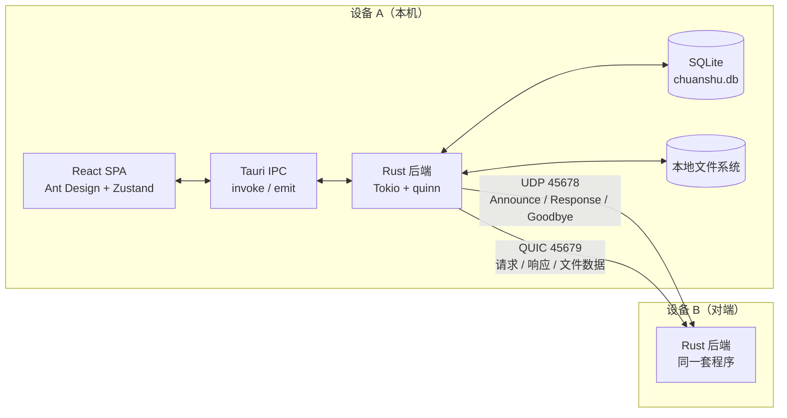
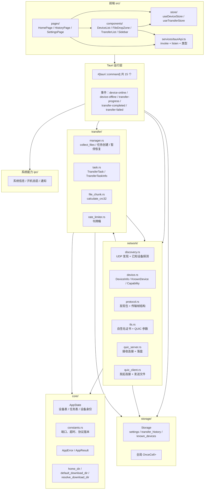
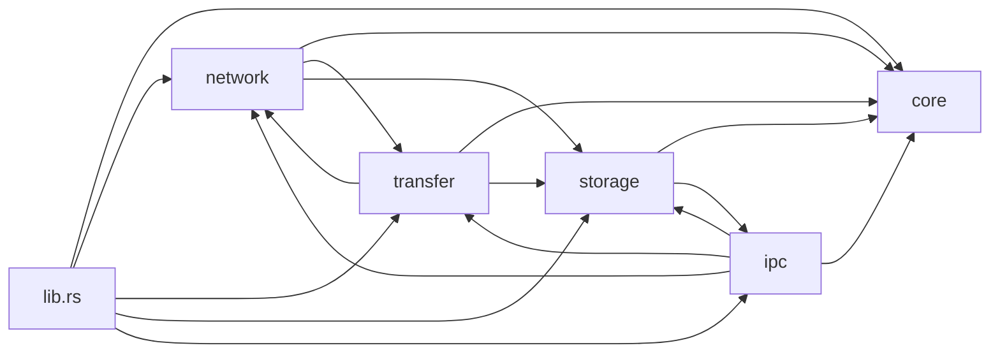
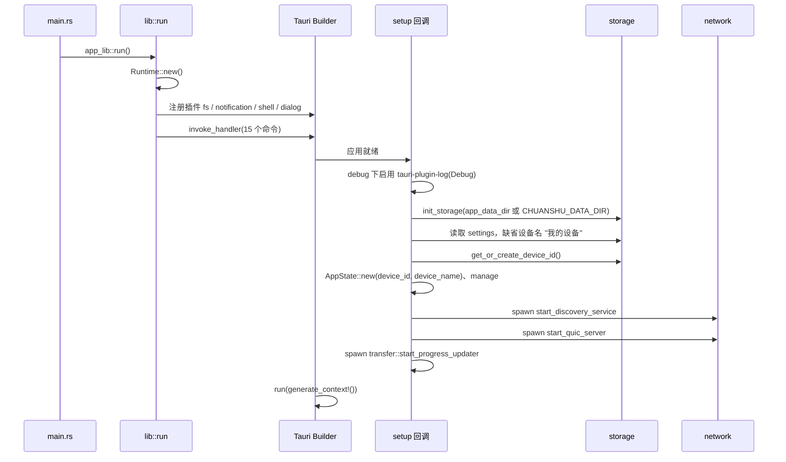

# 01 · 整体架构

## 1. 系统上下文

「传书」是 Tauri 2 桌面应用：前端 React SPA 运行在系统 WebView 中，后端是同一进程内的 Rust 服务。两者通过 **Tauri IPC** 通信——前端 `invoke` 调用命令，后端 `emit` 推送事件。Rust 侧独占网络、文件、SQLite 与系统集成能力。

两台设备的地位对等：都启动 UDP 发现与 QUIC 服务端，任意一方都可以发起传输。没有中心服务器，也没有账号或配对流程。

## 2. 分层结构

### 各层职责

| 层 | 目录 | 职责 | 不负责 |
| --- | --- | --- | --- |
| 表现层 | `src/pages`, `src/components` | 渲染、拖拽、弹窗、交互反馈 | 网络、磁盘 |
| 前端状态层 | `src/store` | 设备/任务的本地副本与增量更新 | 持久化 |
| 前端适配层 | `src/services/tauriApi.ts` | 把命令与事件包装成类型化函数，做 MB/s ↔ B/s 换算 | 业务逻辑 |
| IPC 层 | `src-tauri/src/ipc` | 参数解析、调用领域函数、发射事件、通知、系统能力 | 协议细节 |
| 领域层 | `core`, `network`, `transfer`, `storage` | 发现、连接、传输、落盘、持久化 | UI |
| 运行入口 | `lib.rs`, `main.rs` | 组装状态、注册命令、启动后台任务、退出清理 | 具体算法 |

## 3. 模块依赖

真实存在的耦合点：

- `network::quic_server` 直接构造 `transfer::TransferTask`，并在结束时写 `storage` 历史、调用 `ipc::emit_transfer_completed` / `emit_transfer_failed`。
- `transfer::manager` 调用 `network::quic_client::send_transfer`，并复用 `network::protocol` 的结构。
- `storage` 依赖 `ipc::Settings` 类型（`use crate::ipc::Settings`），因此 `storage → ipc` 是编译期依赖；`ipc` 又依赖 `storage`，形成互引，但通过同一 crate 内的模块引用可以编译。
- 设备模型 `DeviceInfo` / `KnownDevice` 定义在 `network::device`，`storage` 直接引用它们。

模块划分只到目录级别，没有单独的 crate，因此这些交叉引用不影响构建。

## 4. 运行模型与状态所有权

### 4.1 进程与线程

- Tauri 主线程负责窗口与事件循环。
- `lib.rs` 中创建**独立 Tokio Runtime**（`Runtime::new()`），以 `Arc` 持有；除退出清理外，后台任务都通过它的 handle `spawn`。
- 每个入站 QUIC 连接由 `quic_server` 单独 `tokio::spawn`；每次出站传输由 `transfer::manager` 单独 `tokio::spawn`。
- UDP 发现内部再起 4 个循环任务：心跳广播、收包处理、离线清理、已知设备探测。
- 另有 1 个全局进度任务 `start_progress_updater`，每 500 ms 扫描一次任务表。

### 4.2 全局单例

| 单例 | 位置 | 类型 | 说明 |
| --- | --- | --- | --- |
| `AppState` | `lib.rs` → `app.manage` | `Arc<AppState>` | 所有命令与后台任务共享 |
| `DISCOVERY_SERVICE` | `network/discovery.rs` | `OnceCell<DiscoveryService>` | 发现服务，含 `running` 开关 |
| `QUIC_SERVER` | `network/quic_server.rs` | `OnceCell<QuicServer>` | 服务端端点 |
| `STORAGE` | `storage/mod.rs` | `OnceCell<Mutex<Storage>>` | SQLite 全局句柄 |

`AppState` 字段（`src-tauri/src/core/app_state.rs`）：

| 字段 | 类型 | 用途 |
| --- | --- | --- |
| `devices` | `Arc<DashMap<Uuid, DeviceInfo>>` | 在线设备内存表 |
| `transfer_tasks` | `Arc<DashMap<Uuid, Arc<AsyncMutex<TransferTask>>>>` | 本次进程内创建的全部任务 |
| `device_id` | `Uuid` | 本机 ID，首次启动生成并写入 SQLite `settings.device_id` |
| `device_name` | `Arc<RwLock<String>>` | 设备名，保存设置时即时更新，心跳读取最新值 |
| `app_handle` | `Arc<Mutex<Option<AppHandle>>>` | 后端主动 emit 事件的句柄 |

`AppState` 提供 `device_name()` / `set_device_name()`、`set_app_handle()` / `get_app_handle()`、`emit()` / `emit_async()`。`emit()` 在句柄缺失时静默成功，仅序列化失败会返回错误。

### 4.3 锁与并发边界

- 设备表、任务表使用 `DashMap`，读多写少，避免全局锁。
- 单个任务用 `tokio::sync::Mutex`，进度更新、状态切换都需短暂加锁；接收端与发送端可能同时持锁，因此持锁期间不做 I/O。
- SQLite 用 `std::sync::Mutex<Storage>` 同步访问，在 async 上下文中直接调用，属于已知的阻塞点。

## 5. 启动生命周期

关键点：

1. **存储先于一切**：`init_storage` 建库建表；失败只记录错误，后续 `get_storage()` 返回 `None`，多数命令随之报“Storage not initialized”。
2. **设备身份先就绪**：`device_id` 来自 SQLite，设备名来自 `settings.device_name`，空白则回退 `"我的设备"`。
3. **发现与 QUIC 并行启动**：两者都在 setup 中用 `rt_handle.spawn` 拉起，互不等待；发现包中的 `quic_port` 固定使用 `QUIC_DEFAULT_PORT`，不读取服务端实际端口。
4. **无额外维护任务**：没有任务清理循环，任务只在进程结束时消失。
5. **托盘常驻**：`setup` 创建系统托盘（显示主窗口 / 退出）；`CloseRequested` 默认只隐藏窗口、服务继续运行，仅当 `minimize_to_tray=false` 或托盘选「退出」时才阻塞式 `stop_discovery_service()`（广播 `Goodbye`）并 `stop_quic_server()`。
6. **接收提示**：QUIC 服务接受传输后调用 `emit_incoming_transfer`，同时发 `incoming-transfer` 事件与系统通知。

## 6. 架构取舍

| 选择 | 体现 | 影响 |
| --- | --- | --- |
| 用 UDP 广播而非 mDNS | `discovery.rs` 自行序列化 `DiscoveryPacket` | 无外部依赖；需处理多网卡、防火墙与端口占用 |
| 用 QUIC 而非 TCP | `quinn` + 自签名证书 | 内建加密与多路复用；但客户端不校验证书，安全性依赖局域网信任 |
| 一次传输一条连接 | `quic_client::send_transfer` 每次新建 `Endpoint` | 实现简单、任务隔离；无法复用连接，握手开销随任务数增长 |
| 二进制 bincode | `protocol.rs` 全部使用 `bincode` | 体积小、解析快；没有字段演进能力，只能靠版本号强校验 |
| Zustand + 轮询兜底 | `DeviceList` 5 s、`TransferList` 2 s | 实现简单；事件与轮询双通道存在冗余 |
| 无任务清理 | `transfer_tasks` 只增不减 | 状态查询简单；长时间运行内存缓慢增长 |

发送、接收与帧格式的完整链路见 [05-transfer-pipeline.md](./05-transfer-pipeline.md) 与 [07-protocol-and-flows.md](./07-protocol-and-flows.md)。
