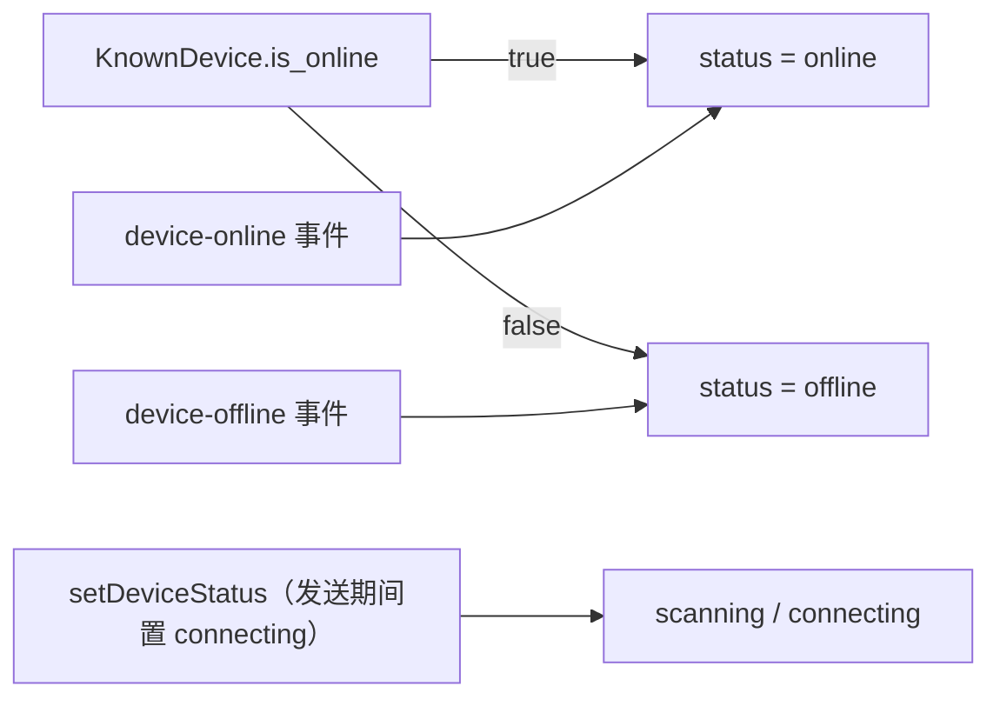
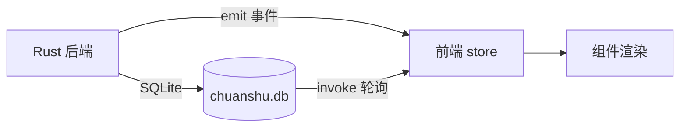

# 02 · 前端模块

## 1. 入口与根组件

### `src/main.tsx`

```tsx
ReactDOM.createRoot(document.getElementById('root')!).render(
  <React.StrictMode><App /></React.StrictMode>
)
```

标准 Vite + React 挂载；`index.html` 提供 `#root`，`src/index.css` 做 Tailwind 引入与全局重置。

### `src/App.tsx`

职责：

1. 维护当前页面（`'home' | 'history' | 'settings'`），**没有路由库**，用 `useState` 切换。
2. 加载并应用主题：
   - 启动时 `getSettings()` → `applyTheme(theme)`；
   - 监听系统 `prefers-color-scheme` 变化；
   - 监听 `window` 的 `theme-change` 自定义事件（由 `SettingsPage` 派发）；
   - 页面切换时重新读取设置。
3. 用 Ant Design `ConfigProvider`（`zhCN` 语言包、主色 `#1890ff`、`borderRadius: 6`）切换 `darkAlgorithm` / `defaultAlgorithm`。
4. 布局：左侧 `Sider`（200px）放 `Sidebar`，右侧 `Content` 按页渲染；全局挂载 `IncomingTransferRequestModal`。

主题有两个通道：

| 通道 | 作用 |
| --- | --- |
| React state `currentTheme` | 决定 antd 算法与 Layout 背景色 |
| `document.documentElement` 的 `data-theme` + `color-scheme` | 由 `SettingsPage.applyTheme` 设置并写入 `localStorage`；当前 `index.css` 没有深色规则，主要影响原生控件配色 |

## 2. 页面

| 页面 | 文件 | 职责 | 关键交互 |
| --- | --- | --- | --- |
| 文件传输 | [HomePage.tsx](../../src/pages/HomePage.tsx) | 左右分栏：设备列表（350px）+ 拖拽区 + 传输列表 | `selectedDeviceId` 通过 `useState` 传给子组件 |
| 传输历史 | [HistoryPage.tsx](../../src/pages/HistoryPage.tsx) | 分页表格展示 `get_transfer_history` 结果 | 打开文件位置、重新发送、清空历史 |
| 设置 | [SettingsPage.tsx](../../src/pages/SettingsPage.tsx) | 表单：设备名、下载路径、自启、自动接收、限速、通知、主题 | 目录选择走 `@tauri-apps/plugin-dialog`；保存走 `save_settings` |

### HistoryPage 细节

- `convertToTableItem` 把后端 `TransferHistoryEntry` 映射为表格模型：状态 `completed/failed/canceled` → `success/failed/canceled`；时间戳按 `zh-CN` 格式化。
- `sourcePathsFor` 解析 `source_path`：后端存的是 JSON 数组字符串，解析失败则按单路径处理。
- `handleOpenLocation`：优先 `destination_path`，否则 `source_path[0]`，调用 `open_file_location`。
- `handleResend`：仅 `type === 'send'` 可点；调用 `resend_files(peer_device_id, filePaths)`。
- 列定义是模块级常量，通过 `columnsWithHandlers` 在渲染时注入操作按钮。

### SettingsPage 细节

- 表单值来自 `get_settings()`；`Form.useWatch` 监听 `theme` 与 `device_name`/`download_path` 以受控更新。
- 限速滑块的**单位是 MB/s**（0–100，0 表示不限），后端通过 `Settings::upload_bytes_per_sec` / `download_bytes_per_sec` 转为字节/秒（见 [05-transfer-pipeline.md](./05-transfer-pipeline.md#5-限速rate_limiterrs)）。
- 系统信息与自启状态分别来自 `get_system_info()`、`get_auto_launch()`。
- 「重置」按钮实际是重新 `loadSettings()`，不是恢复默认值。

## 3. 组件

### 3.1 `Sidebar`

纯展示。菜单项固定三项（文件传输 / 传输历史 / 设置），`onClick` 把 key 作为页面名回传。

### 3.2 `DeviceList`

文件：[DeviceList.tsx](../../src/components/device/DeviceList.tsx)

职责：

- 挂载时 `getKnownDevices()` → `useDeviceStore.loadKnownDevices()`（**已知设备包含离线设备**）。
- 订阅 `device-online` / `device-offline` 事件增量更新 store；不再轮询，首次挂载时加载已知设备。
- IP 输入框 + 「发现」按钮调用 `discoverDeviceByIp(ip)`，3 秒超时，返回 `null` 视为未发现。
- 渲染四态：
  - 颜色/文案来自 `DEVICE_STATUS_COLORS` / `DEVICE_STATUS_LABELS`；
  - `scanning` 仅在空状态提示中出现（`SyncOutlined spin`）；
  - `connecting` 由 `FileDropZone` 在发送期间设置，发送结束（无论成功或失败）恢复为 `online`；
  - 离线设备透明度 0.6 且不可点击。

设备状态取值链路：



### 3.3 `FileDropZone`

文件：[FileDropZone.tsx](../../src/components/transfer/FileDropZone.tsx)

职责：

- 通过 Tauri v2 `getCurrentWebviewWindow().onDragDropEvent()` 接收系统级拖拽；`payload.type === 'drop'` 时把 `paths` 加入本地 `fileList`。
- 同时保留 DOM `dragover/enter/leave` 仅用于视觉高亮。
- 未选设备时拒绝添加文件并提示。
- 「发送」先弹出确认 `Modal`（最多展示 5 个文件），确认后 `sendFiles([selectedDeviceId], paths)`。
- 发送成功后清空列表。

> 拖拽事件监听在 `useEffect` 中注册，并在组件卸载时通过 `disposed` 标志与保存的 `unlisten` 正确释放。

### 3.4 `TransferList`

文件：[TransferList.tsx](../../src/components/transfer/TransferList.tsx)

职责：

- 挂载时 `getTransferTasks()` → `useTransferStore.setTasks`；
- 订阅 `transfer-progress`（更新进度/速度/已传字节）、`transfer-completed`、`transfer-failed`；发送与接收端都会发出完成/失败事件，因此无需轮询。
- 操作：暂停、恢复、取消；已完成且 `save_path` 存在的接收任务显示「打开位置」按钮，点击调用 `openFileLocation`。

状态文案映射：`Pending 等待中 / Transferring 传输中 / Paused 已暂停 / Completed 已完成 / Failed 失败 / Canceled 已取消`。

### 3.5 `IncomingTransferRequestModal`

文件：[IncomingTransferRequestModal.tsx](../../src/components/transfer/IncomingTransferRequestModal.tsx)

- 订阅 `transfer-request`，保存请求到本地 state；
- 弹窗展示发送设备、文件数、总大小、前 8 个文件；
- 「接受」→ `accept_transfer_request(task_id)`；「拒绝」→ `reject_transfer_request(task_id)`；
- `maskClosable=false`，必须显式选择。

## 4. 状态管理（Zustand）

### `useDeviceStore`

文件：[useDeviceStore.ts](../../src/store/useDeviceStore.ts)

```ts
interface DeviceWithStatus extends DeviceInfo {
  is_online: boolean
  status: DeviceStatus   // 'scanning' | 'connecting' | 'online' | 'offline'
  last_connected?: number | null
}
```

| Action | 行为 |
| --- | --- |
| `setDevices` | 整体替换 |
| `addDevice` | 存在则替换，不存在则追加 |
| `removeDevice` | 移除；若为当前选中则清空选中 |
| `updateDevice` | 按 `device_id` 替换 |
| `selectDevice` | 设置选中 |
| `loadKnownDevices` | `KnownDevice[]` → `DeviceWithStatus[]`；解析 `capabilities` JSON；排序：在线优先，其次 `last_connected || last_seen` 倒序 |
| `setDeviceOnline` | 存在则合并字段并置 `online`；不存在则追加 |
| `setDeviceOffline` | 置 `is_online=false`、`status='offline'` |
| `setDeviceStatus` | 只改 `status`（当前无调用方） |

> `selectedDeviceId` 存在于 store，但 `HomePage` 另有一份 `useState` 选中态；实际选中以 HomePage 的为准。

### `useTransferStore`

文件：[useTransferStore.ts](../../src/store/useTransferStore.ts)

| Action | 行为 |
| --- | --- |
| `setTasks` | 整体替换（后端已按 `created_at` 倒序） |
| `addTask` | 去重后插到头部 |
| `updateTask` | 按 `task_id` 替换整条 |
| `removeTask` | 过滤 |
| `updateTaskProgress` | 只更新 `progress/speed/transferred_size` |
| `setTaskStatus` | 只更新 `status` |

## 5. IPC 封装层

文件：[tauriApi.ts](../../src/services/tauriApi.ts)

该文件是前端与 Rust 之间的**唯一契约点**，包含三部分：

### 5.1 类型定义

- `DeviceInfo`、`KnownDevice`、`DeviceStatus`、`TransferTaskInfo`、`IncomingTransferRequest`、`Settings`、`TransferHistoryEntry`、`SystemInfo`。
- 状态颜色/文案常量：`DEVICE_STATUS_COLORS`、`DEVICE_STATUS_LABELS`。

Rust ↔ TypeScript 的类型映射见 [09-reference.md](./09-reference.md#2-rust--typescript-类型映射)。

### 5.2 命令包装

| 函数 | 调用的命令 | 参数（前端 → Rust） |
| --- | --- | --- |
| `getDeviceList()` | `get_device_list` | — |
| `discoverDeviceByIp(ip)` | `discover_device_by_ip` | `{ ip }` |
| `getTransferTasks()` | `get_transfer_tasks` | — |
| `sendFiles(deviceIds, filePaths)` | `send_files` | `{ request: { device_ids, file_paths } }` |
| `cancelTransfer(taskId)` | `cancel_transfer` | `{ taskId }` |
| `pauseTransfer(taskId)` | `pause_transfer` | `{ taskId }` |
| `resumeTransfer(taskId)` | `resume_transfer` | `{ taskId }` |
| `acceptTransferRequest(taskId)` | `accept_transfer_request` | `{ taskId }` |
| `rejectTransferRequest(taskId)` | `reject_transfer_request` | `{ taskId }` |
| `getSettings()` / `saveSettings(settings)` | `get_settings` / `save_settings` | — / `{ settings }` |
| `getTransferHistory(query)` | `get_transfer_history` | `{ query: { limit, offset } }` |
| `clearTransferHistory()` | `clear_transfer_history` | — |
| `getKnownDevices()` | `get_known_devices` | — |
| `deleteKnownDevice(deviceId)` | `delete_known_device` | `{ deviceId }` |
| `getSystemInfo()` | `get_system_info` | — |
| `setAutoLaunch(enabled)` / `getAutoLaunch()` | `set_auto_launch` / `get_auto_launch` | `{ enabled }` / — |
| `openFileLocation(filePath)` | `open_file_location` | `{ filePath }` |
| `resendFiles(deviceId, filePaths)` | `resend_files` | `{ deviceIds: [deviceId], filePaths }` |

> Tauri 2 默认把 Rust 的 `snake_case` 参数在 JS 侧映射为 **camelCase**（`task_id` → `taskId`）。新增命令时务必按此约定传参，否则会报缺参。

### 5.3 事件订阅

| 函数 | 事件名 | 载荷 |
| --- | --- | --- |
| `onDeviceOnline` | `device-online` | `DeviceInfo` |
| `onDeviceOffline` | `device-offline` | `device_id: string` |
| `onTransferProgress` | `transfer-progress` | `TransferTaskInfo` |
| `onTransferCompleted` | `transfer-completed` | `task_id: string` |
| `onTransferFailed` | `transfer-failed` | `{ task_id, error }` |
| `onTransferRequest` | `transfer-request` | `IncomingTransferRequest` |


## 6. 数据流与刷新策略



| 数据 | 实时通道 | 兜底 |
| --- | --- | --- |
| 设备列表 | `device-online` / `device-offline` | 手动刷新 / 手动 IP 发现后重载 |
| 传输任务 | `transfer-progress` / `transfer-completed` / `transfer-failed` | 进入页面时加载一次 |
| 设置 | 无 | 进入页面时加载 |
| 历史 | 无 | 进入页面时加载 |

## 7. 样式与设计约束

- 设计系统以 [DESIGN.md](../../DESIGN.md) 为准：Industrial/Utilitarian、系统字体栈、字号 12/14/16/20、间距 4/8/12/16/24/32、卡片圆角 8、按钮 4、过渡 200ms。
- 组件大量使用内联样式而非 Tailwind class；Tailwind 仅提供基础重置与工具类能力。
- 设备四态颜色是硬约束：扫描 `#9CA3AF`、连接中 `#F59E0B`、在线 `#10B981`、离线 `#6B7280`。
- 深色模式在 antd 层已生效（`darkAlgorithm`），但 `index.css` 没有 `data-theme="dark"` 的补充规则，部分写死颜色（如 `#fff`、`#f5f5f5`）不会跟随。
