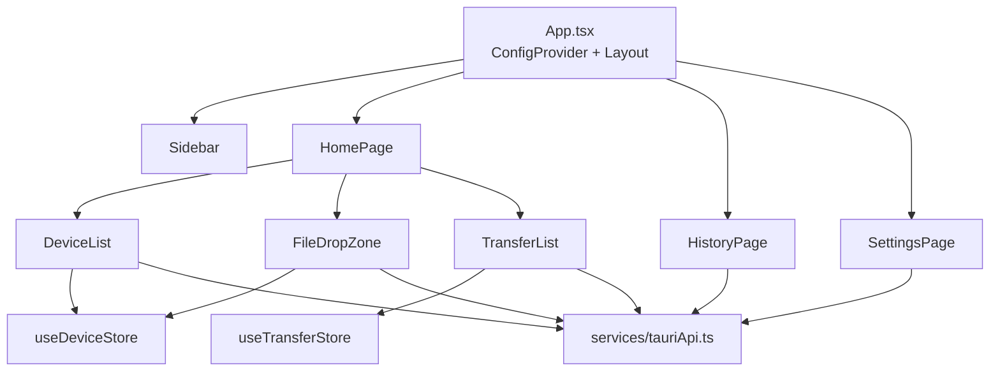

# 02 · 前端

前端位于 `src/`，技术栈为 React 19 + TypeScript + Ant Design 6 + Zustand 5，构建工具是 Vite 7。没有任何路由库，页面切换由 `App.tsx` 的本地状态控制。

## 1. 入口与骨架

- `src/main.tsx`：`ReactDOM.createRoot(...).render(<App />)`，引入 `index.css`。
- `src/index.css`：三条 Tailwind 指令（`@tailwind base/components/utilities`）+ 全局重置；`#root` 固定 `100vw × 100vh` 且 `overflow: hidden`。
- `src/App.tsx`：
  - `ConfigProvider` 使用 `zhCN` 语言包，主色 `#1890ff`，圆角 `6`。
  - 主题算法在 `theme.darkAlgorithm` 与 `theme.defaultAlgorithm` 间切换；`Sider` 宽度 200。
  - 页面枚举 `type Page = 'home' | 'history' | 'settings'`，由 `Sidebar` 的菜单回调修改。
  - 启动时调用 `getSettings()` 读取 `theme`；`auto` 时用 `matchMedia('(prefers-color-scheme: dark)')` 跟随系统。
  - 监听自定义 DOM 事件 `theme-change`（由 `SettingsPage` 派发），并订阅系统主题变化。
  - 每次切换页面会重新拉取设置以刷新主题。

## 2. 页面

### HomePage

`src/pages/HomePage.tsx`：左侧 350px 卡片放 `DeviceList`，右侧上方 `FileDropZone`、下方 `TransferList`。`selectedDeviceId` 是页面本地状态，由设备列表点击设置，传给拖拽区作为发送目标。

### HistoryPage

`src/pages/HistoryPage.tsx`：

- 挂载时调用 `getTransferHistory({ limit: 100, offset: 0 })`。
- 表格列：文件名、大小、类型（发送/接收）、状态、设备、时间；`pageSize` 20。
- 状态映射：`completed → 成功`、`failed → 失败`、`canceled → 已取消`，其他值显示为“已取消”（`statusMap[entry.status] || 'canceled'`）。
- “清空历史”先 `Modal.confirm`，确认后调用 `clearTransferHistory()` 并刷新。

### SettingsPage

`src/pages/SettingsPage.tsx` 是一个 Ant Design `Form`：

| 字段 | 控件 | 说明 |
| --- | --- | --- |
| `device_name` | Input | 必填；保存后后端立即更新内存设备名 |
| `download_path` | Input + 浏览按钮 | 调用 `@tauri-apps/plugin-dialog` 的 `open({ directory: true })` |
| 开机自启 | Switch | `getAutoLaunch()` / `setAutoLaunch()`，不属于表单提交 |
| 系统信息、本机设备 ID | 只读 Input | `getSystemInfo()` / `getLocalDeviceInfo()` |
| `auto_accept` | Switch | 默认 `true` |
| `upload_limit` / `download_limit` | Slider 0–100 | 单位 MB/s，0 表示不限速 |
| `enable_notification` | Switch | 控制后端通知 |
| `theme` | Select | `auto` / `light` / `dark` |

主题切换通过 `applyTheme()` 设置 `document.documentElement` 的 `data-theme`、`color-scheme`、`localStorage.theme`，并 `dispatchEvent(new CustomEvent('theme-change'))`。页面底部还展示了“快捷键”等提示文本，但这些快捷键**并未在代码中绑定**。

## 3. 组件

### DeviceList

`src/components/device/DeviceList.tsx`：

- 挂载时 `getKnownDevices()` 拉取全部已知设备（含离线），通过 `loadKnownDevices()` 合并进 store；此后每 5 秒轮询一次作为兜底。
- 订阅 `device-online` / `device-offline` 事件实时更新状态；清理时取消订阅并清除定时器。
- 顶部提供 IP 输入框，调用 `discoverDeviceByIp(ip)`，3 秒内无响应返回 `null`，前端用 message 提示。
- 在线设备可点击选中，离线设备点击无效且整体透明度 0.6。
- 状态颜色/文案取自 `tauriApi.ts` 的常量：

| 状态 | 颜色 | 文案 |
| --- | --- | --- |
| `scanning` | `#9CA3AF` | 扫描中 |
| `connecting` | `#F59E0B` | 连接中 |
| `online` | `#10B981` | 在线 |
| `offline` | `#6B7280` | 离线 |

`connecting` / `scanning` 目前没有代码路径会写入，界面通常只出现“在线/离线”。

### FileDropZone

`src/components/transfer/FileDropZone.tsx`：

- 使用 Tauri v2 的 `getCurrentWebviewWindow().onDragDropEvent()` 接收 `type === 'drop'` 的 `paths`，未选设备时直接报错。
- 文件项只记录 `name` 与 `path`，不读取大小；支持同一批追加多个路径。
- 点击“发送”先弹确认框，确认后调用 `sendFiles([selectedDeviceId], filePaths)`，成功后清空列表。
- 注意：`useEffect` 调用 `setupDragDrop()` 后没有返回/执行 unlisten，设备选择变化导致回调重建时会重复注册拖拽监听。

### TransferList

`src/components/transfer/TransferList.tsx`：

- 挂载时 `getTransferTasks()`，随后每 2 秒轮询；同时订阅 `transfer-progress`、`transfer-completed`、`transfer-failed`。
- 进度事件直接更新 store 里的 `progress`、`speed`、`transferred_size`；完成/失败事件修改状态并重新拉取列表。
- 操作按钮：`Transferring` 显示暂停，`Paused` 显示继续；非 `Completed`/`Canceled` 显示取消。
- 速度用 `filesize(bytesPerSecond, { base: 2 })` 格式化，后端 `speed` 已是字节/秒。

### Sidebar

`src/components/layout/Sidebar.tsx`：固定三项菜单（文件传输、传输历史、设置），`Menu` 受控选中当前页。

## 4. 状态管理

### useDeviceStore

`src/store/useDeviceStore.ts` 定义 `DeviceWithStatus extends DeviceInfo`，额外含 `is_online`、`status`、`last_connected`。

| 方法 | 行为 |
| --- | --- |
| `setDevices` | 整体替换 |
| `addDevice` / `updateDevice` | 按 `device_id` 替换或追加 |
| `removeDevice` | 按 ID 过滤 |
| `loadKnownDevices` | 把 `KnownDevice` 映射为 `DeviceWithStatus`，`capabilities` 是 JSON 字符串，解析失败回退 `[]`；在线优先，其次按 `last_connected ?? last_seen` 降序 |
| `setDeviceOnline` | 已存在则合并并置 `online`；不存在则追加，`last_connected` 取当前时间（秒） |
| `setDeviceOffline` | 置 `is_online=false`、`status='offline'`，**不移除** |

### useTransferStore

`src/store/useTransferStore.ts` 只保存 `tasks`、`isLoading`、`error`，提供 `setTasks`、`updateTaskProgress`、`setTaskStatus`。所有网络请求仍由组件发起，store 不封装异步逻辑。

## 5. tauriApi 封装

`src/services/tauriApi.ts` 是前端唯一与后端交互的出口，导出 15 个函数，与后端 15 个命令一一对应：

| 函数 | 命令 | 参数映射 |
| --- | --- | --- |
| `discoverDeviceByIp(ip)` | `discover_device_by_ip` | `{ ip }` |
| `getTransferTasks()` | `get_transfer_tasks` | — |
| `sendFiles(deviceIds, filePaths)` | `send_files` | `{ request: { device_ids, file_paths } }` |
| `cancelTransfer(taskId)` | `cancel_transfer` | `{ taskId }` |
| `pauseTransfer(taskId)` | `pause_transfer` | `{ taskId }` |
| `resumeTransfer(taskId)` | `resume_transfer` | `{ taskId }` |
| `getSettings()` | `get_settings` | 返回值把两个限速字段除以 `1024*1024` |
| `saveSettings(settings)` | `save_settings` | 提交前把限速字段乘 `1024*1024` |
| `getTransferHistory(query)` | `get_transfer_history` | `{ query: { limit, offset } }` |
| `clearTransferHistory()` | `clear_transfer_history` | — |
| `getKnownDevices()` | `get_known_devices` | — |
| `getLocalDeviceInfo()` | `get_local_device_info` | — |
| `getSystemInfo()` | `get_system_info` | — |
| `setAutoLaunch(enabled)` | `set_auto_launch` | `{ enabled }` |
| `getAutoLaunch()` | `get_auto_launch` | — |

**单位换算只在这里做一次**：后端 `Settings.upload_limit` / `download_limit` 始终是字节/秒，前端界面与 API 类型是 MB/s。其它模块不得重复换算。

文件内还定义了 `DeviceInfo`、`KnownDevice`、`TransferTaskInfo`、`Settings`、`TransferHistoryEntry`、`SystemInfo`、`LocalDeviceInfo` 等 TypeScript 类型，字段名与 Rust 序列化结果保持 snake_case 一致。

## 6. 事件订阅与轮询

`tauriApi.ts` 导出 5 个订阅函数：

| 函数 | 事件名 | 载荷 |
| --- | --- | --- |
| `onDeviceOnline` | `device-online` | `DeviceInfo` |
| `onDeviceOffline` | `device-offline` | 设备 ID 字符串（UUID） |
| `onTransferProgress` | `transfer-progress` | `TransferTaskInfo` |
| `onTransferCompleted` | `transfer-completed` | `taskId` 字符串 |
| `onTransferFailed` | `transfer-failed` | `{ taskId, error }` |
| `onIncomingTransfer` | `incoming-transfer` | `{ task_id, sender_name, file_count, total_size }` |

轮询作为兜底同时存在：设备列表 5 秒、任务列表 2 秒。事件与轮询都直接反映后端内存状态，没有本地乐观更新。

## 7. 前后端契约注意事项

- 所有命令返回 `AppError` 时，前端拿到的是其 `Display` 字符串（`AppError` 手写实现了 `Serialize`）。
- 命令参数名遵循 Tauri 的默认转换：Rust 的 `task_id` 在前端写作 `taskId`；`SendFilesRequest` 作为结构体放入 `request`，内部字段保持 `device_ids` / `file_paths`。
- `TransferTaskInfo.created_at` 是 Unix 秒（`u64`）；`TransferHistoryEntry.created_at` 是 SQLite 的 Unix 秒（`i64`），两者都需乘 1000 再交给 `Date`。
- `KnownDevice.capabilities` 是**二次编码的 JSON 字符串**，不是数组；在线设备的 `DeviceInfo.capabilities` 才是数组。
