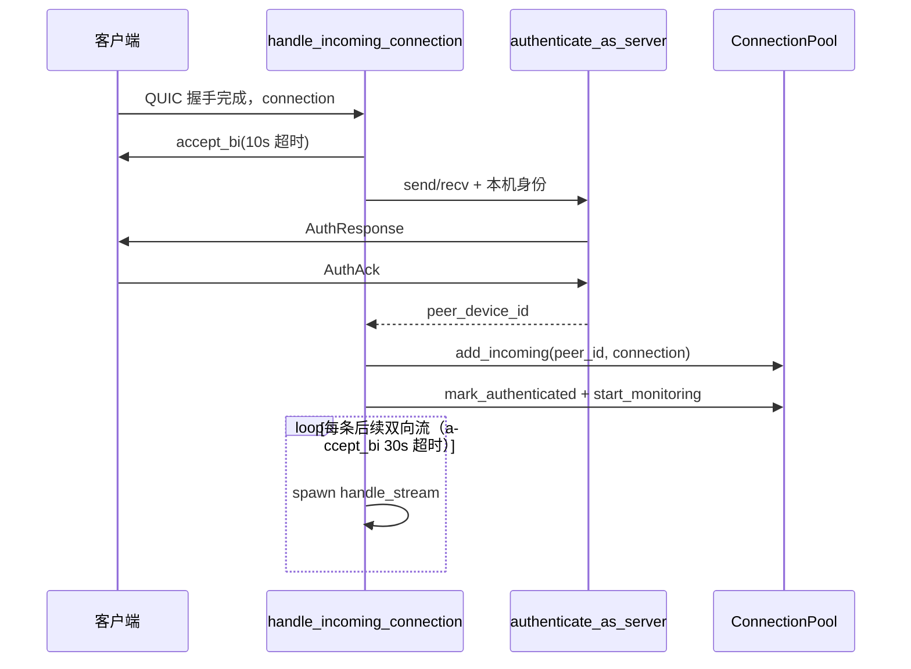

# 04 · 网络层

```
network/
├── mod.rs          // 导出 discovery / device / quic_server 的公共符号
├── discovery.rs    // UDP 设备发现、跨子网探测、device-online/offline 事件
├── device.rs       // DeviceInfo / OperatingSystem / Capability / KnownDevice
├── protocol.rs     // 发现包、控制消息、文件元数据、数据包（bincode）
├── auth.rs         // QUIC 双向认证握手
├── connection.rs   // 连接池、PeerConnection、TLS/QUIC 配置、自签名证书
├── quic_server.rs  // QUIC 服务端：接收连接、处理控制流、落盘
└── quic_client.rs  // QUIC 客户端：发起请求、暂停/恢复/取消
```

## 1. 设备模型（`device.rs`）

```rust
pub enum OperatingSystem { Windows, MacOS, Linux, Unknown }

pub enum Capability { FolderTransfer, ResumeTransfer, MultiDeviceSend, P2PTransfer }

pub struct DeviceInfo {
    pub device_id: Uuid,
    pub device_name: String,
    pub os: OperatingSystem,
    pub ip_address: IpAddr,
    pub quic_port: u16,
    pub protocol_version: String,
    pub capabilities: Vec<Capability>,
    pub last_seen: SystemTime,
    pub cert_fingerprint: String,
}
```

| 方法/结构 | 说明 |
| --- | --- |
| `DeviceInfo::is_online()` | `last_seen.elapsed() < DISCOVERY_TIMEOUT (30s)`；`SystemTime` 时钟异常时返回 `false` |
| `KnownDevice` | 数据库投影：UUID/OS/能力都转成字符串或 `i64`，`last_seen/created_at` 为 Unix 秒；新增 `cert_fingerprint` |

`Capability::P2PTransfer` 只存在于枚举，`DeviceInfo::new` 不会添加，发现响应也不会声明。

## 2. 发现协议（`protocol.rs` + `discovery.rs`）

### 2.1 报文结构

`DiscoveryPacket`（[protocol.rs](../../src-tauri/src/network/protocol.rs)）：

| 字段 | 类型 | 说明 |
| --- | --- | --- |
| `message_type` | `DiscoveryMessageType` | `Announce` / `Response` / `Goodbye` |
| `protocol_version` | `String` | 固定 `1.1.0` |
| `device_id` | `Uuid` | 设备唯一标识（每次启动随机） |
| `device_name` | `String` | 设置中的设备名（启动时从 SQLite 读取） |
| `os` | `OperatingSystem` | 由 `cfg!(target_os)` 推导 |
| `ip_address` | `Option<IpAddr>` | 通常为 `None`，接收侧用 socket 源地址 |
| `quic_port` | `u16` | 由 `QUIC_DEFAULT_PORT` 填入 |
| `capabilities` | `Vec<Capability>` | 三项固定能力 |
| `cert_fingerprint` | `String` | 本机 QUIC 证书 SHA-256，用于对端证书固定 |
| `timestamp` | `u64` | 发送时的 Unix 秒（**当前未用于校验**） |

序列化为 `bincode`，UDP 单包上限 `65507`。

### 2.2 `DiscoveryService` 生命周期

```rust
DiscoveryService::new(device_id, device_name, quic_port)
DiscoveryService::start(app_state: Arc<AppState>, app_handle: AppHandle) -> AppResult<()>
DiscoveryService::stop() -> AppResult<()>
```

`start()` 做了 5 件事：

1. 用 `running: Arc<Mutex<bool>>` 防重复启动；
2. 把所有已知设备标记为离线（`is_online = 0`）；
3. 创建 UDP socket（`socket2`：`SO_REUSEADDR`、macOS 额外 `SO_REUSEPORT`、`SO_BROADCAST`、非阻塞，绑定 `0.0.0.0:45678`）；
4. 启动 4 个后台循环；
5. 返回。

`stop()` 置 `running=false`，并用新建 socket 向所有广播地址发送一次 `Goodbye`。

### 2.3 四个后台任务

| 任务 | 周期 | 行为 |
| --- | --- | --- |
| 心跳广播 | 3 s | 构造 `Announce`，向每块网卡的广播地址发送；无网卡时退回 `255.255.255.255` |
| 收包循环 | 持续 | `recv_from` → `handle_discovery_packet` |
| 离线清理 | 30 s | 遍历 `devices`，`last_seen` 超过 30s 的移除、写库置离线、emit `device-offline` |
| 已知设备探测 | 10 s（启动后延迟 2s） | 从 SQLite 读已知设备，逐个 `Announce` 到其 IP:45678，间隔 50ms；随后 5 秒内监听 `Response` |

### 2.4 收包处理 `handle_discovery_packet`

```rust
async fn handle_discovery_packet(
    data: &[u8], addr: SocketAddr, local_device_id: Uuid,
    app_state: &Arc<AppState>, app_handle: &AppHandle, socket: &UdpSocket
) -> AppResult<()>
```

流程：

1. 解析包；`device_id == 本机` 直接丢弃；
2. `protocol_version != 1.1.0` 丢弃；控制消息与认证也会校验同一版本号；
3. 按类型分支：

| 类型 | 行为 |
| --- | --- |
| `Announce` | 转 `DeviceInfo` → 写入 `devices` → 保存 `known_devices`（含证书指纹）；若新设备或曾离线则 `spawn_quic_connection_task`；新设备 emit `device-online`；向源地址回复 `Response` |
| `Response` | 同上，但在「新设备或曾离线」时也 emit `device-online`（更新场景） |
| `Goodbye` | 从 `devices` 移除、数据库置离线、emit `device-offline` |

`check_device_was_offline` 使用 **25 秒** 阈值（与 30 秒超时不同）：只要超过 25 秒没见就视为“曾离线”，会触发重连与 online 事件。

### 2.5 连接任务 `spawn_quic_connection_task`

发现到设备后为“新设备/曾离线”设备建立一条 QUIC 长连接：

1. 取全局连接池与共享 `QuicClient`（单个 Endpoint）；
2. `client.connect(device_id, addr, Some(cert_fingerprint))` → 连接池按指纹固定对端证书并建连；
3. 立即执行 `ensure_authenticated`，在 10 秒内完成客户端认证（服务端等待首条流的超时为 10 秒）；
4. 注册关闭回调：数据库置离线 + emit `device-offline`；
5. `peer_conn.start_monitoring(pool)`。

> 共享 Endpoint 与“连接即认证”避免了此前连接在 10 秒后被服务端关闭、以及每次发现都新建 Endpoint 的问题。

### 2.6 手动 IP 发现

命令 `discover_device_by_ip`（[discovery.rs](../../src-tauri/src/network/discovery.rs)）：

1. 解析 IPv4；
2. 新建临时 UDP socket，向 `ip:45678` 发送 `Announce`；
3. 3 秒内等待第一个包；
4. 仅接受 `Response` 且版本匹配的包；
5. 写入 `devices`、`known_devices`、`last_connected`，emit `device-online`，返回 `Some(DeviceInfo)`；
6. 超时或非法包返回 `None`。

## 3. 认证握手（`auth.rs`）

### 3.1 消息

```rust
struct AuthHello   { device_id, device_name, protocol_version, cert_fingerprint, nonce: Vec<u8> }
struct AuthResponse{ device_id, device_name, cert_fingerprint: String, signature: Vec<u8>, nonce: Vec<u8> }
struct AuthAck     { device_id, signature: Vec<u8>, authenticated: bool, error: Option<String> }
```

### 3.2 客户端 `authenticate_as_client`

```rust
async fn authenticate_as_client(
    send: SendStream, recv: RecvStream,
    local_device_id: Uuid, local_device_name: String,
    remote_addr: SocketAddr, app_state: Arc<AppState>,
    expected_cert_fingerprint: Option<String>
) -> AppResult<Uuid>
```

1. 生成 32 字节随机 nonce；
2. 发 `AuthHello`（携带本机证书指纹）；
3. 收 `AuthResponse`；
4. 校验 `signature == SHA256(client_nonce || response.device_id)`；
5. 校验 `cert_fingerprint` 非空、不以 `mock-` 开头，且与发现阶段记录的指纹一致；
6. 合并对端设备信息（保留发现阶段的 OS/能力）；
7. 发 `AuthAck`，签名 = `SHA256(response.nonce || local_device_id)`；
8. 返回对端 `device_id`。

### 3.3 服务端 `authenticate_as_server`

1. 收 `AuthHello`；
2. 生成 32 字节 nonce；
3. 校验 `protocol_version == 1.1.0`、`cert_fingerprint` 非空且不以 `mock-` 开头；
4. `signature = SHA256(hello.nonce || local_device_id)`；
5. 从 `AppState.certificate_fingerprint()` 取本机证书指纹（启动时由 `start_quic_server` 写入；缺失则认证失败）；
6. 发 `AuthResponse`；
7. 收 `AuthAck`，要求 `authenticated == true`、`device_id == hello.device_id`、`signature == SHA256(response_nonce || hello.device_id)`；
8. 合并对端设备信息（保留发现阶段学到的 OS/能力）；
9. 返回对端 `device_id`。

### 3.4 传输封装

`send_control_message` / `recv_control_message` 使用 **4 字节大端长度前缀 + bincode 载荷**；接收侧限制单条消息 ≤ 10 MiB。

### 3.5 安全边界

| 项 | 现状 |
| --- | --- |
| 身份证明 | 仍是 `SHA256(nonce ‖ device_id)`，不是数字签名；但证书已按发现阶段公布的指纹固定 |
| 证书校验 | 客户端 `PinnedCertVerifier` 校验对端证书 SHA-256；缺少指纹时直接拒绝连接（必须先完成发现） |
| 证书持久化 | 服务端每次启动重新生成自签名证书，指纹随发现包广播并写入 `known_devices`；重启后首次发现前旧指纹会失效 |
| 防重放 | nonce 仅一次性使用于签名，没有时间戳/重放窗口校验 |
| 中间人 | 已记录指纹的设备可防证书替换；UDP 发现本身未认证，首次发现仍存在 TOFU 风险 |
| 客户端证书 | 服务端未启用双向 TLS，`AuthHello` 中的客户端指纹为自报值，仅用于后续主动连接时固定 |

## 4. 连接池（`connection.rs`）

### 4.1 `ConnectionPool`

```rust
pub struct ConnectionPool {
    connections: DashMap<Uuid, PeerConnection>,
    connect_locks: DashMap<Uuid, Arc<tokio::sync::Mutex<()>>>,
    close_callbacks: DashMap<Uuid, Box<dyn Fn(Uuid) + Send + Sync>>,
}
```

| 方法 | 说明 |
| --- | --- |
| `new()` / `Default` | 空池 |
| `on_connection_close(device_id, callback)` | 注册每设备一个关闭回调 |
| `trigger_close_callback(device_id)` | 取出并执行回调 |
| `get_or_connect(device_id, addr, endpoint, fingerprint)` | 命中且存活则复用；否则在按设备的锁内建连，避免并发重复连接 |
| `add_incoming(device_id, connection)` | 服务端认证后插入 |
| `remove(&device_id)` | 移除 |
| `get(&device_id)` | 取克隆 |
| `remove_and_callback(&device_id)` | 移除并触发关闭回调 |

### 4.2 `PeerConnection`

```rust
#[derive(Clone)]
pub struct PeerConnection {
    device_id: Uuid,
    connection: quinn::Connection,
    authenticated: Arc<AtomicBool>,
    authentication_lock: Arc<Mutex<()>>,
}
```

| 方法 | 说明 |
| --- | --- |
| `mark_authenticated()` | 服务端握手成功后置位 |
| `ensure_authenticated(authenticate)` | 双检锁：未认证则开一条流执行认证闭包，只执行一次；返回对端 `device_id` |
| `start_monitoring(pool)` | `tokio::spawn` 等待 `connection.closed()`，然后 `pool.remove_and_callback` |
| `is_connected()` | `close_reason().is_none()` |
| `open_stream()` / `accept_stream()` | 双向流 |
| `send_control(&ControlMessage)` | 新开一条双向流，写入长度前缀 + 消息，`finish()` |
| `close()` | `close(0, b"connection closed")` |

### 4.3 QUIC/TLS 配置

| 函数 | 关键参数 |
| --- | --- |
| `generate_self_signed_cert()` | `rcgen`：CN = 「传书文件传输」，SAN = `chuanshu.local` + `127.0.0.1`；返回 `rustls::Certificate` / `PrivateKey` |
| `create_client_config(fingerprint)` | `rustls::ClientConfig` + `PinnedCertVerifier`；缺少指纹时返回错误，不会建立未校验连接；传输层 `keep_alive_interval = 15s`、`max_idle_timeout = 60s` |
| `create_server_config(cert,key)` | `with_single_cert`；`max_concurrent_bidi_streams=100`、`max_concurrent_uni_streams=100`、`receive_window=16MiB`、`send_window=16MiB`、保活/空闲同上 |
| `connect_to_peer(addr, endpoint, fingerprint)` | `endpoint.connect_with(config, addr, "chuanshu.local")`，5 秒超时 |
| `init_connection_pool()` / `get_connection_pool()` | 全局 `OnceCell<Arc<ConnectionPool>>` |

> 客户端不再使用空根证书；证书固定通过 `PinnedCertVerifier::verify_server_cert` 完成，握手签名校验沿用 rustls 默认实现。

## 5. QUIC 服务端（`quic_server.rs`）

### 5.1 结构与启动

```rust
pub struct QuicServer { endpoint: Endpoint, port: u16, certificate_fingerprint: String }

QuicServer::new(port) -> AppResult<Self>
QuicServer::run(self, app_state) -> AppResult<()>
QuicServer::stop(&self)
start_quic_server(app_state) -> AppResult<u16>
stop_quic_server()
```

- `new`：生成证书、计算指纹、绑定 `0.0.0.0:45679`，记录实际端口。
- `run`：初始化连接池，循环 `endpoint.accept()`，每个连接 `tokio::spawn(handle_incoming_connection)`。
- `start_quic_server`：把指纹写入 `AppState`，再 spawn `run`，返回端口。
- 全局 `QUIC_SERVER: OnceCell<QuicServer>`；`new` 失败时 `expect` 会 panic。

### 5.2 入站连接 `handle_incoming_connection`



### 5.3 流分发 `handle_stream`

读 4 字节长度（≤10 MiB）→ 读载荷 → `ControlMessage::from_bytes` → 按类型：

| 消息类型 | 处理函数 |
| --- | --- |
| `TransferRequest` | `handle_transfer_request` |
| `DataTransferStart` | `handle_data_transfer_start` |
| `CancelTransfer` / `PauseTransfer` / `ResumeTransfer` | 更新对应任务状态 |
| 其他 | 记录 debug 日志 |

### 5.4 `handle_transfer_request`

```rust
async fn handle_transfer_request(
    message: ControlMessage, send: SendStream, recv: RecvStream,
    peer_device_id: Uuid, app_state: Arc<AppState>
) -> AppResult<()>
```

1. 反序列化 `TransferRequest`；
2. **校验 `request.sender_id == peer_device_id`**（防止冒用）；
3. 读设置 `auto_accept`；为 `false` 时：
   - 生成 `oneshot` 放入 `pending_transfer_requests`；
   - emit `transfer-request`；
   - 等待 60 秒，超时/通道关闭视为拒绝；
4. 从设置取 `save_path`（不展开 `~/`）；
5. 回复 `TransferResponse { accepted, reason, save_path }`；
6. 若接受：创建 `TransferType::Receive` 的 `TransferTask` 插入 `transfer_tasks`（此时 `files` 仍为空，等 `DataTransferStart` 填充）。

### 5.5 `handle_data_transfer_start`

1. 按 `task_id` 找到任务；校验 `peer_device_id`；
2. 写入 `files`，状态置 `Transferring`；
3. 计算 `missing_chunks`：
   - 有存储且 `resume=true` → 读 `resume_info`，按文件计算总分片数并过滤已收分片；
   - 否则 → 每个文件返回 `0..total`；
4. 回复 `DataTransferReady`；
5. 调 `receive_files`，完成后置 `Completed` 并写历史，失败则 `set_error` + 写失败历史。

> 规格文档要求「任务 ID、文件 ID、大小、修改时间、校验和全部匹配才允许续传」，但当前实现只按 `file_id` 取分片位图，未做元数据一致性校验。

### 5.6 `receive_files`

```rust
async fn receive_files(
    recv: RecvStream, task_id: Uuid, files: Vec<FileMetadata>,
    sender_id: Uuid, app_state: Arc<AppState>
) -> AppResult<()>
```

落盘流程：

1. 读设置：`download_path`（把 `~/` 替换为 `$HOME`）、`download_limit`；
2. `create_dir_all`，创建 `SharedRateLimiter(download_limit)`；
3. 构建 `file_id → metadata` 映射，加载/创建 `ResumeInfo` 并保存；
4. 循环读取「文件头长度 + `FileHeader`」：
   - 长度为 0 表示全部结束；
   - 在下载目录创建临时文件 `.{file_id}.tmp`，按需 `set_len`；
   - 按 `FileChunker::optimal_chunk_size` 计算块大小与总分片；
   - 循环读取「块长度 + `DataPacket`」：
     - 块长度为 0 表示该文件结束；
     - CRC32 校验失败立即返回错误；
     - `seek(offset)` 后写入；
     - 每 4 块持久化一次 `ResumeInfo`；
     - 应用下载限速；
     - 每 ≥100ms emit `transfer-progress`；
   - `flush + sync_all`；
   - 若 `FileHeader.checksum` 存在，计算整文件 SHA-256 并比对；
   - `sanitize_relative_path`：拒绝 `..`、根路径、Windows 前缀，只保留 `Normal` 组件；
   - 建子目录并 `rename` 临时文件到最终路径。
5. 删除 `resume_info` 记录。

注意点：

- 临时文件名只在 `file_id` 级别，已在传输层改为 `.{task_id}-{file_id}.tmp`，避免跨任务冲突；
- 暂停时接收循环 `sleep(100ms)` 继续等待，但不会停止读取已到达的 QUIC 数据；
- 取消时会删除临时文件与断点记录；失败时保留以便续传。

### 5.7 控制命令

| 函数 | 行为 |
| --- | --- |
| `handle_cancel_transfer` | 置 `Canceled`（不删除临时文件） |
| `handle_pause_transfer` | 置 `Paused` |
| `handle_resume_transfer` | 置 `Transferring` |

## 6. QUIC 客户端（`quic_client.rs`）

```rust
pub struct QuicClient { endpoint: Endpoint }

QuicClient::new() -> AppResult<Self>
QuicClient::connect(peer_device_id, peer_addr, fingerprint) -> AppResult<PeerConnection>
QuicClient::send_transfer_request(peer_addr, peer_device_id, request, app_state, fingerprint)
    -> AppResult<(TransferResponse, PeerConnection)>
QuicClient::close(&self)
```

`send_transfer_request` 流程：

1. `client.connect(...)` → `pool.get_or_connect(peer_device_id, peer_addr, &self.endpoint, fingerprint)`，按指纹固定证书；
2. 取 `connection.remote_address()`；
3. `peer_conn.ensure_authenticated(...)`：**仅首次**认证，避免在已认证连接上重复握手；
4. 新开双向流，发送长度前缀 + `TransferRequest`，`finish()`；
5. 读取 `TransferResponse`。

暂停/恢复/取消由 `TransferManager` 直接通过连接池 `send_control` 发送，连接不存在时静默忽略。

模块级函数：

| 函数 | 说明 |
| --- | --- |
| `init_quic_client()` | 确保共享客户端已创建 |
| `get_shared_client()` | 返回全局 `Arc<QuicClient>`（单个 Endpoint，供发现与传输复用） |
| `request_transfer(...)` | 使用共享客户端发送请求 |
| `close_quic_client()` | 退出时关闭共享 Endpoint |

> 不再为每次请求新建 `Endpoint`，避免了资源累积；连接由全局池复用。

## 7. 网络层设计小结

| 特性 | 实现方式 | 状态 |
| --- | --- | --- |
| 同网段自动发现 | UDP 广播 + 3s 心跳 | ✅ |
| 跨子网发现 | 已知设备定向探测（每 10s） | ✅ |
| 手动添加 | IP 探测 | ✅ |
| 离线检测 | 30s 无心跳 / QUIC 连接关闭 | ✅ |
| 多网卡 | `if_addrs` 枚举广播地址 | ✅ |
| 连接复用 | 全局 `ConnectionPool` + 按设备连接锁 | ✅ |
| 证书固定 | 发现包指纹 + `PinnedCertVerifier` | ✅（首次发现仍为 TOFU） |
| 双向认证 | 3 步握手 + nonce 摘要 | ⚠️ 形式完整，强度不足 |
| 断线重连 | 下次发现或强制探测时重建 | ⚠️ 无退避策略 |
