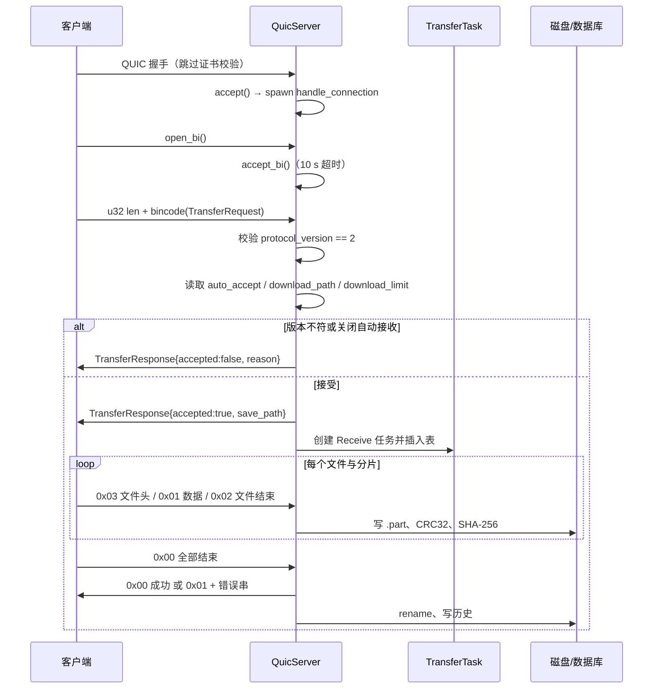

# 04 · 网络层

## 1. 总览

网络层位于 `src-tauri/src/network/`，由六部分组成：

| 文件 | 职责 |
| --- | --- |
| `discovery.rs` | UDP 广播发现、离线清理、已知设备探测、按 IP 发现命令 |
| `device.rs` | `DeviceInfo` / `KnownDevice` / `OperatingSystem` / `Capability` / `now_secs()` |
| `protocol.rs` | 发现包结构、传输协议 v2 结构、帧读写辅助 |
| `tls.rs` | 自签名证书生成、QUIC 传输参数、服务端/客户端 TLS 配置 |
| `quic_server.rs` | 监听 `45679`，接收一条双向流并落盘 |
| `quic_client.rs` | 为一次传输建立连接并发送全部文件 |

发现与传输使用两套独立端口和两套独立版本号：发现包是 `PROTOCOL_VERSION = "1.0.0"` 字符串，传输协议是 `TRANSFER_PROTOCOL_VERSION = 2`。

## 2. UDP 设备发现

### 2.1 Socket 创建

`create_discovery_socket()`：

1. `socket2::Socket` 创建 IPv4 UDP。
2. `SO_REUSEADDR`；macOS 额外启用 `SO_REUSEPORT`，允许同机多实例绑定同端口。
3. 绑定 `0.0.0.0:45678`，开启广播，设为非阻塞。
4. 转为 `tokio::net::UdpSocket`。

广播地址由 `get_broadcast_addresses()` 枚举所有非回环 IPv4 网卡的 `broadcast`，为空时回退 `255.255.255.255`。所有发送都逐个地址投递。

### 2.2 四个后台循环

`DiscoveryService::start()` 用 `running: Arc<AtomicBool>` 控制生命周期，启动后：

| 循环 | 周期 | 行为 |
| --- | --- | --- |
| 心跳广播 | 3 s（`interval` 首次立即触发） | 构造 `Announce` 包，发往所有广播地址；设备名实时读取 `AppState` |
| 收包处理 | 持续 `recv_from` | 解析后交给 `handle_discovery_packet`；读错误时 sleep 10 ms |
| 离线清理 | 30 s | 移除 `now - last_seen > 30` 的设备，写库置离线并 emit |
| 已知设备探测 | 启动后延迟 2 s，之后每 10 s | 从 SQLite 读已知设备，逐个定向发送 `Announce`，再收 2 秒响应 |

启动时还会先执行 `mark_all_devices_offline()`，把数据库里所有设备的 `is_online` 置 0，避免上次异常退出留下“在线”假象。

停止时 `stop()` 将 `running` 置 false，并用新的临时 socket 向所有广播地址发送 `Goodbye`。

### 2.3 收包处理

`handle_discovery_packet` 的顺序：

1. 反序列化 `DiscoveryPacket`。
2. 丢弃 `device_id` 等于本机的包。
3. 丢弃 `protocol_version != "1.0.0"` 的包（只记 debug 日志）。
4. 按 `message_type` 分支：

| 类型 | 处理 |
| --- | --- |
| `Announce` | 写入设备表；若设备是新出现或距上次心跳超过 25 s，emit `device-online`；随后向来源地址单播 `Response` |
| `Response` | 写入设备表；新设备或曾离线时 emit `device-online` |
| `Goodbye` | 从设备表移除，数据库置离线，emit `device-offline` |

`record_device()` 负责写内存并节流写库：设备首次出现、名称/IP/端口变化，或距上次持久化 ≥ 30 s 时才调用 `save_known_device()`。

### 2.4 已知设备探测

`probe_known_devices()` 用于跨子网：广播到不了的对端，只要数据库里存过它的 IP，就每 10 秒定向发一次 `Announce` 到 `ip:45678`，每个目标间隔 50 ms。随后在 2 秒窗口内以 500 ms 超时循环收包，响应交给同一个 `handle_discovery_packet`（因此响应会更新设备表并触发上线事件）。探测使用独立的 `0.0.0.0:0` 临时 socket。

## 3. 设备模型

`DeviceInfo`（内存态，也是 `device-online` 载荷）：

| 字段 | 类型 | 说明 |
| --- | --- | --- |
| `device_id` | `Uuid` | 设备唯一 ID |
| `device_name` | `String` | 显示名 |
| `os` | `OperatingSystem` | `Windows` / `MacOS` / `Linux` / `Unknown` |
| `ip_address` | `IpAddr` | 优先用发现包里的 `ip_address`，缺省用 UDP 来源 IP |
| `quic_port` | `u16` | 对端 QUIC 端口 |
| `protocol_version` | `String` | 发现协议版本 |
| `capabilities` | `Vec<Capability>` | 能力列表 |
| `last_seen` | `u64` | Unix 秒 |

`KnownDevice`（SQLite 行，字段多为字符串/整数以适配数据库）额外含 `last_connected`、`is_online`、`created_at`，`capabilities` 是 JSON 数组字符串。

`Capability` 枚举含 `FolderTransfer`、`MultiDeviceSend`（以及两个当前未使用的取值）；`capabilities()` 实际只广播前两个。

`detect_os()` 在编译期按目标平台返回对应枚举值。

## 4. 发现包

`DiscoveryPacket` 使用 bincode 序列化，字段：

```text
message_type: Announce | Response | Goodbye
protocol_version: String
device_id: Uuid
device_name: String
os: OperatingSystem
ip_address: Option<IpAddr>
quic_port: u16
capabilities: Vec<Capability>
timestamp: u64
```

- `Announce`：本机广播，`ip_address` 为 `None`，接收方以 UDP 源地址补全。
- `Response`：对 `Announce` 的单播回应，`ip_address` 也为 `None`。
- `Goodbye`：退出通知，`capabilities` 为空。

`to_device_info(socket_addr)` 用 `ip_address.unwrap_or(socket_addr.ip())` 生成内存设备。

## 5. TLS

`src-tauri/src/network/tls.rs`：

- 服务端证书由 `rcgen` 现生成，不落盘：
  - `CommonName = "传书文件传输"`
  - SAN：`DnsName("chuanshu.local")` 与 `IpAddress(127.0.0.1)`
  - 输出 DER 证书与私钥，交给 `rustls::ServerConfig::with_single_cert`
- 客户端使用 `rustls 0.21` 的 `dangerous_configuration` 特性，安装自定义 `NoCertificateVerification`：
  - `verify_server_cert`、`verify_tls12_signature`、`verify_tls13_signature` 全部直接返回成功；
  - `supported_verify_schemes` 列出一组常见签名算法。
- 连接时 `server_name` 固定为 `"chuanshu.local"`，与证书 SAN 对应。
- 服务端启用 `with_no_client_auth()`，不要求客户端证书。

因此 TLS 只提供链路加密，**不提供对端身份保证**；任何能访问 `45679` 的主机都可以完成握手。

## 6. QUIC 传输参数

`transport_config()` 同时用于服务端与客户端：

| 参数 | 值 |
| --- | --- |
| `max_concurrent_bidi_streams` | 8 |
| `max_concurrent_uni_streams` | 8 |
| `receive_window` | 16 MB |
| `stream_receive_window` | 8 MB |
| `send_window` | 16 MB |
| `keep_alive_interval` | 10 s（`QUIC_KEEP_ALIVE_INTERVAL`） |
| `max_idle_timeout` | 60 s（`QUIC_IDLE_TIMEOUT`） |

客户端若 `transport_config()` 构造失败，会退回 `quinn` 默认参数而不阻断连接。

## 7. QUIC 服务端

`quic_server.rs`：



关键实现点：

- `start_quic_server()` 用 `OnceCell` 保证只创建一次，绑定 `0.0.0.0:45679`，随后 `spawn` 接受循环。
- 每个连接只接受一条双向流；10 秒内没有流则报“等待传输流超时”。
- 版本不匹配时返回拒绝响应，`reason` 含两端版本号，然后 `finish()` 流并结束。
- `auto_accept=false` 时直接拒绝，原因“接收端已关闭自动接收”；没有前端确认弹窗流程。
- 下载目录：`download_path` 为空则 `default_download_dir()`，否则 `resolve_download_dir()`；接收前 `create_dir_all`。
- 接收任务在发出接受响应后创建，`TransferType::Receive`，初始 `Transferring`。
- 临时文件命名 `.{task_id}.{file_id}.part`，成功后 `rename` 到 `unique_path()` 计算出的最终路径；失败时删除全部未完成临时文件。
- 重名文件追加 ` (n)` 序号，最多尝试 9999 次。
- 路径安全：`build_safe_target()` 拒绝 `..`、含 `:` 的路径段、空文件名、含分隔符或 `:` 的文件名；随后对父目录做 `canonicalize`，要求仍以下载目录为前缀。
- 完成时写 `completed` 历史并 emit `transfer-completed`；取消写 `canceled`，其它失败写 `failed`，并 emit `transfer-failed`。

## 8. QUIC 客户端

`quic_client::send_transfer()` 每个任务调用一次，**不复用连接**：

1. `Endpoint::client("0.0.0.0:0")`，设置 `tls::client_config()`。
2. `connect(peer, "chuanshu.local")`，连接超时 10 秒。
3. `open_bi()`，写入 `TransferRequest`，等待响应超时 15 秒。
4. 被拒绝：关闭连接（`b"rejected"`），任务置错误，返回 `AppError::Permission(reason)`。
5. 被接受：若任务已被取消则直接关闭；否则写回 `files`、置 `Transferring`。
6. 读取 `upload_limit`，创建 `SharedRateLimiter`。
7. 逐文件：写 `0x03` 标签 + `FileHeader`，按 4 MB 读文件，写 `0x01 + offset + len + crc32 + bytes`，每片后 `consume_and_wait`，更新 `transferred_size`。
8. 文件读完校验实际字节数等于声明值，写 `0x02 + 0x01 + sha256`。
9. 全部文件写完写 `0x00`，`finish()` 发送流，等待接收端确认最多 60 秒。
10. 收到非 `0x00` 时读取 `u32 len + UTF-8` 错误串并返回错误；成功则 `close(b"done")`，最多等 5 秒 `wait_idle()`。

暂停/取消通过 `wait_if_paused()` 在文件边界与每个分片前检查：`Paused` 时每 100 ms 重试，`Canceled` 时返回错误，任务随即被标记为取消。

## 9. 按 IP 发现

`discover_device_by_ip`（`#[tauri::command]`，定义在 `discovery.rs`）：

1. 只接受 IPv4，解析失败返回 `AppError::Config`。
2. 绑定随机 UDP 端口，向目标 `ip:45678` 发送一次 `Announce`。
3. 3 秒内等待一个包；只接受 `Response` 且版本为 `1.0.0`。
4. 成功则写入设备表、`save_known_device()`、`update_last_connected()`、emit `device-online`，返回 `Some(DeviceInfo)`；超时或包不合法返回 `None`。

## 10. 安全边界

- 没有账号、配对码或信任列表；服务端只检查协议版本与 `auto_accept`。
- 客户端不校验证书，也不校验服务端 TLS 身份；`TransferRequest.sender_id` / `sender_name` 是自报字段。
- UDP 发现包可被伪造，设备列表可能被投毒。
- 文件名与相对路径做了目录穿越防护，但传输内容本身不做病毒或类型检查。

这些取舍以“可信局域网内的个人工具”为前提，不应在公共网络使用。
