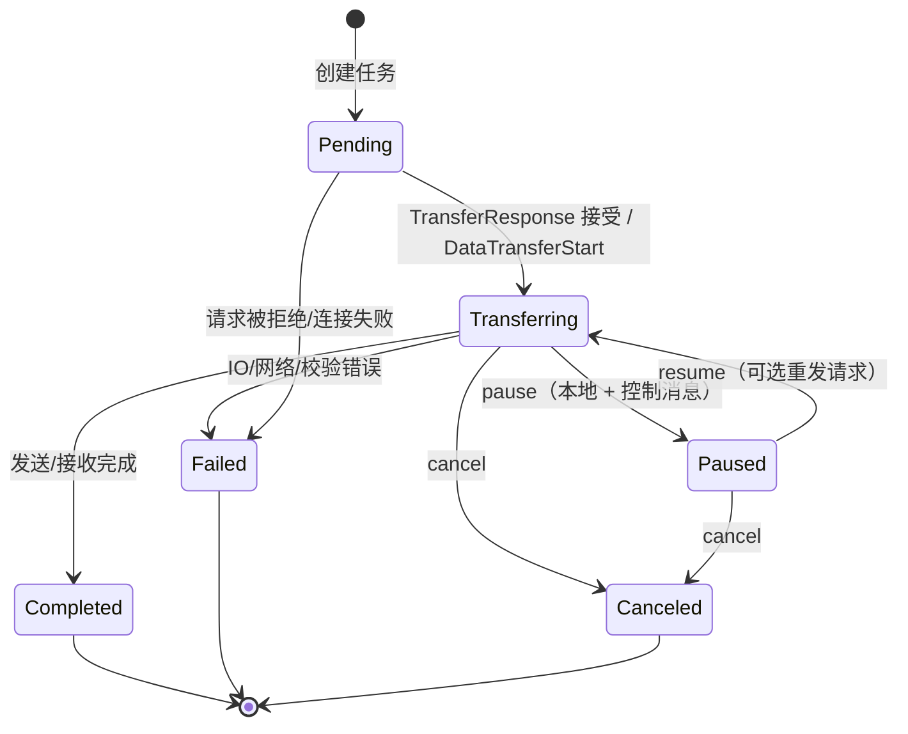
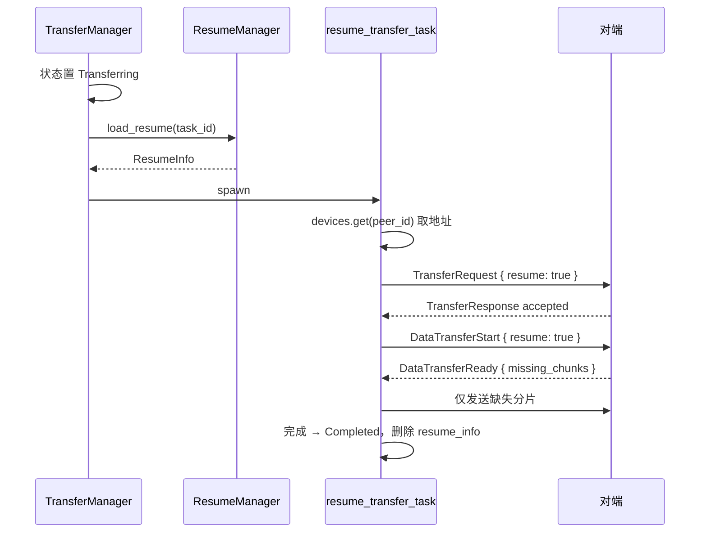

# 05 · 传输管线

```
transfer/
├── mod.rs          // 导出 manager / task
├── manager.rs      // TransferManager：收集文件、发起发送、暂停/恢复/取消、进度更新器
├── task.rs         // TransferTask / TransferStatus / TransferType / TransferTaskInfo
├── file_chunk.rs   // FileChunker 的块大小计算、CRC32/SHA-256
├── resume.rs       // ResumeInfo / FileResumeInfo / ResumeManager
└── rate_limiter.rs // 令牌桶限速
```

## 1. 任务模型与状态机

### 1.1 `TransferTask`

```rust
pub struct TransferTask {
    pub task_id: Uuid,
    pub peer_device_id: Uuid,
    pub peer_device_name: String,
    pub transfer_type: TransferType,   // Send | Receive
    pub status: TransferStatus,
    pub total_size: u64,
    pub transferred_size: u64,
    pub file_count: u32,
    pub files: Vec<FileMetadata>,
    pub current_file_index: u32,
    pub current_file: String,
    pub speed: u64,                    // 字节/秒
    pub error_message: Option<String>,
    pub created_at: SystemTime,
    pub updated_at: SystemTime,
    pub save_path: Option<PathBuf>,    // 接收端保存目录
    pub source_paths: Vec<PathBuf>,    // 发送端源路径（用于历史/重发）
}
```

| 方法 | 说明 |
| --- | --- |
| `new(task_id, peer_id, peer_name, type, total_size, file_count)` | 初始状态 `Pending`，`files` 为空 |
| `update_progress(transferred, speed)` | 更新字节数与速度、`updated_at` |
| `set_status(status)` | 更新状态与 `updated_at` |
| `set_current_file(name, index)` | 更新当前文件 |
| `set_error(msg)` | 写入错误并置 `Failed` |
| `progress()` | `transferred_size / total_size * 100`，`total_size == 0` 时返回 0 |

### 1.2 `TransferTaskInfo`

对外（IPC/事件）使用的轻量投影：

```rust
pub struct TransferTaskInfo {
    task_id, peer_device_name, transfer_type, status,
    total_size, transferred_size, file_count, current_file,
    speed, progress: f64, error_message, created_at: u64,
}
```

`From<&TransferTask>` 把 `SystemTime` 转成 Unix 秒，`progress` 为 0–100 的百分比（前端直接作为 antd `Progress.percent`）。

### 1.3 状态机



- 状态只在内存 `transfer_tasks` 中维护；进程重启后**进行中任务全部丢失**（`resume_info` 表仍在，但没有列出来供用户恢复）。
- `TransferStatus` 序列化为枚举名（`Pending`/`Transferring`/…），前端按同名值判断。

## 2. `TransferManager`

文件：[manager.rs](../../src-tauri/src/transfer/manager.rs)

```rust
pub struct TransferManager {
    app_state: Arc<AppState>,
    active_transfers: Arc<Mutex<Vec<Uuid>>>, // 只在 cancel 时被 retain，从未 push
}
```

### 2.1 `send_files`

```rust
pub async fn send_files(&self, request: SendFilesRequest) -> AppResult<Vec<Uuid>>
```

1. `collect_files(&request.file_paths)` 收集**全部**文件的元数据（一次）；
2. 计算 `total_size`、`file_count`；
3. 对 `request.device_ids` 中每个设备：
   - 要求设备存在于 `app_state.devices`（否则 `DeviceNotFound`）；
   - 生成新 `task_id`；
   - 构造 `TransferRequest { resume: false, .. }`；
   - 创建 `TransferTask`（`Send`），写入 `files` 与 `source_paths`；
   - 插入任务表；
   - `tokio::spawn` 前先获取 `AppState.transfer_semaphore` 的许可（最多 5 个并发发送）；超出部分排队等待；
4. 立即返回所有 `task_id`（异步执行，不等传输完成）。

> 设备地址取自发现阶段的 `device.ip_address` 与 `device.quic_port`，不重新探测。

### 2.2 `collect_files`

| 输入 | 行为 |
| --- | --- |
| 单个文件 | `get_file_metadata(path, relative_path="")`，`file_id = 0/1/…` |
| 目录 | `base_path = dir.parent()`，`WalkDir::new(dir).follow_links(true)` 递归；只取普通文件；`relative_path = 相对 base_path 的父目录`，因此**保留顶层文件夹名** |
| 空目录 / 符号链接目录 | 不发送目录项（`is_directory` 永远为 `false`），空目录会丢失 |
| 顺序 | 所有路径按输入顺序累积，`file_id` 全局递增 |

`get_file_metadata`：

- `file_size`、`modified_time`（Unix 秒）；
- **小于 100 MiB 的文件**计算 SHA-256（`calculate_file_hash`），否则 `checksum = None`；
- `source_path` 仅用于发送端本地读取（`#[serde(skip)]`，不上线）。

> 小于 100MB 的判断在**每个文件**上，大文件没有整文件校验，只有分片 CRC32。

### 2.3 发起发送 `initiate_transfer`

```rust
async fn initiate_transfer(
    peer_addr: SocketAddr, peer_device_id: Uuid,
    request: TransferRequest, app_state: Arc<AppState>
) -> AppResult<()>
```

1. `init_quic_client()`（失败忽略）；
2. 读设置 `upload_limit`；
3. `request_transfer(...)` → 得到 `(TransferResponse, PeerConnection)`；
4. 被拒绝则返回错误；
5. 接受后任务置 `Transferring`，写入 `files`；
6. `tokio::spawn(send_files_data(...))`；
7. 完成/失败时：
   - 更新任务状态；
   - 写 `transfer_history`（成功 `completed` / 失败 `failed`；发送端 `source_path` 存 JSON 数组，`destination_path` 取 `task.save_path`，发送端通常为 `None`）；
   - 成功时 `emit_transfer_completed` 并弹系统通知；失败时 `emit_transfer_failed`。

### 2.4 发送数据 `send_files_data`

```rust
async fn send_files_data(
    peer_conn: PeerConnection, task_id: Uuid, files: Vec<FileMetadata>,
    app_state: Arc<AppState>, upload_limit: u32, resume: bool
) -> AppResult<()>
```

1. 在已认证连接上 `open_stream()`；
2. 发 `DataTransferStart { task_id, files, resume }`；
3. 读 `DataTransferReady`，被拒绝则返回；得到 `missing_chunks`；
4. 创建 `SharedRateLimiter(upload_limit)`；
5. 对每个文件：
   - `set_current_file`；
   - 发 `FileHeader`（长度前缀 + bincode）；
   - 打开源文件；
   - `chunk_size = FileChunker::optimal_chunk_size(file_size)`，`total_chunks = ceil(size/chunk) max 1`；
   - 需要发送的分片索引 = `missing_chunks[file_id]`（存在）或 `0..total_chunks`；
   - 对每个分片：
     - **暂停/取消检查**：`Paused` 时每 100ms 轮询并原地等待；`Canceled` 时返回错误；
     - `offset = chunk * chunk_size`，若 `offset >= file_size` 跳过；
     - `seek(offset)` 读取 `min(chunk_size, size-offset)` 字节；
     - 计算 CRC32，构造 `ChunkMetadata` + `DataPacket`；
     - 发送长度前缀 + 数据；
     - 应用上传限速；
     - 每 ≥100ms 更新进度并 emit `transfer-progress`；
6. 所有文件后发送 `0u32` 作为结束标记，`finish()`；不再等待对端 ack。

### 2.5 暂停 / 恢复 / 取消

| 方法 | 本地动作 | 远端动作 | 备注 |
| --- | --- | --- | --- |
| `cancel_transfer(task_id)` | 任务置 `Canceled`；从 `active_transfers` 移除 | `CancelTransfer` 控制消息 | 不删除临时文件/断点 |
| `pause_transfer(task_id)` | 仅当 `Transferring` 时置 `Paused` | `PauseTransfer` | 双方循环都会等待 |
| `resume_transfer(task_id)` | 仅当 `Paused` 时置 `Transferring` | `ResumeTransfer` | 若是发送任务，还会加载断点并重新发起请求 |

`resume_transfer` 的发送端额外流程：



注意：

- `resume_transfer_task` 依赖 `app_state.devices` 中仍有对端；设备离线时返回 `DeviceNotFound`。
- `send_files_data_with_resume` 只是以 `resume=true` 调用 `send_files_data`；接收端会通过 `ResumeInfo::reconcile_files` 校验文件名、大小、修改时间、相对路径与校验和，任一不匹配即丢弃旧位图并全量重传。
- 同时还会发送 `ResumeTransfer` 控制消息，对端会把任务状态也置为 `Transferring`。

### 2.6 其他方法

| 方法 | 说明 |
| --- | --- |
| `cleanup_old_tasks(max_age)` | 清理已终态且超过保留时间（默认 1 小时）的任务；由后台维护任务每 60 秒调用 |

### 2.7 后台维护

```rust
pub async fn start_task_maintenance(app_state: Arc<AppState>)
```

每 60 秒：
- 清理终态且超过 `TRANSFER_TASK_RETENTION`（1 小时）的任务；
- 清理超过 7 天的断点记录（`cleanup_old_resume_entries(7)`）。

进度事件由发送/接收循环直接 emit（每 ≥100ms），不再有额外的 500ms 进度更新器。

### 2.8 模块级导出函数

| 函数 | 说明 |
| --- | --- |
| `send_files(request, state, rt_handle)` | 新建 `TransferManager` 并调用 `send_files` |
| `cancel_transfer(task_id, state)` | 同上 |
| `pause_transfer(task_id, state)` | 同上 |
| `resume_transfer(task_id, state)` | 同上 |

`rt_handle` 参数当前未使用。

## 3. 接收管线（服务端）

完整实现位于 [quic_server.rs](../../src-tauri/src/network/quic_server.rs)，调用链：

```
handle_incoming_connection
  └─ handle_stream
       └─ handle_transfer_request      // 创建 Receive 任务，回复接受/拒绝
       └─ handle_data_transfer_start   // 计算缺失分片，回复 DataTransferReady
            └─ receive_files           // 解帧、CRC 校验、写盘、限速、进度
```

接收侧关键行为：

| 环节 | 行为 |
| --- | --- |
| 保存目录 | `settings.download_path`，`~/` 替换为 `$HOME`；缺省 `~/Downloads/传书` |
| 临时文件 | `.{file_id}.tmp`（位于保存目录） |
| 预分配 | 若临时文件长度 ≠ 文件大小则 `set_len` |
| 分片校验 | 每个 `DataPacket` 计算 CRC32 与 `metadata.checksum` 比对，失败立即中断 |
| 整文件校验 | `FileHeader.checksum` 存在时（即发送端文件 <100MB）计算 SHA-256 比对 |
| 路径安全 | `sanitize_relative_path` 拒绝 `ParentDir/RootDir/Prefix` |
| 目录结构 | `relative_path` 非空时创建子目录；顶层文件夹名被保留 |
| 断点写入 | 每 4 个分片 `save_resume_info` 一次 |
| 完成 | 置 `Completed`、删除 `resume_info`、写 `transfer_history` |
| 失败 | `set_error`、写失败历史；临时文件与断点保留 |
| 通知 | 成功时 emit `transfer-completed` 并弹系统通知；失败时 emit `transfer-failed` 并弹失败通知 |

## 4. 分块策略（`file_chunk.rs`）

### 4.1 `optimal_chunk_size`

| 文件大小 | 块大小 |
| --- | --- |
| `< 256 KiB` | `max(file_size, 64 KiB)` |
| `< 100 MiB` | 1 MiB |
| `< 1 GiB` | 4 MiB |
| `>= 1 GiB` | 8 MiB |

`chunk_count(size, chunk) = ceil(size/chunk).max(1)`。

### 4.2 其他结构

| 结构/方法 | 状态 | 说明 |
| --- | --- | --- |
| `FileChunker::optimal_chunk_size` | ✅ | 发送/接收/断点共同使用 |
| `FileChunker::chunk_count` | ✅ | 分片数量 |
| `calculate_crc32(data)` | ✅ | 分片校验 |
| `calculate_file_hash(path)` | ✅ | 64KB 缓冲流式 SHA-256 |

> `FileAssembler`、`BatchBuilder`、`batch_files`、`read_chunk*` 等未使用代码已删除。

## 5. 限速（`rate_limiter.rs`）

```rust
pub struct RateLimiter { max_tokens, tokens, refill_rate, last_refill }
pub struct SharedRateLimiter { inner: Arc<Mutex<RateLimiter>> }
```

- `RateLimiter::new(limit_bytes_per_sec)`：`limit == 0` 表示不限（`u64::MAX`）；桶容量 = 每秒补充量。
- `consume(tokens)`：先按经过时间补充，再判断是否足够；不足时返回需要等待的 `Duration`。
- `SharedRateLimiter::consume_and_wait(bytes)`：循环消费/等待，直到可立即消费。
- `try_consume(bytes)`：不等待，返回是否成功。
- 单元测试覆盖不限速、限速、共享限速三种场景。

使用位置：

| 场景 | 位置 | 限速值 |
| --- | --- | --- |
| 发送 | `send_files_data` | `settings.upload_bytes_per_sec()` |
| 接收 | `receive_files` | `settings.download_bytes_per_sec()` |

`Settings` 中的 0–100 表示 MB/s，后端统一换算为字节/秒；0 表示不限速。

## 6. 并发与资源模型

| 维度 | 现状 |
| --- | --- |
| 同时发送到多设备 | 每个设备一个任务，由 `transfer_semaphore` 限制为最多 5 个并发 |
| 同一设备的并发任务 | 复用同一 `PeerConnection`，每个任务占一条双向流，服务端并发处理 |
| 断点数据 | 每个任务一份 `ResumeInfo`，以 `task_id` 为主键 |
| 任务清理 | 后台维护每 60 秒清理超过 1 小时的终态任务 |
| 取消后的流 | 发送端返回错误，接收端删除临时文件与断点 |
| 阻塞调用风险 | 已改为 `tokio::sync::Mutex` + `await`，不再使用 `blocking_lock` |
| 内存 | `files` 元数据与分片缓冲按块分配（最大 8 MiB/块），大文件不会整文件读入内存 |

## 7. 传输相关缺陷清单（阅读源码时的注意点）

> 以下为**已修复**项（保留记录便于回溯）：
>
> - 限速单位已统一为 MB/s → B/s；
> - `transfer-failed` 前后端均使用 `task_id`；
> - 接收端会发出 `transfer-completed` / `transfer-failed`；
> - 临时文件改为 `.{task_id}-{file_id}.tmp`；
> - 续传会校验文件元数据；
> - `FileHeader` 统一到 `network/protocol.rs`；
> - 结束标记后不再等待无效 ack。

**仍然存在的限制：**

1. 没有“列出可恢复任务”的 UI/命令；重启后只能通过重新发送触发续传，无法主动选择未完成任务。
2. 接收端失败过早（如创建目录失败）时，历史记录中的 `destination_path` 可能为 `None`。
3. 暂停是通过循环轮询状态实现的，已经进入 QUIC 接收缓冲的数据仍会被读取。
4. 断点记录每 4 个分片保存一次，崩溃可能丢失最近几个分片（重传即可，不影响正确性）。
5. 没有传输优先级/队列界面，超出 5 个的任务只能在后台排队。
