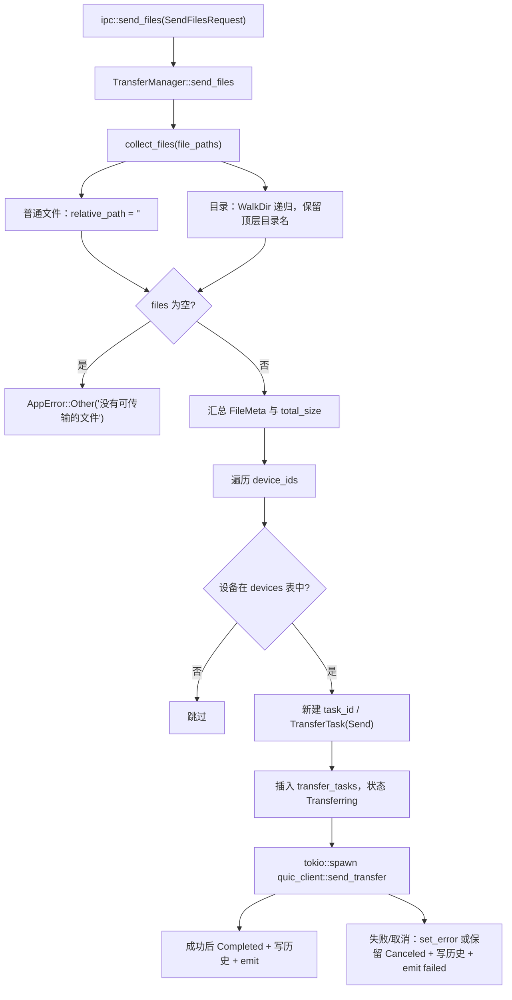
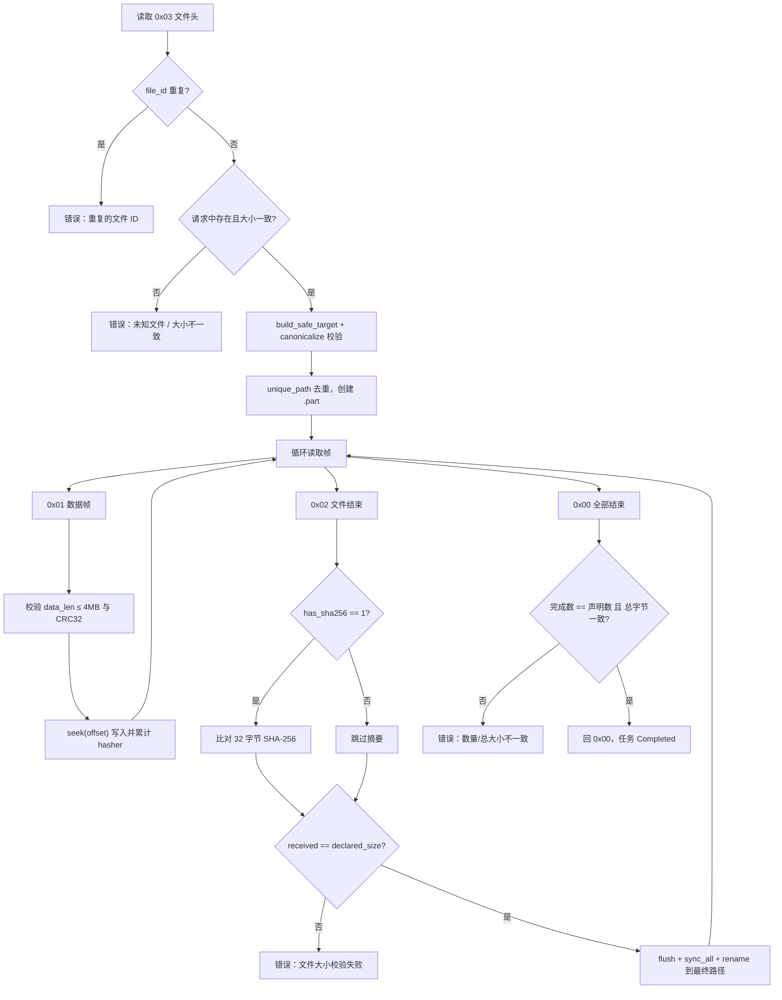

# 05 · 传输管线

## 1. 任务模型

`src-tauri/src/transfer/task.rs`：

```rust
TransferTask {
  task_id, peer_device_id, peer_device_name,
  transfer_type: Send | Receive,
  status: Pending | Transferring | Paused | Completed | Failed | Canceled,
  total_size, transferred_size, file_count,
  files: Vec<FileMeta>,
  current_file_index, current_file,
  speed, error_message,
  created_at, updated_at: SystemTime
}
```

对前端暴露的 `TransferTaskInfo` 是只读投影，额外计算 `progress = transferred / total * 100`（0 字节时为 0），`created_at` 转成 Unix 秒。任务保存在 `AppState.transfer_tasks`，**进程退出前不会删除**。

`FileMeta` 字段：`file_id`（`u64`，从 0 递增）、`relative_path`、`file_name`、`file_size`。

## 2. 发送管线



### 2.1 文件收集

`collect_files()`：

- 传入路径是文件：`relative_path` 为空字符串，`file_name` 取文件名。
- 传入路径是目录：以**目录的父目录**为基准，`WalkDir::new(dir).follow_links(true)` 递归，所有普通文件都保留“目录名/子路径/文件名”。
- 不存在的路径只记 warn 日志并跳过。
- `file_id` 在整个请求内连续递增，跨文件、跨设备共用同一组元数据。

### 2.2 任务创建

- 一次 `send_files` 可以带多个 `device_ids`，每台在线设备生成一个独立任务与一个独立 QUIC 连接。
- 目标设备不在 `AppState.devices` 中时直接跳过；最终一个任务都没建成则返回 `AppError::DeviceNotFound("目标设备不在线")`。
- 请求中的 `sender_id` / `sender_name` 来自本机 `AppState`。
- 任务在 spawn 之前就已置为 `Transferring`，因此前端立刻能看到任务。

### 2.3 发送结果处理

`quic_client::send_transfer` 返回后，manager 在任务锁内判断：

| 结果 | 任务状态 | 历史 `status` | 事件 |
| --- | --- | --- | --- |
| `Ok(())` | `Completed` | `completed` | `transfer-completed` |
| `Err` 且任务已是 `Canceled` | 保持 `Canceled` | `canceled` | `transfer-failed` |
| 其它 `Err` | `Failed`（`set_error`） | `failed` | `transfer-failed` |

取消与失败都会触发 `transfer-failed`，撤销不会被当作成功。

## 3. 接收管线

`quic_server::handle_transfer` 接受后先创建 `Receive` 任务，再进入 `receive_files`：



要点：

- 每个分片先校验长度上限与 CRC32，再按 `offset` 定位写入；发送端实际是顺序写入，但协议允许乱序。
- 文件结束帧的 `has_sha256` 由发送端固定写 `1`，因此摘要校验总会执行；接收端也支持 `0`（跳过）。
- 文件名与相对路径都经过目录穿越校验；最终路径若已存在，会追加 ` (n)`。
- 临时文件写在下载目录根下，命名为 `.{task_id}.{file_id}.part`。
- 成功后 `rename`，并把临时路径从待清理列表移除；失败或取消时删除所有尚未完成的 `.part`。
- 已经完成的文件不会被回滚，但**没有续传机制**，重新发送会再传一遍。

## 4. 状态机

```mermaid
stateDiagram-v2
  [*] --> Pending: TransferTask::new
  Pending --> Transferring: 发送端接受后 / 接收端建任务
  Transferring --> Paused: pause_transfer（仅发送端可主动设置）
  Paused --> Transferring: resume_transfer
  Transferring --> Completed: 全部字节 + 校验通过
  Transferring --> Failed: I/O、网络、校验错误
  Transferring --> Canceled: cancel_transfer
  Paused --> Canceled: cancel_transfer
  Completed --> Canceled: cancel_transfer 不检查当前状态
```

状态变更都通过 `TransferTask::set_status`，同时刷新 `updated_at`。`set_error` 会写入 `error_message` 并直接置 `Failed`。

## 5. 进度与速率

`transfer::start_progress_updater()` 是唯一的进度事件源：

- 每 500 ms 遍历一次任务表。
- 只处理 `Transferring` 状态；其它状态会清掉该任务的速度历史并跳过。
- 速度 = `(本次 transferred_size - 上次) / 实际经过秒数`，单位为字节/秒。
- 把速度写回任务后构造 `TransferTaskInfo`，emit `transfer-progress`。
- 首次采样时 `prev_bytes` 取当前值，因此第一个 500 ms 窗口速度可能为 0。

发送/接收循环本身只更新 `transferred_size`（`update_progress(transferred, 0)`），不直接发事件。

## 6. 限速

`transfer/rate_limiter.rs` 是令牌桶：

| 构造参数 | 行为 |
| --- | --- |
| `0` | `max_tokens = refill_rate = u64::MAX`，`consume` 直接放行 |
| `N > 0` | 桶容量与每秒补充量都是 N 字节 |

`consume(tokens)` 先按经过时间补充令牌（上限为桶容量）；令牌足够则立即扣除，否则返回需要等待的毫秒数。`SharedRateLimiter::consume_and_wait()` 在循环中 sleep 后重试。

- 客户端在每写完一个分片后调用 `consume_and_wait(n)`，使用 `settings.upload_limit`。
- 服务端在每写完一个分片后调用，使用 `settings.download_limit`。
- 限速值在**每次传输开始时**读取，修改设置只影响之后新建的任务。
- 因为是在写完之后才等待，瞬时速度可能略高于设定值，长期平均受令牌桶约束。

## 7. 暂停、恢复与取消

| 命令 | 实现 | 约束 |
| --- | --- | --- |
| `pause_transfer` | 仅当状态为 `Transferring` 时置 `Paused` | 接收端任务也可被本地置暂停（命令不区分 Send/Receive） |
| `resume_transfer` | 仅当状态为 `Paused` 时置 `Transferring` | — |
| `cancel_transfer` | 直接置 `Canceled`，不校验当前状态 | 对已完成任务调用也会改成已取消 |

暂停是**单端本地行为**：没有控制帧通知对端。两端各自在文件边界和每个分片前调用 `wait_if_paused()`：

- `Paused`：释放任务锁，`sleep(100ms)` 后重新检查；
- `Canceled`：返回 `AppError::Other("传输已取消")`，由外层统一收尾。

发送端暂停时，接收端阻塞在 `read_exact` 上；接收端暂停时，发送端可能因流控窗口耗尽而阻塞在写操作上。QUIC 的 10 秒 keep-alive 会维持连接，短时间暂停不会触发 60 秒空闲超时。

## 8. 历史记录

`manager::record_history()`（发送）与 `quic_server::save_history()`（接收）都会调用 `Storage::add_transfer_history`：

- `transfer_type` 分别为 `"send"` / `"receive"`。
- `status` 为 `"completed"` / `"failed"` / `"canceled"`。
- `file_names` 是该任务全部文件名用 `", "` 拼接的字符串。
- 失败时再调用 `update_transfer_status` 写入 `error_message`。
- `completed_at` 由 SQL 在终态时填 `strftime('%s','now')`。

## 9. 失败面与清理

| 场景 | 表现 |
| --- | --- |
| 目标设备不在线 | `send_files` 返回 `DeviceNotFound`，不创建任务 |
| 连接超时（10 s）/ 响应超时（15 s） | 任务 `Failed`，`transfer-failed` |
| 接收端关闭自动接收 | 发送端收到 `accepted=false`，任务 `Failed`，原因为 `reason` |
| 版本不一致 | 接收端回拒绝，`reason` 含两端版本 |
| 分片 CRC 错误 | 接收端报“分片校验失败”，删除未完成 `.part` |
| SHA-256 或文件大小不符 | 接收端报校验失败 |
| 请求总大小与实际字节不符 | 接收端报“传输总大小不一致” |
| 发送过程中文件变大/变小 | 发送端报“文件大小发生变化” |
| 用户取消 | 两端任务置 `Canceled`，历史写 `canceled` |

没有自动重试、没有排队、没有并发上限：每个 `send_files` 请求会立即为每台设备起一个发送任务。
