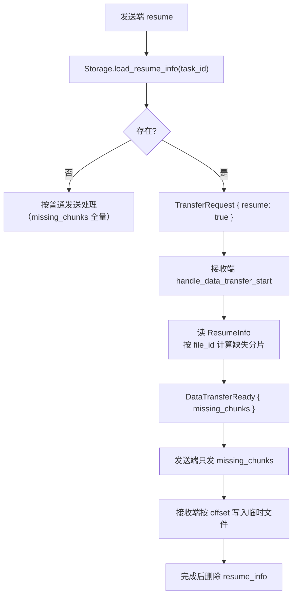
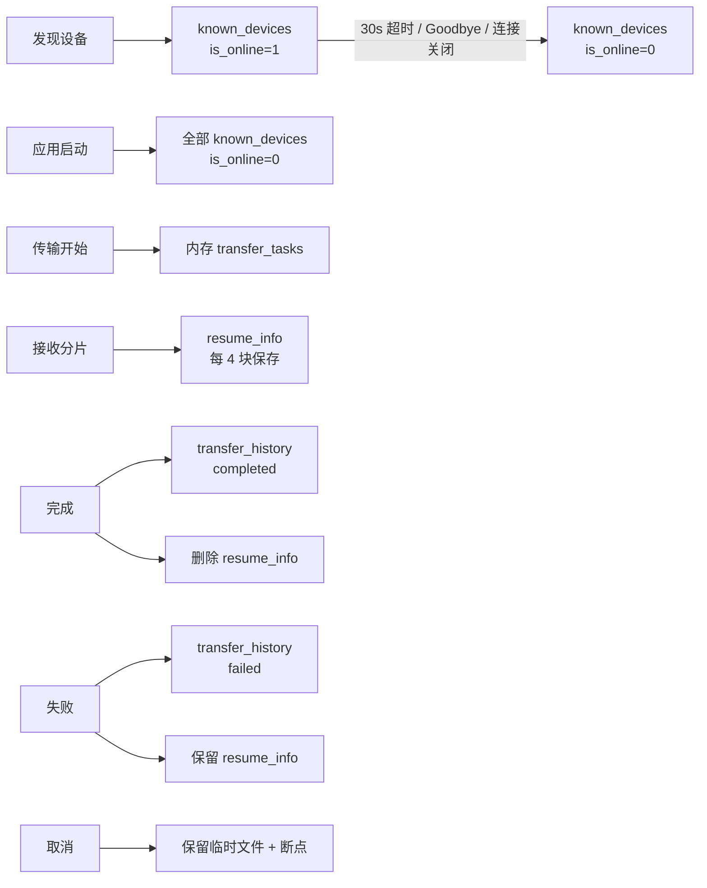

# 06 · 存储与断点续传

## 1. 存储位置与初始化

```rust
Storage::new(app_data_dir: &PathBuf) -> AppResult<Self>
init_storage(app_data_dir: &PathBuf) -> AppResult<()>
get_storage() -> Option<MutexGuard<'static, Storage>>
```

- 目录：Tauri 的 `app.path().app_data_dir()`（macOS 通常为 `~/Library/Application Support/com.chuanshu.app`）。
- 文件：`chuanshu.db`（SQLite，`rusqlite` 启用 `bundled`）。
- 初始化时机：`lib.rs` 的 `setup` 回调中调用 `init_storage`，失败只记日志、不阻止应用启动（之后所有依赖存储的功能会退化为默认值或报错）。
- 全局句柄：`static STORAGE: OnceCell<Mutex<Storage>>`；`get_storage()` 每次返回 `MutexGuard`，调用方即持锁。

> 该门面是**同步阻塞**的：所有 SQL 都在调用线程执行。网络/传输任务中调用时会短暂阻塞 Tokio 工作线程。调用处应避免跨 `await` 持有 guard（否则 future 不是 `Send`，编译期会报错）。

## 2. 表结构

### 2.1 `settings`（键值对）

| 列 | 类型 | 说明 |
| --- | --- | --- |
| `key` | TEXT PK | 设置名 |
| `value` | TEXT NOT NULL | 字符串化值 |
| `updated_at` | INTEGER | 自动 `strftime('%s','now')` |

已使用的 key：`device_name`、`download_path`、`auto_accept`、`upload_limit`、`download_limit`、`enable_notification`、`theme`。

> 用键值表而不是固定列，新增设置项无需迁移；代价是读取时全部转字符串，再解析 `bool/u32`，解析失败静默使用默认值。

### 2.2 `transfer_history`

| 列 | 类型 | 说明 |
| --- | --- | --- |
| `id` | INTEGER PK AUTOINCREMENT | 自增主键 |
| `task_id` | TEXT UNIQUE NOT NULL | 任务 ID（UPSERT 依据） |
| `peer_device_id` / `peer_device_name` | TEXT | 对端 |
| `transfer_type` | TEXT | `send` / `receive` |
| `status` | TEXT | `completed` / `failed` / `canceled`（历史写入只用前两者） |
| `total_size` / `file_count` | INTEGER | 统计 |
| `file_names` | TEXT | 逗号拼接的文件名 |
| `source_path` | TEXT | 发送端源路径 JSON 数组 |
| `destination_path` | TEXT | 接收端保存路径 |
| `file_metadata_json` | TEXT | `Vec<FileMetadata>` JSON |
| `error_message` | TEXT | 失败原因（`add_transfer_history` 不写，`update_transfer_status` 可写） |
| `created_at` | INTEGER | 默认 now |
| `completed_at` | INTEGER | 终态时写入 |

索引：`idx_history_status(status)`、`idx_history_created(created_at DESC)`。

写入策略：`add_transfer_history` 使用 `INSERT ... ON CONFLICT(task_id) DO UPDATE`，终态时把 `completed_at` 设为 now；对 `source_path/destination_path/file_metadata_json` 使用 `COALESCE(excluded, old)`，避免后续更新把已有值覆盖成 `NULL`。

### 2.3 `resume_info`

| 列 | 类型 | 说明 |
| --- | --- | --- |
| `task_id` | TEXT PK | 任务 ID |
| `peer_device_id` / `peer_device_name` | TEXT | 对端 |
| `transfer_type` | TEXT | `Send` / `Receive`（`{:?}` 格式） |
| `total_size` | INTEGER | **其实是第一个文件的大小** |
| `total_transferred` | INTEGER | 已传输字节 |
| `files_json` | TEXT | `HashMap<u64, FileResumeInfo>`（含 `received_chunks`） |
| `received_chunks_json` | TEXT | `HashMap<u64, Vec<u8>>`（与上面重复的分片位图） |
| `save_path` | TEXT | **第一个文件的临时路径** |
| `created_at` / `updated_at` | INTEGER | 时间戳 |

索引：`idx_resume_updated(updated_at)`。

### 2.4 `known_devices`

| 列 | 类型 | 说明 |
| --- | --- | --- |
| `device_id` | TEXT PK | UUID 字符串 |
| `device_name` / `os` / `ip_address` | TEXT | 设备信息 |
| `quic_port` | INTEGER | 端口 |
| `protocol_version` | TEXT | 协议版本 |
| `capabilities` | TEXT | JSON 数组字符串 |
| `cert_fingerprint` | TEXT | 对端 QUIC 证书 SHA-256，用于证书固定 |
| `last_seen` / `last_connected` | INTEGER | Unix 秒 |
| `is_online` | INTEGER | 0/1（进程重启时全部清零） |
| `created_at` | INTEGER | 时间戳 |

索引：`idx_known_devices_last_connected(last_connected DESC)`。

> 「旧库升级」通过三次 `ALTER TABLE transfer_history ADD COLUMN ...` 与一次 `ALTER TABLE known_devices ADD COLUMN cert_fingerprint` 尝试完成；语句失败被忽略（`let _ =`）。

## 3. 存储 API

### 3.1 设置

| 方法 | 说明 |
| --- | --- |
| `save_setting(key, value)` | UPSERT 单键 |
| `get_setting(key)` | 返回 `Option<String>` |
| `save_settings(&Settings)` | 逐项写入 7 个 key |
| `load_settings()` | `device_name` 缺失时返回 `None`（视为未初始化）；其余项缺省用默认值 |

### 3.2 历史

| 方法 | 说明 |
| --- | --- |
| `add_transfer_history(...)` | 11 个参数；UPSERT 并维护 `completed_at` |
| `get_transfer_history(limit, offset)` | 按 `created_at DESC` 分页，返回 `TransferHistoryEntry` |
| `clear_transfer_history()` | 全表删除 |

### 3.3 断点

| 方法 | 说明 |
| --- | --- |
| `save_resume_info(&ResumeInfo)` | UPSERT；只更新 `total_transferred` 与 `received_chunks_json`（其他字段首次写入后不变） |
| `load_resume_info(task_id)` | 反序列化 `files_json` 与 `received_chunks_json`，用后者覆盖前者的位图 |
| `delete_resume_info(task_id)` | 删除 |
| `cleanup_old_resume_entries(max_age_days)` | 删除超期记录；由后台维护任务每 60 秒调用（保留 7 天） |

### 3.4 已知设备

| 方法 | 说明 |
| --- | --- |
| `save_known_device(&DeviceInfo)` | UPSERT，强制 `is_online = 1`、刷新 `last_seen` |
| `get_known_devices()` | 按 `last_connected DESC, last_seen DESC` |
| `update_device_online_status(id, bool)` | 置在线状态 |
| `update_last_connected(id)` | 手动 IP 发现成功时调用 |
| `mark_device_offline(id)` | `is_online = 0` |
| `mark_all_devices_offline()` | 启动时全部清零 |
| `delete_known_device(id)` | 删除 |

## 4. 断点续传模型

### 4.1 `ResumeInfo`

```rust
pub struct ResumeInfo {
    pub task_id: Uuid,
    pub peer_device_id: Uuid,
    pub peer_device_name: String,
    pub transfer_type: TransferType,
    pub files: HashMap<u64, FileResumeInfo>,  // key = file_id
    pub total_transferred: u64,
    pub last_updated: u64,
}

pub struct FileResumeInfo {
    pub metadata: FileMetadata,
    pub received_chunks: Vec<u8>,  // 位图：1 bit / chunk
    pub chunks_received: u64,
    pub temp_path: PathBuf,
}
```

| 方法 | 说明 |
| --- | --- |
| `ResumeInfo::new(...)` | 按 `optimal_chunk_size` 计算每文件总分片，位图长度 `ceil(total/8)`，临时路径 `download_path/.{task_id}-{file_id}.tmp` |
| `mark_chunk_received(file_id, index)` | 置位并 `chunks_received += 1`（重复置位不重复计数），刷新 `last_updated` |
| `is_chunk_received(file_id, index)` | 读位 |
| `reconcile_files(files, download_path)` | 校验并重建/丢弃失效位图（见 4.2） |

### 4.2 续传校验

`ResumeInfo::reconcile_files(files, download_path)` 会在收到 `DataTransferStart` 后执行：

- 对每个文件比较 `file_name`、`file_size`、`modified_time`、`relative_path`、`checksum`；
- 任一不匹配则丢弃该文件的旧位图，重建零位图并全量重传；
- 移除已不在本次传输中的文件条目。

### 4.3 位图工具

`bitmap_to_indices` / `indices_to_bitmap` 与 `FileAssembler` 已随未使用代码清理移除；位图读写由 `ResumeInfo::mark_chunk_received` / `is_chunk_received` 直接完成（低位在前）。

### 4.4 `ResumeManager`

```rust
pub struct ResumeManager<'a> { storage: &'a Storage }

new(storage) / load_resume(task_id)
```

只是 `Storage` 断点方法的薄封装，仅 `load_resume` 在 `TransferManager::resume_transfer` 中被使用；其余方法随未使用代码清理移除。

### 4.5 续传的真实行为



实现的缺口：

1. **元数据不一致时只能全量重传**：`reconcile_files` 会丢弃不匹配文件的位图，而不是尝试复用部分分片。
2. 位图按 `optimal_chunk_size(file_size)` 计算；两端版本不一致导致块大小不同时，索引会错位（当前协议版本统一为 1.1.0，已拒绝跨版本连接）。
3. 暂停不会立即停住已进入 QUIC 接收缓冲的数据。
4. 断点记录只在每 4 个分片保存一次；崩溃可能丢失最近几个分片（下次重传，安全）。
5. 失败时保留临时文件与断点；取消时删除两者。
6. 没有「列出可恢复任务」的 UI/命令，重启后用户无法选择继续。

## 5. 数据生命周期



## 6. 已知存储问题

| 问题 | 影响 | 建议 |
| --- | --- | --- |
| `save_resume_info` 的 `total_size`/`save_path` 取自第一个文件 | 字段语义错误，外部若按整任务读取会误判 | 拆成任务级与文件级字段，或按实际总大小写入 |
| `files_json` 与 `received_chunks_json` 重复存位图 | 数据冗余，写入放大 | 只存其一 |
| 同步 SQLite 调用在异步任务中执行 | 大历史查询时阻塞工作线程 | 用 `spawn_blocking` 或连接池 |
| `update_transfer_status` 未使用 | 历史状态只在终态写入一次 | 若需中间状态，接入任务状态变更 |
| 无历史保留策略 | 历史无限增长 | 增加按天数清理或分页归档 |
| `ALTER TABLE` 迁移静默失败 | 旧库缺列时查询会报错但无提示 | 显式版本化迁移并记录日志 |
| `get_storage()` 返回裸 `MutexGuard` | 调用方容易长时间持锁 | 提供短生命周期方法 |
