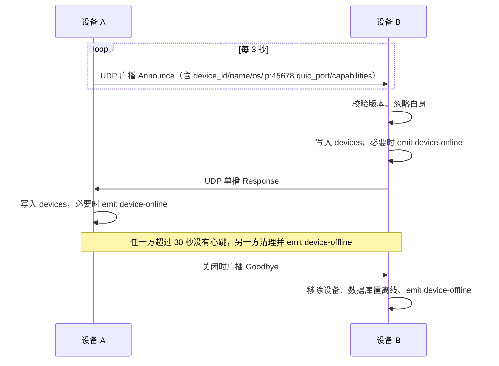
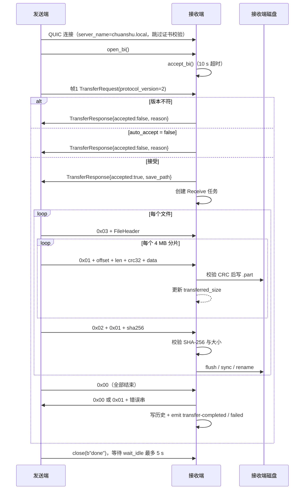

# 07 · 协议与时序

## 1. 两层协议

| | 发现协议 | 传输协议 |
| --- | --- | --- |
| 承载 | UDP 单播/广播，端口 `45678` | QUIC 双向流，端口 `45679` |
| 编码 | bincode | 长度前缀 + 自定义标签帧 + bincode |
| 版本 | `PROTOCOL_VERSION = "1.0.0"`（字符串） | `TRANSFER_PROTOCOL_VERSION = 2`（`u16`） |
| 校验 | 版本字符串必须完全相等 | 请求中的 `protocol_version` 必须等于 2 |

两者互不影响：发现包版本升级不会改变传输帧格式，反之亦然。

## 2. 字节序与序列化

- 手写的长度、偏移、分片长度、CRC32 全部使用**大端**（`to_be_bytes` / `from_be_bytes`）。
- 结构体本身用 `bincode` 1.3 默认配置序列化；`bincode` 内部是固定宽度、小端，不要与外层的大端长度前缀混淆。
- 发现包没有额外长度前缀，一个 UDP datagram 就是一个完整的 bincode `DiscoveryPacket`。
- 控制类帧（请求、响应、文件头）读入时都受 `MAX_CONTROL_FRAME_SIZE = 8 MB` 限制；数据帧的 `data_len` 受 `DEFAULT_CHUNK_SIZE = 4 MB` 限制。

## 3. 发现包

`DiscoveryPacket` 的 bincode 字段顺序：

```text
message_type      enum { Announce, Response, Goodbye }
protocol_version  String
device_id         Uuid
device_name       String
os                enum { Windows, MacOS, Linux, Unknown }
ip_address        Option<IpAddr>
quic_port         u16
capabilities      Vec<Capability>
timestamp         u64（Unix 秒）
```

行为约定：

- 发送方广播/定向发送时 `ip_address = None`，接收方用 UDP 源 IP 补全。
- `Response` 只单播给 `Announce` 的来源地址，不广播。
- `Goodbye` 在应用关闭时广播，接收方立刻移除设备。
- 接收方丢弃 `device_id` 等于自己的包，以及 `protocol_version != "1.0.0"` 的包。

## 4. 传输 v2 帧总览

一次传输固定在一条双向流内完成，顺序如下：

| 顺序 | 发送方 | 内容 |
| --- | --- | --- |
| 1 | 客户端 | `u32 req_len` + `bincode(TransferRequest)` |
| 2 | 服务端 | `u32 resp_len` + `bincode(TransferResponse)` |
| 3 | 客户端 | 对每个文件：文件头帧、若干数据帧、文件结束帧 |
| 4 | 客户端 | `u8 0x00`（全部结束） |
| 5 | 服务端 | `u8 0x00`（成功）或 `u8 0x01 + u32 len + UTF-8 错误串` |

### 4.1 请求与响应

`TransferRequest`：

```text
protocol_version: u16   // 必须为 2
task_id: Uuid
sender_id: Uuid
sender_name: String
total_size: u64
files: Vec<FileMeta>
```

`FileMeta`：`file_id: u64`、`relative_path: String`、`file_name: String`、`file_size: u64`。`file_id` 在一次请求内唯一且从 0 递增；`relative_path` 对单文件为空串，对目录保留“顶层目录/子路径”。

`TransferResponse`：

```text
task_id: Uuid
accepted: bool
reason: Option<String>
save_path: Option<String>
```

`save_path` 是接收端计算出的下载目录字符串，仅供展示/诊断；发送端不会据此改路径。

### 4.2 文件头帧

```text
u8   0x03                        // TAG_FILE_HEADER
u32  len（大端）
     bincode(FileHeader {
       file_id: u64,
       file_name: String,
       relative_path: String,
       file_size: u64
     })
```

文件头**不是**裸长度帧，必须先读到 `0x03` 标签，否则无法与 `0x00` 结束标签区分。

### 4.3 数据帧

```text
u8   0x01                        // TAG_DATA
u64  offset（大端，文件内偏移）
u32  data_len（大端，≤ 4 MB）
u32  crc32（大端，对紧随其后的原始字节计算）
[data_len] 原始字节
```

接收端先校验 `data_len <= 4 MB`，再读数据、计算 CRC32 并比对，最后 `seek(offset)` 写入临时文件。发送端总是顺序写，但接收端按 `offset` 定位，协议本身允许乱序。

### 4.4 文件结束帧

```text
u8   0x02                        // TAG_FILE_END
u8   has_sha256                  // 发送端固定写 1
[32] sha256                      // 仅当 has_sha256 == 1
```

发送端对文件全部字节增量计算 SHA-256；接收端在 `has_sha256 == 1` 时比对，随后再校验实际接收字节数等于声明大小，最后 `flush + sync_all` 并把 `.part` 改名为最终文件。

### 4.5 全部结束与确认

```text
客户端 -> 服务端: u8 0x00        // TAG_TRANSFER_END
服务端 -> 客户端: u8 0x00        // 成功
              或 u8 0x01 + u32 len（大端） + UTF-8 错误信息
```

接收端在回 `0x00` 之前还会检查：已完成文件数等于请求中的文件数、累计接收字节等于 `total_size`。

## 5. 发现时序



补充：已知设备探测复用了 `Announce`。探测方从临时端口向目标 `ip:45678` 单播 `Announce`，目标按普通流程回 `Response`，因此能跨过广播域发现设备。

## 6. 传输时序



发送端的超时约束：

| 阶段 | 超时 |
| --- | --- |
| QUIC 连接建立 | 10 s |
| 等待 `TransferResponse` | 15 s |
| 等待最终确认 | 60 s |
| `endpoint.wait_idle()` | 5 s |

接收端等待第一条双向流为 10 s；数据读取没有额外超时，依赖 QUIC 的 60 s 空闲超时与 10 s keep-alive。

## 7. 错误与提前终止

- 接收端在请求阶段拒绝时，回 `TransferResponse{accepted:false}` 后 `finish()` 发送流并结束；发送端不会进入数据阶段。
- 数据阶段任何错误都会让接收端跳到统一收尾：写 `0x01 + 错误串`，关闭流，删除未完成 `.part`，任务置 `Failed`（若已被本地取消则保持 `Canceled`），写历史并发 `transfer-failed`。
- 发送端收到非 `0x00` 确认时，读取错误串并作为 `AppError::Other` 返回，任务在 manager 中置 `Failed`。
- 发送端发现实际读取字节数与 `file_size` 不符时主动报错，不会发送错误的文件结束帧。

## 8. 版本兼容

- 发现协议只做字符串相等比较，不解析语义版本；任何字段变更都应同时修改 `PROTOCOL_VERSION`。
- 传输协议只比较 `u16` 是否等于 2；不兼容时接收端给出“请将两端升级到同一版本”的拒绝原因。
- 两种协议都使用 bincode，没有可选字段或向后兼容机制；结构体字段顺序、类型一旦变化，必须升级版本号并保证两端同步。
