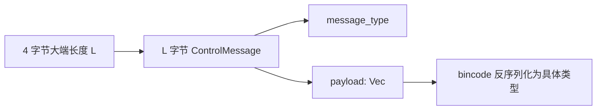
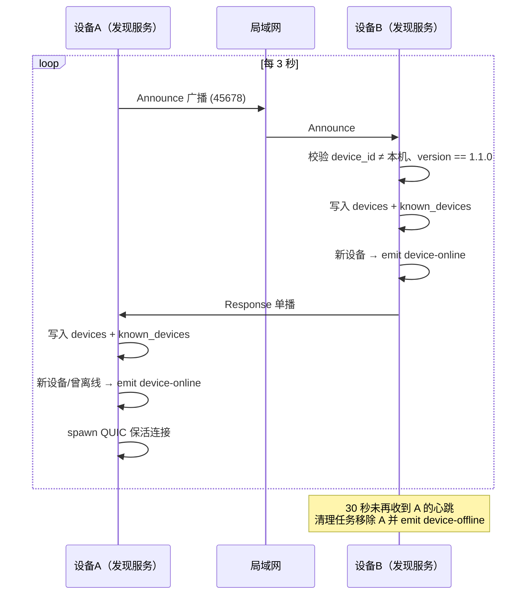
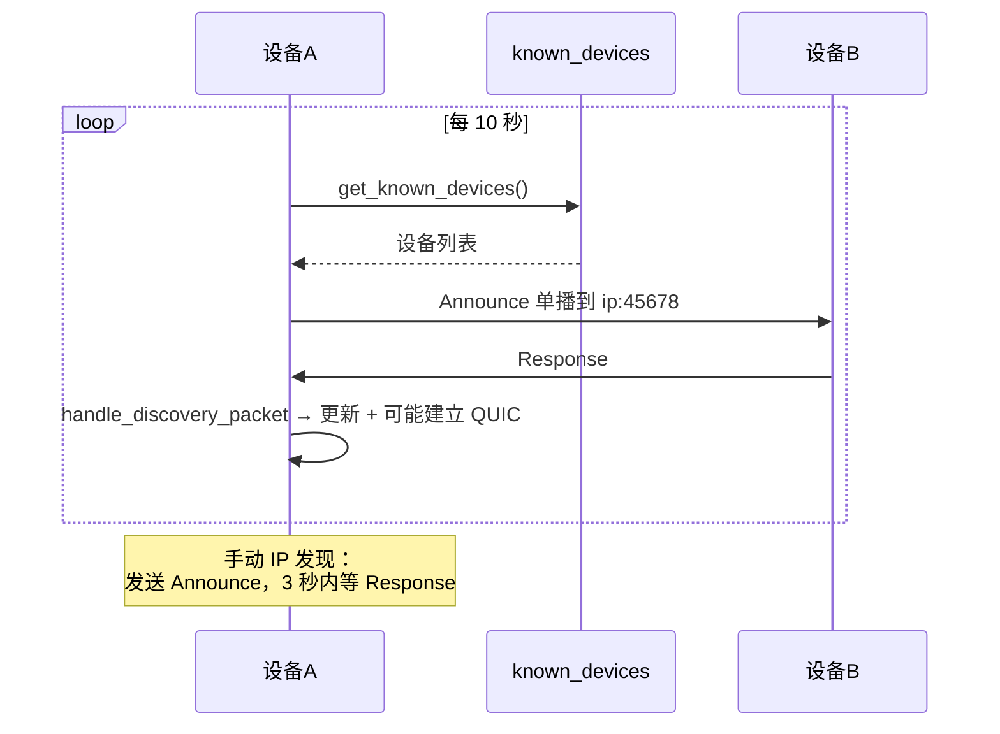
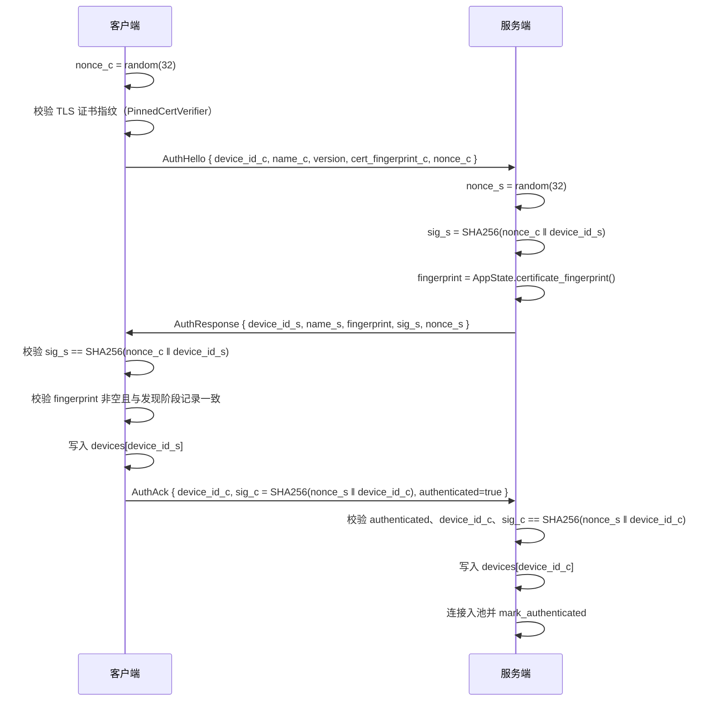
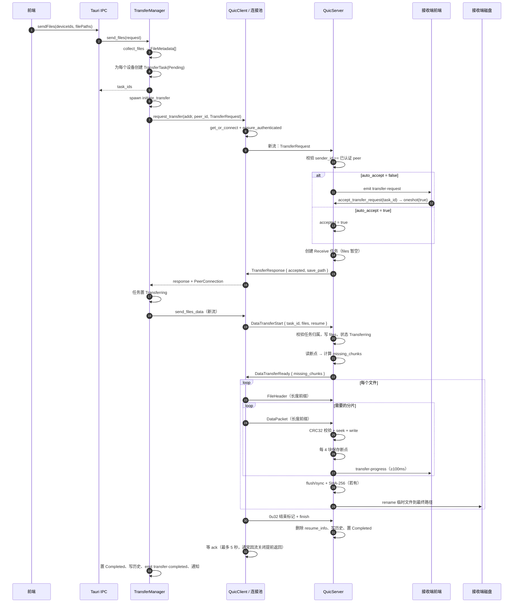
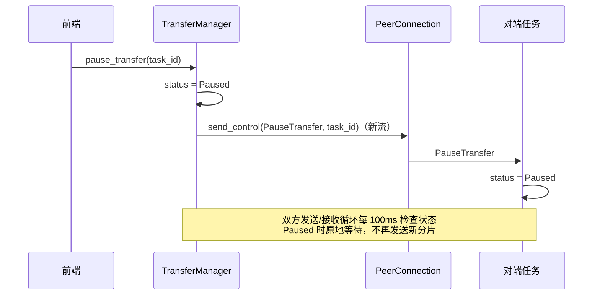
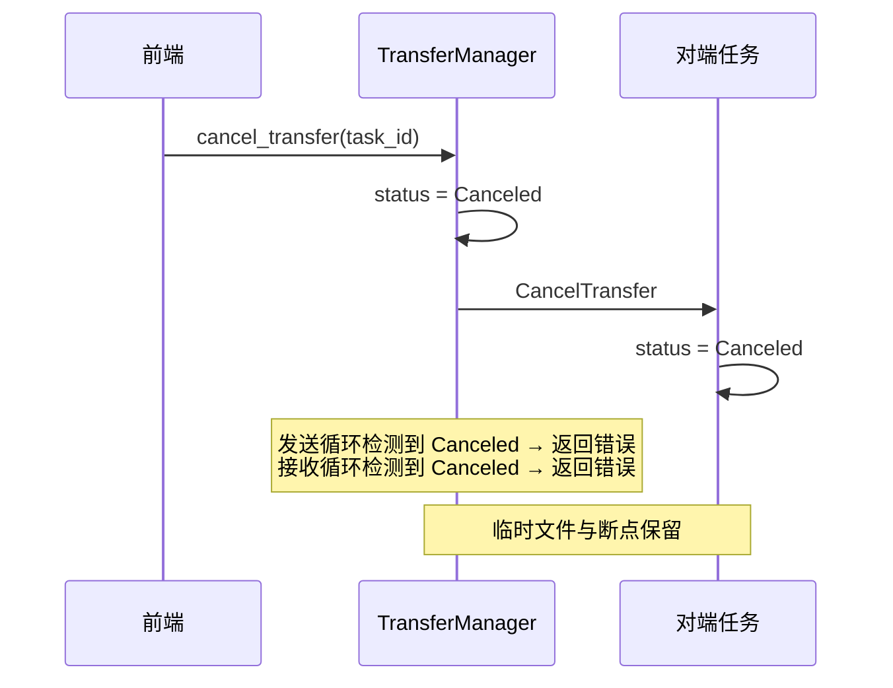
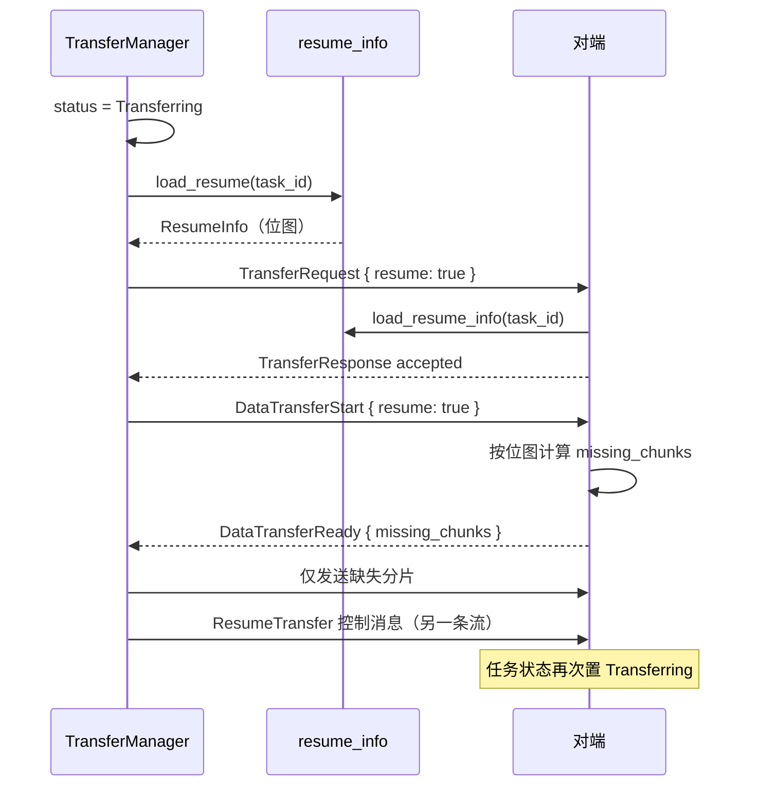
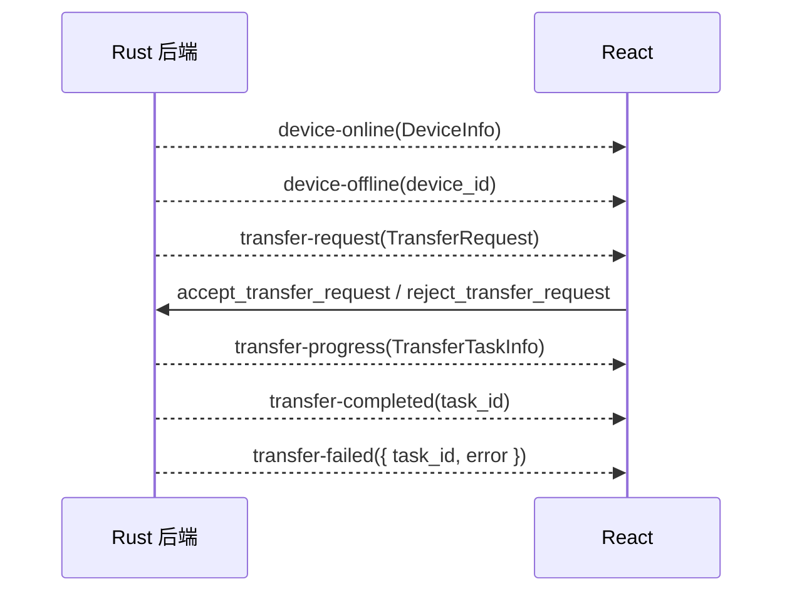

# 07 · 协议与数据流

## 1. 线格式总览

| 通道 | 传输 | 帧格式 | 序列化 |
| --- | --- | --- | --- |
| 设备发现 | UDP `45678` | 单个 `DiscoveryPacket`（无长度前缀） | bincode |
| 认证 | 每条 QUIC 连接的第一条双向流 | `u32` 大端长度 + `ControlMessage` | bincode（嵌套） |
| 控制消息 | 每条新建双向流一条消息 | 同上 | bincode |
| 数据传输 | 一条双向流内连续多帧 | `u32` 大端长度 + `FileHeader` / `DataPacket`；长度 0 表示结束 | bincode |

`ControlMessage` 的结构是：

```rust
pub struct ControlMessage {
    pub protocol_version: String,
    pub message_type: ControlMessageType,
    pub payload: Vec<u8>,   // 具体结构再 bincode 一次
}
```

即「长度前缀 → bincode(ControlMessage) → payload 内部再 bincode」。接收端限制单条控制消息 ≤ **10 MiB**，并校验 `protocol_version == 1.1.0`。



## 2. 消息类型表

### 2.1 发现层

| `DiscoveryMessageType` | 方向 | 触发 | 载荷结构 |
| --- | --- | --- | --- |
| `Announce` | 广播 / 定向 | 每 3s；已知设备探测每 10s；手动 IP 发现 | `DiscoveryPacket`（含证书指纹） |
| `Response` | 单播回源 | 收到 `Announce` 后 | `DiscoveryPacket`（`ip_address=None`，接收方用源地址） |
| `Goodbye` | 广播 | 应用退出、停止发现服务 | `DiscoveryPacket`（能力为空） |

### 2.2 控制层

| `ControlMessageType` | 方向 | payload | 说明 |
| --- | --- | --- | --- |
| `AuthHello` | C → S | `AuthHello` | 第一条流，携带客户端证书指纹 |
| `AuthResponse` | S → C | `AuthResponse` | 含本机证书指纹与 nonce 签名 |
| `AuthAck` | C → S | `AuthAck` | 含对服务端 nonce 的签名 |
| `TransferRequest` | C → S | `TransferRequest` | 文件清单 + 总大小 + `resume` |
| `TransferResponse` | S → C | `TransferResponse` | 接受/拒绝 + 建议保存路径 |
| `DataTransferStart` | C → S | `DataTransferStart` | 开一条新流，声明本次数据流属于哪个任务 |
| `DataTransferReady` | S → C | `DataTransferReady` | 接受 + 每文件缺失分片 |
| `CancelTransfer` | 双向 | `Uuid` | 任务 ID |
| `PauseTransfer` | 双向 | `Uuid` | 任务 ID |
| `ResumeTransfer` | 双向 | `Uuid` | 任务 ID |

> `QueryProgress` / `ProgressUpdate` / `Error` 等未实现枚举已从协议中移除。

### 2.3 数据结构字段

`FileMetadata`：

| 字段 | 说明 |
| --- | --- |
| `file_id: u64` | 任务内唯一，按收集顺序递增 |
| `relative_path: String` | 目录传输时保留顶层文件夹（如 `src/utils`） |
| `file_name: String` | 文件名 |
| `file_size: u64` | 字节 |
| `modified_time: u64` | Unix 秒 |
| `checksum: Option<String>` | <100MB 文件的 SHA-256 |
| `is_directory: bool` | 恒为 `false` |
| `source_path: String` | `#[serde(skip)]`，不传输 |

`TransferRequest`：`task_id, sender_id, sender_name, file_count, total_size, files, resume`。

`TransferResponse`：`task_id, accepted, reason, save_path`。

`DataTransferStart`：`task_id, files, resume`。

`DataTransferReady`：`task_id, accepted, reason, missing_chunks: HashMap<file_id, Vec<chunk_index>>`。

`ChunkMetadata`：`task_id, file_id, chunk_index, total_chunks, chunk_size, offset, checksum(CRC32)`。

`DataPacket`：`metadata: ChunkMetadata` + `data: Vec<u8>`。

## 3. 设备发现时序

### 3.1 同网段自动发现



### 3.2 跨子网 / 手动发现



### 3.3 离线判定

| 触发 | 处理 |
| --- | --- |
| 收到 `Goodbye` | 立即移除、置库离线、emit `device-offline` |
| 30s 清理任务 | `last_seen` 超过 30s → 移除、置离线、emit |
| QUIC 连接关闭回调 | 置库离线、emit `device-offline`（不从 `devices` 移除） |
| 下次 `Announce`/`Response` 且曾离线（>25s） | 重新建立 QUIC、emit `device-online` |

> 25s 与 30s 两个阈值并存：25s 用于“曾离线”判断（决定是否重连/重发事件），30s 用于实际移除。

## 4. 认证时序



认证只发生在**每条 QUIC 连接的第一条双向流**；客户端用 `ensure_authenticated` 保证只执行一次，服务端在 `handle_incoming_connection` 中同步完成。

## 5. 发送 → 接收完整时序



## 6. 暂停 / 恢复 / 取消时序

### 6.1 暂停



### 6.2 取消



### 6.3 恢复（发送端）



## 7. 事件时序（前端 ⇄ 后端）



## 8. 兼容性契约

| 维度 | 约定 | 当前保障 |
| --- | --- | --- |
| 协议版本 | `1.1.0` | 发现包、`ControlMessage`、`AuthHello` 三处统一校验；数据包无版本字段 |
| 设备 ID | UUID v4，每次启动重新生成 | 无持久化，重启后对端“已知设备”记录会与新 ID 不匹配 |
| 序列化 | bincode 1.3 默认配置 | 无 schema 演进能力，字段顺序/类型变更即不兼容 |
| 端口 | UDP 45678 / QUIC 45679 | 修改需同步 `constants.rs`、Tauri 防火墙说明与文档 |
| 字节序 | 所有长度前缀为大端 `u32` | 两端一致 |
| 最大控制消息 | 10 MiB | 接收端强制校验 |
| 分块上限 | 8 MiB（超大文件） | `optimal_chunk_size` 决定 |
| 证书信任 | 发现包公布 SHA-256 指纹，客户端固定校验 | 旧版本（1.0.0）无法与本版本互通 |

> 1.1.0 是破坏性升级：发现包新增 `cert_fingerprint`、`AuthHello` 新增 `cert_fingerprint`、`ControlMessage` 新增 `protocol_version`，字段顺序变化导致 bincode 不兼容。未来升级需继续同步提升 `PROTOCOL_VERSION`。
